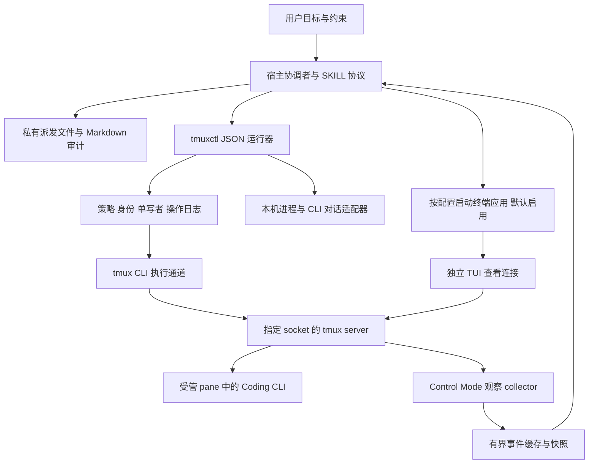

# goals-tmux-skill 实现方案与能力规划

调研日期：2026-11-06，Asia/Shanghai。本文件保留当日的架构研究与分阶段方案，后续内容中的“拟议接口”“尚未开发”及阶段判断是历史记录，不代表当前进度；旧命令示例以当前运行器为准。当前代码为 0.2.2，新增恢复证据、SSH、tmux 3.8 等待与原生显示路径；当前验收见 [0.2 报告](acceptance-0.2-2026-11-06.md)。此前已发布的 0.1.0 代码含标准库 `scripts/tmuxctl`、任务与 pane registry、私有 dispatch/audit、有限 Control Mode watch、四个 CLI adapter 和可选 TUI launcher。实际命令以 `scripts/tmuxctl --help` 与 `capabilities --json` 为准，当前发布范围和限制见 [README](../README.md) 与 [SKILL](../SKILL.md)。

历史阶段边界：本文原始方案中的阶段标签不代表 0.2 当前状态。四 CLI 原始协作闭环及其真实会话恢复、macOS iTerm2 原生显示与隔离 SSH 已有实测证据；版本和平台限制以当前 README 与验收报告为准。Linux/独立远端主机仍未验收。MCP 不是安装和使用的前提。

当日设计主张是保留 goals-iterm-skill 的协调协议，以 **Python 独立运行器封装 tmux 命令，以 Control Mode 增强观察**；后文保留这一方案的理由、假设与风险，便于追溯设计来源。后续章节未因运行器落地而逐条改写，使用时应以当前 skill 指令、运行器契约和 capability 报告为准。

## 1. 目标与设计约束

目标是让宿主 agent 指挥 tmux 内的 Coding CLI 执行任务，持续观察并作出常规决策，在独立验收后回收自己创建的资源，同时支持接管、移交和恢复。

| 约束 | 当前依据与设计取值 |
| --- | --- |
| 使用规模 | 按个人开发环境设计；暂定单 endpoint 常用 1–8 个受管 pane，压测观察上限 32 个。属于设计假设，不是已测容量 |
| 一致性 | 同一 pane 一个写入协调者；写操作需要最新 generation/revision、身份和拓扑校验；观察允许短暂滞后 |
| 延迟 | 不设未经验证的 SLA；目标是活跃窗口约 1 秒合并一次事件，静默时 5–30 秒兜底读取，待实现后测量 |
| 技术与平台 | 沿用参考项目 Python 3.12 技术基础；macOS 首先验收，Linux 通过独立进程适配与 CI 验收后宣布支持；WSL 归入 Linux 验证范围，原生 Windows 不列入首版 |
| 运行成本 | 无云服务、数据库服务或常驻 MCP 依赖；观察 collector 仅按需要运行 |
| 项目要求 | 非必要不执行全量测试；Python 进程不使用 `--reload` |

若目标变为多用户共享服务器或数百 pane，必须重新评估租户隔离、持久化和 collector 资源控制。上述规模和时延是本方案的假设，不作为已实现承诺。

首版不实现完整终端模拟器、不代替 Coding CLI 的对话存储、不承诺机器重启后恢复活进程，也不自行给宿主增加后台唤醒能力。

## 2. 继承参考项目的工作方式

参考版本：`/Users/jwyuan/source_code/goals-iterm-skill`，commit `918cd7b31481e2f9ea0a7e94f61e8f28b202206f`，skill `0.4.0-dev`。

原项目已采用内置独立运行器，而不是依赖 MCP。它把“业务完成”“监控停止”“终端回收”“对话可恢复”分别记录。这些协议比终端 API 的名称更值得复用。

| 原组件 | tmux 版处理 |
| --- | --- |
| `SKILL.md`、`references/orchestrator.md` | 延续协调者负责目标、决策、只读验收，项目执行交给被控 CLI 的工作模式；只约束使用该 skill 的任务 |
| `references/dispatch.md` | 保留私有、不可变的决策文件，以及“输入短指令 → 检查 → 单独提交 → 验证读取”的协议 |
| `references/monitoring.md` | 保留内联监控、恢复次数、阶段判断和用户进度说明；增加事件合并及断流补读 |
| `references/audit.md` | 保留按任务/日期的 Markdown 台账，以及 E/U/C/D 事件和轮次编号 |
| `scripts/session_registry.py` | 迁移单写者、generation/revision、归属、保留和 finalizing 逻辑；改为 pane 主键和拓扑关联表 |
| `contract.py`、`operation_store.py`、`policy.py` | 复用请求信封、结果语义、持久化预留和策略思路；重写 target 与 scope，不能原样复制 schema |
| `closing.py` | 复用先预检、记恢复信息、执行、再核验的状态机；重写共享窗口和 tmux 退出行为 |
| `process_inspection.py`、`cli_recovery.py` | 抽取进程/对话证据模型；原进程探测含 macOS 假设，增加 Linux provider；CLI 适配按实际版本验证 |
| `backends.py`、`service.py`、`sdk_auth.py`、`screen_coordinates.py` | iTerm API、授权、屏幕坐标实现不移植，改写 tmux transport、format 和 capture 适配 |
| `bootstrap.sh`、打包工具 | 保留自包含 skill 包思路；删除 iTerm SDK 和 GUI 权限依赖，检查 Python/tmux/私有状态目录 |

若复制实现或协议文本，保留 MIT 版权声明，并在 `runtime/UPSTREAM.md` 记录上述 commit。先保持两个项目独立，待 tmux 后端稳定后再评估抽取共享协调内核，避免本次设计同时重构原项目。

## 3. 架构选择

| 选项 | 优点 | 代价与适用范围 |
| --- | --- | --- |
| A：纯 tmux CLI + 周期 capture | 无长连接，易调试，最快完成基础闭环 | 高频轮询、短暂事件可能遗漏；适合 P0/P1 和降级模式 |
| B：CLI 执行 + Control Mode 观察 | 保留 CLI 的可验证命令结果，增加输出/拓扑通知与格式订阅；无 GUI、可扩展远端 | 需要流协议解析、连接生命周期、背压和重连；推荐最终架构 |
| C：常驻服务统一执行所有命令，可选 MCP | 可集中连接和跨客户端请求调度 | 增加服务管理、授权、安装与故障面；目前没有足够需求作为首版前提 |

选择 B，按 A → B 增量交付。首版直接用 Python 标准库调用 tmux，不依赖第三方 tmux 对象封装库；需要的是精确命令、原始结果和版本能力，不先引入另一套对象模型。



运行器执行机械操作和检查；collector 只采集事实，不自主发送“继续”、确认菜单或判定验收。宿主结束执行后，collector 即使仍有输出，也不代表宿主会被唤醒。

### 3.1 可选 TUI 与终端应用

用户要求增加 `tui.enabled`，**默认 `true`**。这里 TUI 指向用户展示受管 tmux 会话的交互界面，不另建一套仪表盘，也不控制 Coding CLI 自己是否使用交互模式。`false` 时仍在 tmux PTY 中运行 CLI，派发、监控、验收与审计照常进行，只是不自动打开供用户查看的终端窗口。

执行层始终先创建 detached tmux 资源；显示层通过独立 viewer client 连接同一 socket/session。新增 `TerminalLauncher` 适配层，只负责打开、定位及分离本任务的查看连接。业务输入和读取继续经过 tmux runner，不能改用 iTerm 的屏幕 API 作为必需通道。

macOS 的默认选择策略是：`terminal=auto` 时优先 iTerm2；未安装 iTerm2 时使用 Terminal.app。也可以显式配置 `terminal=iterm2`。skill 直接选择目标应用，**不要求也不修改系统默认终端或文件关联**。iTerm2 官方支持指定应用创建终端窗口并运行命令；其“默认终端”菜单主要配置若干文件类型的打开关联，并不是使用 tmux 的前提。依据：[iTerm2 脚本接口](https://iterm2.com/documentation-scripting.html)、[默认终端设置说明](https://iterm2.com/documentation-menu-items.html)。

显示模式分为：

| `tui.mode` | 行为 | 交付 |
| --- | --- | --- |
| `tmux`，默认 | 在选定终端中运行普通 `tmux -S SOCKET attach-session -t SESSION_ID`，显示 tmux 原生 TUI | P1 |
| `iterm2-native`，可选 | 在 iTerm2 中运行 `tmux -S SOCKET -CC attach-session -t SESSION_ID`，把 tmux 窗口/分屏映射到 iTerm2 原生界面 | P2，要求 iTerm2 launcher 与兼容性验证 |

两种模式都能使用 iTerm2 作为终端应用，但只有第二种属于 iTerm2 的原生 tmux 集成。原生集成中，关闭映射的窗口/标签页可能实际 kill tmux 资源，隐藏界面必须走 detach，不能复用普通 GUI 关闭动作。依据：[iTerm2 tmux 集成说明](https://iterm2.com/documentation-tmux-integration.html)。

viewer 与 Control Mode collector 是两条独立连接，`tui.enabled=false` 不关闭 collector，也不等于停止监控。打开窗口后通过 tmux client 绑定核验实际连接，不以应用启动成功为准；同一任务/目标复用已登记的 viewer，避免每轮派发都新建窗口。用户需要输入时走已有的单写者移交协议。

Linux/SSH 无桌面环境没有可通用依赖的“系统默认 TUI”。仅在用户拥有且明确可使用的交互 TTY 中附着，或使用配置且已支持的终端 launcher；不占用 agent 的工具 stdio。无可用显示环境时记录 `tui_status=unavailable` 并提示精确 attach 方法，已启动的 tmux 任务可继续运行，不能把显示请求记为成功。显式指定 iTerm2 但不可用时同样报告原因，不静默换应用；只有 `auto` 允许按上述规则回退。

GUI 启动接口按本机 iTerm2 版本验证。官方已将 AppleScript 标记为 deprecated，因此将其视为可选兼容路径；无论选用哪种 launcher，其 GUI 权限或 SDK 依赖都限定在显示适配层。无 TUI 执行路径不依赖 iTerm2 安装或 Python API 授权。

## 4. 身份与拓扑模型

### 4.1 不复用 iTerm 的 Session 语义

| iTerm 对象 | tmux 中最接近的执行/容器对象 | 差异 |
| --- | --- | --- |
| Session | pane，`%N` | pane 是具体 PTY 和输入目标 |
| Tab | window，`@N` | 一个 tmux window 可以被多个 session 链接 |
| Window | session，`$N` | tmux session 不等于桌面窗口；用户可从多个 client 连接 |
| iTerm 应用连接 | server/socket + client | 一个机器可有多个独立 server |

对外使用 `pane_id`、`window_id`、`session_id` 和 `endpoint_id`，不把 iTerm 的 `close_session` 偷换成关闭 tmux session。终端执行对象统一称为 pane。

本机实测 server 重启后 `$0/@0/%0` 重新出现。因此拟议身份为：

```text
endpoint = 显式本机/远端标识 + 规范化 socket 路径
server_instance = server PID + OS 进程启动身份 + 可用的启动时间/boot 身份
pane_identity = endpoint + server_instance + pane_id
process_instance = pane_pid + OS 进程启动身份
task_binding = task_id + coordinator_id + generation + revision
```

`socket_path` 或 PID 单独都不足够；socket inode 只能作为辅助证据，socket 重建不一定意味着 server 换代。未知进程启动身份不得伪造稳定标识。`respawn-pane` 可以在同一 pane 上替换进程，所以进程身份变化同样要求重新绑定。`@goals_*` user options 可作任务提示，不能充当不可伪造的权限或身份凭证。

### 4.2 用图描述归属

Registry 保存 `sessions`、`windows`、`panes` 和 `session_window_links`。同一 window 的多个链接不可折叠成唯一父 session。

创建一个 pane 只拥有这个 pane；在用户 session 内创建 window，不拥有该 session；接管现有 pane 默认 borrowed/retain。移位、link/unlink、respawn、用户接管都可能使原来的清理条件失效。

容器清理须枚举所有关联 session/window/pane。第一阶段遇到跨任务、借用或共享 window，拒绝整个容器关闭，再由协调者选择确有权限的单个 pane。`kill-window` 会影响所有引用该 window 的 session，不能只检查当前 session。依据见 [API 调研](tmux-api-research.md#3-命令接口与可实现能力)。

## 5. 运行器契约

以下是拟议 CLI，尚不可执行：

```sh
scripts/bootstrap.sh --check
scripts/tmuxctl capabilities --json
scripts/tmuxctl doctor --json
scripts/tmuxctl invoke --request-file /private/path/request.json
scripts/tmuxctl operation-status --request-id UUID
scripts/tmuxctl watch --task-id TASK_ID --timeout 30 --jsonl
scripts/tmuxctl registry report --task-id TASK_ID --require-settled
```

`doctor` 默认只检查二进制、版本、配置和路径；连接已有 endpoint 的探测必须明确指定该 endpoint。创建隔离 server 的自测属于单独选项，不能把只读诊断变成隐式创建。`capabilities` 应同时返回运行器已实现、tmux 已支持、当前策略允许三类信息。

沿用结果状态 `ok/refused/unknown/partial/error` 和 `side_effects=none/confirmed/unknown`。退出码延续 0/2/3/4，但原始 tmux 退出码不等于业务结果。设计初期独立使用 tmux schema v1，不宣称兼容 iTerm schema。

```json
{
  "schema_version": 1,
  "request_id": "550e8400-e29b-41d4-a716-446655440000",
  "operation": "send_text",
  "target": {
    "endpoint_id": "local-goals",
    "server_instance_id": "opaque-from-discovery",
    "pane_id": "%3"
  },
  "arguments": {"text": "Read the decision file /private/path/C01.md; dispatch ID task-1-C01"},
  "task_context": {
    "task_id": "task-1", "coordinator_id": "C1", "generation": 2, "expected_revision": 8
  },
  "expected_observation": {
    "observation_id": "opaque-from-inspection",
    "process_instance_id": "opaque-from-process-probe",
    "topology_digest": "opaque-from-discovery"
  }
}
```

不把观察 ID 当作全局锁；运行器将其对应的身份、成员集合、进程和影响范围与当前事实比较。单 pane 操作不因无关 session 改名失效；容器操作必须校验完整成员集。

每次变更的顺序为：校验固定策略 → 取得执行锁并复核 registry → 重新观察 → 持久化 request 预留 → 执行 → 核验 → 持久化结果。全程持有相关写锁；移交也参与同一锁协议。P1 可先采用 endpoint 级执行锁，长时间观察不持锁，后续需要并发时再细化为固定排序的资源锁。

重复 request ID 返回已有结果，已预留但未确认的请求保持 unknown；request ID 搭配不同内容必须拒绝。超时、响应丢失或日志落盘失败后只读核对，不自动重放输入/创建/关闭；这里只保证防重复派发，不保证终端动作 exactly-once。

## 6. 能力清单与交付范围

| 能力 | 运行器拟议接口 | 技术实现 | 阶段 |
| --- | --- | --- | --- |
| 环境与能力检查 | `doctor/capabilities` | `tmux -V`、命令/format 探测、endpoint 检查 | P0 |
| TUI 配置与展示 | `config show/set`、viewer attach/detach | 默认启用；macOS 自动优先 iTerm2；显示层与执行层分离 | P1 |
| 明确目标发现 | `list_resources` | `list-sessions/windows/panes/clients -F` | P1 |
| 活动与恢复诊断 | `inspect_panes` | tmux 元数据 + OS 进程证据 + CLI 适配器 | P1 |
| 屏幕和有限历史 | `read_screen/read_history` | `capture-pane` + geometry/模式信息 | P1 |
| 精确文本与按键 | `send_text/send_keys` | `send-keys -l`、枚举按键；受控 buffer 通道 | P1 |
| 新建任务容器与分屏 | `create_session/create_window/split_pane` | `new-session/new-window/split-window -P -F` | P1 |
| 命名 | `rename_session/rename_window/set_pane_title` | 原生命令；身份不随名字变化 | P1 |
| 正常退出与受控回收 | `close_pane/close_window/close_session` | 正常退出优先，受限 kill 兜底，逐目标结果 | P1 |
| 派发/监控/决策/验收 | SKILL + registry + ledger | 复用协调协议，定向验收 | P1 |
| 对话恢复 | `inspect_recovery/restore_cli` | 已验证 CLI 历史、进程关联、resume 适配 | P1，按 CLI 验收 |
| 实时输出及状态变化 | `watch/read_events` | Control Mode、格式订阅、快照补读 | P2 |
| 有界事件等待 | `wait_for_change` | 3.6a collector；3.8 可用事件等待 | P2 |
| 布局调整、分离和重组 | `resize_pane/set_layout/move_pane` | 原生命令 + 双端拓扑/归属检查 | P2 |
| 持续原始输出记录 | `start_capture/stop_capture` | 可选 `pipe-pane -O` + 固定日志写入器 | P2 |
| shell 命令生命周期 | 观察事件投影 | 3.8 OSC 133 事件；要求 shell 实际发送标记 | P2 增强 |
| 人工查看/接管 | attach 指引、`handoff` | 连接指定 socket/session；写权移交 | P1/P2 |
| 多 endpoint 与 SSH | endpoint provider | 远端同版本 runner + stdin JSON + 文件传输 | P3 |
| 多 CLI 工作编排 | 多 pane 的任务关联 | 协调者安排依赖和交付；tmux 只提供执行与观察 | P3 |

首版不开放 `raw_command`、任意 `run-shell`、任意 hook 命令或一键 `kill-server`。全 server 清理若将来需要，作为单独受限能力设计，不能从“清理本任务”推导出来。

## 7. 关键实现细节

### 7.1 输入、创建与编码

所有本机 tmux 调用使用参数数组和 `shell=False`，绑定显式 socket 和精确 ID。不得将任务正文拼成 shell/tmux 命令串；Control Mode 也有独立命令语法，shell quoting 不能替代它的编码。

`send_text` 不附加提交键；先沿用 16 KiB 上限，默认派发只允许无 CR/LF 的短指令。输入后读取屏幕、确认仍未提交，再单独发 Enter。底层可表达多行不意味着目标 CLI 会按预期处理多行。

**同步输入是硬检查项。** 本机实测 `synchronize-panes=on` 时，精确 `send-keys -t %N` 仍向同窗其他 pane 发送输入。新建专属资源配置为 off；接管资源发现 on 时返回 `INPUT_BROADCAST_ENABLED`，不悄悄改用户配置。copy mode、输入关闭、死 pane 和不明交互状态也阻止业务输入。依据：[原生实现](https://github.com/tmux/tmux/blob/3.6a/window.c)、[实测数据](research/probe-results.json)。

短指令可用 literal send；避免在 argv 放长正文或敏感内容。需要 buffer 时使用随机唯一名称、stdin `load-buffer`，显式目标 `paste-buffer -d -p -r`，并检查/回收本请求的 buffer。buffer 是 server 共享对象，不能覆盖用户剪贴板，也不能将 `-p` 当成无条件可用的粘贴保护。buffer 阶段失败和输入未知要分别记录，不能盲目重发。

新建会话使用 detached 模式和返回 ID 的接口，不抢用户焦点；尽量用多参数程序启动避免 shell 再解释。明确区分 `program_argv` 和经授权的 shell command。未知创建结果通过已记录的唯一创建标记及新拓扑核对，不重复创建。

### 7.2 读取、历史和事件流

`read_screen` 返回文本、尺寸、光标、屏幕类型、采集时间和截断信息。当前可见 TUI 用默认 capture；`-a` 读取的是另一个屏幕缓冲，不能把它机械理解成“更完整的当前界面”。`read_history` 默认 100、上限 2000 行并加字节限制，明确 `retained_history_only=true`。不能把滚屏历史行号当成永不失效的日志游标。

元数据优先使用固定 format；不能直接把标题、路径插入 JSON 模板。实现受测的字段转义/解码，或逐个读取自由文本字段，由 Python JSON encoder 编码。标题可含换行或控制字符，简单 TSV 拆分不足以覆盖所有输入。

Control Mode parser 分离命令结果块和异步通知，按协议处理转义字节。输出不是渲染后的屏幕，也不是 Coding CLI 的结构化推理/工具事件。首版 collector 不实现 VT 终端渲染：收到变化后合并事件、再 capture。该边界依据 [Control Mode 官方说明](https://github.com/tmux/tmux/wiki/Control-Mode)。

每个订阅连接有 `connection_epoch`，输出统一写为带自增 `seq` 的有界 JSONL/环形记录；多 session 的 collector 明确各自覆盖范围，不能假设连接一个 session 会收到全 server 所有 pane 输出。执行中按 pane 合并高频输出并设置字节/队列上限；背压时标记 gap、暂停/恢复输出并补读。

断流后：标记旧观察不连续 → 校验 endpoint/server 实例 → 重连订阅 → 重列拓扑 → capture → 建立新游标。快照可恢复当前可见状态，但不承诺补齐断流期间已经滚出历史的文本，更不能重放未知写操作。事件注册前后的竞态用“订阅后再取快照并重新判定条件”缓解；事件本身不是持久化队列。

`pipe-pane` 只记录启用之后的原始输出，不等于历史或对话备份；一 pane 的既有 pipe 不能擅自替换。日志 writer 必须固定、限制权限与大小，并声明保留期。默认不收集原始终端全文。

### 7.3 进程状态与业务状态分离

`pane_pid` 是 pane 首进程，常常是 shell，并不必然是 Coding CLI。`pane_current_command`、标题、短暂静默和 `pane_dead_status=0` 都不能证明任务完成。

macOS/Linux provider 返回有界进程树、TTY、进程启动身份、前台进程组以及可观察的停止/后台作业证据；缺失、截断或冲突标记 unknown。无法完整识别已脱离 TTY 的服务时不能声称自动清理了它们，应依赖任务启动记录和具体服务验收。

CLI adapter 单独负责识别输入状态、正常退出方式、历史保存和当前对话身份。第一版先验收 Claude Code、Codex；Cursor/Kiro 延后。这里不是移植后自动支持四种 CLI 的承诺。

3.8 的 OSC 133 信号可增强 shell 命令开始/结束证据，但 shell 没配置标记时不存在，也不能解释 Coding CLI 内部的业务轮次或验收结果。

### 7.4 清理、恢复和并发边界

清理流程：业务验收 → `finalizing` → 停止业务写入监控 → 持久化已知恢复信息 → 正常退出 CLI → 核验进程 → 退出可清理的空闲 shell → 核验 pane 消失或 dead → 回收确属本任务的剩余 pane/容器。

新建专属 pane 可以启用 `remain-on-exit` 保留退出证据；因此“CLI 已退出”不等于“pane 已消失”。死 pane 应先保存退出状态再回收。既有 pane 的此选项不自动改写。

独立记录 `execution_status`、`monitor_status`、`cleanup_status`、`recovery_status`、`coordinator_phase`。缺少对话 UUID 属于恢复证据不足，不能直接推导成禁止正常退出；进程身份冲突、未知活动或不清楚归属则阻止自动清理。

正常 detach/attach 可以保留仍活着的进程；server/主机死亡后只能根据 CLI 已持久化的对话恢复。`respawn-pane` 启动新进程，不能自动恢复模型对话；保存 layout 也不保存进程内存。

运行器锁只约束合作调用者，不能阻止用户或其他 tmux 客户端写入。默认专属 endpoint、禁用同步输入、操作前复核和短命令队列可缩小竞态，但不宣称 tmux 提供跨“读状态—写输入”的事务。共享 endpoint 发生人工接管时停止自动业务写入并重新移交；对并发不确定的关闭采取拒绝/unknown。

## 8. 状态、策略与安装

### 8.1 用户配置

拟议用户配置文件为 `${XDG_CONFIG_HOME:-~/.config}/goals-tmux-skill/config.json`，与权限策略分开。默认内容：

```json
{
  "schema_version": 1,
  "tui": {
    "enabled": true,
    "terminal": "auto",
    "mode": "tmux"
  }
}
```

配置解析顺序为：本次任务显式覆盖 → 用户配置 → 内置默认值。`terminal` 首版支持 `auto/iterm2/terminal-app/current`；`current` 只接受明确可用的用户交互 TTY。未实现或平台不支持的组合须报告，不随意解释成自动选择。`iterm2-native` 仅在 P2 能力可用且终端解析为 iTerm2 时接受。

拟议配置操作如下，当前文档阶段尚不能执行：

```sh
scripts/tmuxctl config show --json
scripts/tmuxctl config set tui.enabled false
scripts/tmuxctl config set tui.enabled true
scripts/tmuxctl config set tui.terminal iterm2
```

`config show` 返回持久化值、有效值及其来源；`doctor` 分别报告执行能力和 TUI 展示能力。类型/枚举校验失败不写文件，写入使用原子替换并保留其他字段。显示配置不能扩大 `policy.json` 的终端写权限。

配置变更默认作用于后续任务或下一次显式展示，不终止现有 CLI，也不关闭借用的用户窗口。正在运行的任务若请求“隐藏 TUI”，只 detach 本任务登记的 viewer，保留 tmux server/pane 和业务监控；是否清理任务仍按原有验收与归属协议判断。registry 分别记录 `tui_requested`、`tui_status`、`viewer_client_id` 和 `viewer_origin`，不把 viewer 生命周期与 pane 生命周期合并。

### 8.2 运行状态与安装

拟议默认状态根为 `${XDG_STATE_HOME:-~/.local/state}/goals-tmux-skill/`：

```text
policy.json                 固定权限与 endpoint 范围
endpoints.json              显式 socket/远端配置，不做全盘 socket 扫描
registry.json               当前身份、归属、generation/revision 与资源关系
operations/                 request 预留和结果
recovery/                   关闭前恢复记录及后续结果
dispatches/<task-id>/        不可变指令文件
audits/<task-id>/            index.md 与按日期划分的台账
events/<endpoint-id>/        按需、有界的观察事件
```

目录/文件权限以 0700/0600 为目标。状态不放业务仓库，不记录凭据、完整环境或不必要的进程 argv。事件日志与操作日志采用不同保留规则：事件缓存可滚动淘汰，操作日志必须保留足够的防重放事实。

缺少 policy 时默认只读。策略分别控制 endpoint、可写 pane、容器创建、布局调整、关闭和强制中断；发现权限不等于写入权限。不要把 `pane_ids=[]` 解释成允许任意创建后写入，应单独定义 `create_scope`，只允许本请求创建并登记的资源进入其授权范围。

默认新任务使用已配置的专属 socket 和受控配置；不隐式修改用户 `~/.tmux.conf`。专属 server 应确保断开观察 client 不触发自动销毁。接管用户 server 时读取 `destroy-unattached`、`exit-unattached`、同步输入、已有 hooks/pipe 等配置，报告限制，不悄悄覆盖。

socket 与 runner 策略提供误操作隔离，不是对同一 OS 用户的强安全沙箱。恶意同用户进程仍可直接操作 socket。

拟议项目结构：

```text
SKILL.md
agents/openai.yaml
references/{orchestrator,dispatch,monitoring,audit,session-lifecycle,closing-and-recovery,runtime}.md
scripts/{tmuxctl,bootstrap.sh,package_skill.py}
runtime/goals_tmux/
  cli.py, contract.py, policy.py, operation_store.py, registry.py
  transport.py, capabilities.py, topology.py, observations.py
  input.py, capture.py, control_protocol.py, collector.py
  config.py, terminal_launcher.py, viewer.py
  process_inspection.py, cli_recovery.py, closing.py
tests/{unit,integration,acceptance}/
```

实际开发按阶段建立模块，不预先生成空壳。Python 标准库优先，新增第三方依赖需说明必要性。

## 9. 面向用户的使用流程

用户可以提出：“在 tmux 中让 Claude Code 修复这个问题，完成后验收并清理专用 pane”；或“接管 `%3` 中的任务，保留原窗口”；或“恢复昨天的 CLI 对话，只打开不继续”。目标定位存在同名/多 server 歧义时才补充选择。

一次完整执行为：

1. 读取任务、项目规则与现有授权，运行环境检查。
2. 解析 TUI 配置、创建台账；定位或创建 detached 专属 session/pane，立即登记 ID 与归属；默认打开并核验查看连接，禁用时保持无可见窗口。
3. 验证 shell/CLI 启动状态、cwd、历史设置与恢复能力；不向 shell 发自然语言任务。
4. 建立真实内联观察，把目标、约束和验收写入决策文件，发送短指令并核对提交。
5. 根据变化观察执行、常规选择、明确中断、权限问题和完成声明；只有确认需要时发送下一轮。
6. 检查实际产物、diff 和定向验证证据；缺项派发补充工作。
7. 停止业务写入，正常退出并核验；保留用户要求保留的资源。
8. 报告任务结果、实际检查、资源处置、恢复证据和台账路径。

“只查看”“只清理”“只恢复界面”各自走最短流程，不强迫启动新 CLI 或派发业务任务。宿主不可持续运行时诚实报告监控停止；只有明确授权且宿主存在真实调度句柄时才承诺后续后台监控。

## 10. 交付阶段和验收

| 阶段 | 交付 | 退出标准 |
| --- | --- | --- |
| P0：接口验证与骨架 | 能力探测、隔离 server harness、结果 schema、精确身份、最小 capture/input | 对身份复用、同步广播、copy mode 和版本差异有可复现测试；本次研究只完成其中一部分验证，未完成骨架 |
| P1：完整基础 skill | 独立 runner、策略/日志/registry、创建与关闭、文件派发、轮询、审计、两种 CLI adapter、默认开启的 TUI 与配置/终端 launcher | macOS 3.6a 完成有/无 TUI 路径及至少一条真实 Coding CLI 任务的派发→验收→退出→恢复验证；Linux 单独验收 |
| P2：事件与 tmux 增强 | Control Mode、背压/重连、事件等待、布局、可选日志、3.8 事件适配、可选 iTerm2 原生集成 | 大输出/断流/多 session 不漏报 gap，旧版本明确降级，3.8 原生能力与 iTerm2 原生 detach 行为在实机验收 |
| P3：远端和跨任务编排 | SSH endpoint、远端文件映射、多个 CLI 协作、按需统一服务/MCP | 远端断线不重派任务，恢复身份一致，跨 endpoint 权限和日志位置明确 |

P1 必须先解决的定向验证：

- 无配置时 TUI 开启；禁用时不启动 GUI；任务覆盖不污染持久化配置；错误配置不写入。
- macOS `auto` 优先 iTerm2，未安装时回退 Terminal.app；显式选择不可用时准确报告；全程不改系统默认终端。
- viewer 连接同一精确 endpoint/session、重复展示不重复创建、关闭/隐藏 viewer 不误杀任务；GUI 不可用不伪报成功。
- 同一 server 重命名、换索引、移 pane；server 重启复用 ID；同一 pane respawn 后拒绝旧进程身份。
- Unicode、引号、`$()`、反引号、`#{...}` 不被宿主 shell 或 tmux format 解释；输入不隐式追加 Enter。
- 同步输入开启、copy mode、pane 输入关闭、已有草稿时不误派；未知发送结果不重发。
- window 被另一个 session 链接后，旧容器关闭快照失效；borrowed 资源不被自动回收。
- request 预留后崩溃、已发送但结果未落盘、关闭后响应丢失：核对而非重放。
- 旧 generation、并行协调者、finalizing 回调被拒绝；移交不清除未知副作用。
- shell 子任务、后台/停止作业、CLI 空闲输入框、死 pane 分别分类；退出码不替代业务验收。
- 明确对话身份、持久化存在、实际恢复验证分别记录；不能只取“最近对话”。

P2 再增加协议拆包、转义、异步通知、慢消费者、订阅断开及 snapshot gap 测试。测试创建唯一私有 socket，配置用 `/dev/null` 或专用配置，结束时只清理该 socket。修改哪个模块就运行对应定向测试；发布时再执行必要兼容性矩阵，不把全量测试作为每轮默认步骤。

## 11. 决策记录与待验证项

已决定：独立 skill；CLI 执行、事件观察与可见 TUI 分离；TUI 默认启用，macOS 自动优先 iTerm2，无须系统默认终端设置；3.6a 基线、3.8 增强；pane 主键和共享窗口图；保留防重放、审计、恢复与清理闭环；默认专属 endpoint；不用常驻服务作为前提。

未采用：把 iTerm API 名称直接替换成 tmux 名称、把全部状态存成 tmux user options、只看屏幕文字判断完成、以 `kill-server` 作为常规清理、事件到来后无宿主参与自动继续任务。

以下均属于 **implementation discovery**，不阻塞采用本方案，但必须在对应阶段验收：

| 待验证项 | 验证方式与影响 |
| --- | --- |
| 两种 CLI 的粘贴/退出/对话证据 | 用本机实际版本完成真实会话；影响 adapter 与恢复声明 |
| iTerm2/Terminal.app launcher 与 viewer 绑定 | 验证本机支持的启动接口、所需 GUI 权限、路径编码、client 归属和 detach；本次仅核对官方文档，没有启动 GUI 实验 |
| Linux 进程/TTY/后台任务证据 | Linux 集成测试；通过之前不宣称已支持 |
| tmux 3.8 新事件、OSC 133 和时间戳 | 隔离安装/CI 验证；本次只有官方文档和源码依据，未升级本机 |
| collector CPU/内存与事件丢弃阈值 | 1/8/32 pane 的大输出实验；影响默认上限，无预设性能保证 |
| 非合作客户端的输入/配置竞态 | 集成竞态实验和保守拒绝；无法消除的边界写入契约 |
| 远端 dispatch 文件传输和恢复 | P3 以远端 runner、私有文件、内容哈希、stdin 请求验证；不直接暴露本机路径 |

完整 API 依据与本机实验边界见 [调研报告](tmux-api-research.md)。
