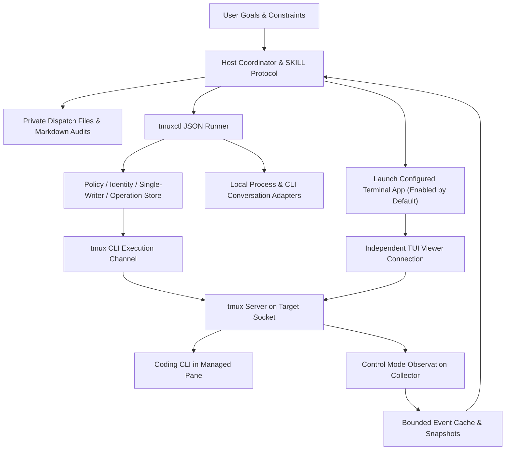

# `goals-tmux-skill` Implementation Plan and Capability Roadmap

Research date: 2026-11-06, Asia/Shanghai. This document preserves the architecture research and phased plan from that date; references below to "proposed interfaces", "not yet built", and phase statuses are historical records and do not reflect current progress. Use the current runner for command syntax. Current code is at 0.3.0, adding recovery evidence, SSH, tmux 3.8 wait, and native display paths; see the [0.2 Acceptance Report](acceptance-0.2-2026-11-06.md). Earlier 0.1.0 code delivered the standard-library `scripts/tmuxctl` runner, task and pane registry, private dispatch/audit, bounded Control Mode `watch`, four CLI adapters, and an optional TUI launcher. Use `scripts/tmuxctl --help` and `capabilities --json` for actual commands, and see [README](../README.md) and [SKILL](../SKILL.md) for current release scope and limitations.

Historical phase boundary: phase labels in the original plan below do not represent 0.2 status. Live evidence exists for the four-CLI collaboration loop, real conversation recovery, macOS iTerm2 native display, and isolated SSH; version and platform limits are governed by the current README and acceptance reports. Linux and separate remote hosts remain unverified. MCP is not required for installation or usage.

The original design thesis was to preserve the coordination protocol of `goals-iterm-skill` while **wrapping tmux commands in a standalone Python runner and enhancing observation with Control Mode**; the sections below retain the rationale, assumptions, and risks for traceability. Subsequent sections have not been rewritten line-by-line after the runner was built; defer to current skill instructions, runner contracts, and capability reports.

## 1. Goals and Design Constraints

The goal is for a host agent to orchestrate Coding CLIs inside tmux, continuously observe and make routine decisions, reclaim self-created resources after independent acceptance, and support adoption, handoff, and recovery.

| Constraint | Basis & Design Target |
| --- | --- |
| Scale | Designed for personal development environments; provisionally 1–8 managed panes per endpoint in normal use, stress-tested up to 32. Design assumption, not a measured capacity limit |
| Consistency | Single write coordinator per pane; writes require current generation/revision, identity, and topology verification; observation permits brief lag |
| Latency | No unverified SLA; target ~1s event coalescing for active windows and 5–30s fallback reads when idle, to be measured after implementation |
| Tech & Platform | Follows reference project's Python 3.12 baseline; macOS verified first, Linux declared supported after platform process adapter and CI acceptance; WSL falls under Linux verification; native Windows excluded from v1 |
| Runtime Cost | No cloud services, database servers, or persistent MCP daemon; observation collector runs only on demand |
| Project Rules | Do not run the full test suite unnecessarily; do not run Python processes with `--reload` |

If the target shifts to multi-user shared servers or hundreds of panes, tenant isolation, persistence, and collector resource controls must be re-evaluated. The scale and latency numbers above are design assumptions, not implemented guarantees.

v1 does not implement a full terminal emulator, replace Coding CLI conversation storage, promise recovery of live processes after a machine reboot, or add background wakeup capabilities to the host.

## 2. Inherited Practices from the Reference Project

Reference version: `/Users/jwyuan/source_code/goals-iterm-skill`, commit `918cd7b31481e2f9ea0a7e94f61e8f28b202206f`, skill `0.4.0-dev`.

The reference project already used a built-in standalone runner instead of depending on MCP, and recorded "business completion", "monitoring stopped", "terminal reclaimed", and "conversation recoverable" separately. Those protocols are more valuable to preserve than terminal API names.

| Original Component | Treatment in tmux Edition |
| --- | --- |
| `SKILL.md`, `references/orchestrator.md` | Keep coordinator ownership of goals, decisions, and read-only acceptance while delegating project execution to controlled CLIs; applies only to tasks using this skill |
| `references/dispatch.md` | Keep private, immutable decision files and the "short instruction input → check → separate submit → verify read" protocol |
| `references/monitoring.md` | Keep inline monitoring, recovery counters, phase checks, and user progress updates; add event coalescing and gap catch-up reads |
| `references/audit.md` | Keep per-task/per-date Markdown ledgers with E/U/C/D events and turn numbering |
| `scripts/session_registry.py` | Port single-writer, generation/revision, ownership, retention, and finalizing logic; adapt to pane primary keys and topology link tables |
| `contract.py`, `operation_store.py`, `policy.py` | Reuse request envelopes, result semantics, persistent reservations, and policy concepts; rewrite `target` and `scope` rather than copying schemas verbatim |
| `closing.py` | Reuse precheck → record recovery info → execute → verify state machine; rewrite shared-window and tmux-exit behavior |
| `process_inspection.py`, `cli_recovery.py` | Extract process/conversation evidence models; original process probe had macOS assumptions, so add a Linux provider; verify CLI adapters against actual versions |
| `backends.py`, `service.py`, `sdk_auth.py`, `screen_coordinates.py` | Do not port iTerm API, auth, or screen coordinates; rewrite tmux transport, format, and capture adapters |
| `bootstrap.sh`, packaging tools | Keep self-contained skill package approach; remove iTerm SDK and GUI permission dependencies, check Python/tmux/private state directory |

If copying code or protocol text, retain MIT copyright notices and record the upstream commit above in `runtime/UPSTREAM.md`. Keep the two projects independent at first; evaluate extracting a shared coordination core only after the tmux backend stabilizes so this design does not refactor the reference project simultaneously.

## 3. Architecture Choice

| Option | Pros | Trade-offs & Scope |
| --- | --- | --- |
| A: Pure tmux CLI + periodic capture | No persistent connection, easy to debug, fastest to basic closed loop | High-frequency polling, transient events may be missed; suitable for P0/P1 and degraded mode |
| B: CLI execution + Control Mode observation | Preserves verifiable CLI command outcomes while adding output/topology notifications and format subscriptions; no GUI, remote-extensible | Requires stream protocol parsing, connection lifecycle, backpressure, and reconnect; recommended target architecture |
| C: Persistent daemon executing all commands, optional MCP | Centralizes connections and cross-client request scheduling | Adds daemon management, auth, installation, and failure modes; insufficient need as a v1 prerequisite |

Select Option B, delivered incrementally via A → B. v1 invokes tmux directly using the Python standard library without third-party tmux object wrappers; we need exact commands, raw outputs, and version capabilities rather than introducing another object model upfront.



The runner executes mechanical operations and checks; the collector only gathers facts and never autonomously sends "continue", confirms menus, or judges acceptance. Once the host finishes its turn, continued collector output does not wake the host.

### 3.1 Optional TUI and Terminal Application

The user requested adding `tui.enabled`, **defaulting to `true`**. Here TUI refers to the interactive terminal interface displaying managed tmux sessions to the user—not a separate dashboard, and not controlling whether Coding CLIs themselves run interactively. When `false`, CLIs still run in tmux PTYs with normal dispatch, monitoring, acceptance, and auditing, simply without opening a visible terminal window automatically.

The execution layer always creates detached tmux resources first; the display layer attaches via an independent viewer client to the same socket/session. A new `TerminalLauncher` adapter layer handles only opening, focusing, and detaching the task's viewer connection. Business input and reads continue through the tmux runner rather than using iTerm's screen API as a required channel.

Default selection on macOS: when `terminal=auto`, prefer iTerm2, falling back to Terminal.app if iTerm2 is not installed. `terminal=iterm2` can also be configured explicitly. The skill selects the target app directly **without requiring or changing the system default terminal or file associations**. iTerm2 officially supports targeting the app to open a window and run a command; its "Make iTerm2 Default Term" menu primarily sets file-type associations and is not a tmux prerequisite. Sources: [iTerm2 Scripting Docs](https://iterm2.com/documentation-scripting.html), [Default Terminal Menu Docs](https://iterm2.com/documentation-menu-items.html).

Display modes:

| `tui.mode` | Behavior | Delivery |
| --- | --- | --- |
| `tmux`, default | Runs standard `tmux -S SOCKET attach-session -t SESSION_ID` in the chosen terminal, showing tmux's native TUI | P1 |
| `iterm2-native`, optional | Runs `tmux -S SOCKET -CC attach-session -t SESSION_ID` in iTerm2, mapping tmux windows/splits to native iTerm2 UI | P2, requires iTerm2 launcher & compatibility verification |

Both modes can use iTerm2 as the terminal app, but only the second is iTerm2's native tmux integration. In native integration, closing a mapped window/tab may actually kill the tmux resource, so hiding must use `detach` rather than a normal GUI close action. Source: [iTerm2 tmux Integration Docs](https://iterm2.com/documentation-tmux-integration.html).

The viewer and Control Mode collector are two separate connections: `tui.enabled=false` does not turn off the collector or stop monitoring. After opening a window, verify the actual connection via tmux client binding rather than trusting app launch success; reuse the registered viewer for the same task/target to avoid spawning a new window on every dispatch. When the user needs to type, follow the existing single-writer handoff protocol.

Headless Linux/SSH environments have no universal "system default TUI". Attach only inside an interactive TTY explicitly owned and usable by the user, or use a configured and supported terminal launcher; never hijack the agent's tool stdio. When no display environment is available, record `tui_status=unavailable` and print exact attach instructions—the started tmux task may keep running, but the display request must not be reported as succeeded. When `iterm2` is explicitly specified but unavailable, report the reason without silently switching apps; only `auto` may fall back per the rules above.

GUI launch interfaces are verified against the local iTerm2 version. Because AppleScript is marked deprecated by iTerm2, treat it as an optional compatibility path; regardless of launcher choice, GUI permissions and SDK dependencies remain confined to the display adapter layer. The headless path has no dependency on iTerm2 installation or Python API authorization.

## 4. Identity and Topology Model

### 4.1 Do Not Reuse iTerm Session Semantics

| iTerm Object | Closest tmux Execution/Container Object | Difference |
| --- | --- | --- |
| Session | pane, `%N` | A pane is the concrete PTY and input target |
| Tab | window, `@N` | A single tmux window can be linked into multiple sessions |
| Window | session, `$N` | A tmux session is not a desktop window; multiple clients can attach |
| iTerm app connection | server/socket + client | One host can run multiple independent servers |

Externally use `pane_id`, `window_id`, `session_id`, and `endpoint_id`, rather than conflating iTerm's `close_session` with killing a tmux session. Execution targets are uniformly called panes.

Local tests confirmed `$0/@0/%0` reappear after a server restart. Proposed identities:

```text
endpoint = explicit local/remote identifier + canonical socket path
server_instance = server PID + OS process start identity + available start-time/boot identity
pane_identity = endpoint + server_instance + pane_id
process_instance = pane_pid + OS process start identity
task_binding = task_id + coordinator_id + generation + revision
```

Neither `socket_path` nor PID alone is sufficient; socket inode is only supporting evidence, and socket recreation does not necessarily mean a new server generation. Unknown process start identities must never be forged into stable IDs. `respawn-pane` can replace the process in the same pane, so process-identity changes also require rebinding. `@goals_*` user options may serve as task hints, never as unforgeable permission or identity credentials.

### 4.2 Model Ownership as a Graph

The registry stores `sessions`, `windows`, `panes`, and `session_window_links`. Multiple links to the same window must never be collapsed into a single parent session.

Creating a pane grants ownership only of that pane; creating a window inside a user session does not grant ownership of that session; adopting an existing pane defaults to `borrowed/retain`. Moves, `link`/`unlink`, `respawn`, and user takeovers can invalidate prior cleanup preconditions.

Container cleanup must enumerate all linked sessions/windows/panes. In Phase 1, if a cross-task, borrowed, or shared window is encountered, reject closing the entire container and let the coordinator target individual owned panes. `kill-window` affects every session referencing that window, so checking only the current session is insufficient. Source: [API Research](tmux-api-research.md#3-command-interfaces-and-achievable-capabilities).

## 5. Runner Contract

Proposed CLI (not yet executable at design time):

```sh
scripts/bootstrap.sh --check
scripts/tmuxctl capabilities --json
scripts/tmuxctl doctor --json
scripts/tmuxctl invoke --request-file /private/path/request.json
scripts/tmuxctl operation-status --request-id UUID
scripts/tmuxctl watch --task-id TASK_ID --timeout 30 --jsonl
scripts/tmuxctl registry report --task-id TASK_ID --require-settled
```

`doctor` checks only binaries, versions, config, and paths by default; probing an existing endpoint requires specifying that endpoint explicitly. Self-tests that create an isolated server belong behind a separate flag so read-only diagnostics never mutate state implicitly. `capabilities` should report three distinct categories: runner-implemented, tmux-supported, and policy-permitted.

Preserve result statuses `ok/refused/unknown/partial/error` and `side_effects=none/confirmed/unknown`. Exit codes remain `0/2/3/4`, though raw tmux exit codes never equate to business outcomes. Start with tmux schema v1 independently without claiming iTerm schema compatibility.

```json
{
  "schema_version": 1,
  "request_id": "550e8400-e29b-41d4-a716-446655440000",
  "operation": "send_text",
  "target": {
    "endpoint_id": "local-goals",
    "server_instance_id": "opaque-from-discovery",
    "pane_id": "%3"
  },
  "arguments": {"text": "Read the decision file /private/path/C01.md; dispatch ID task-1-C01"},
  "task_context": {
    "task_id": "task-1", "coordinator_id": "C1", "generation": 2, "expected_revision": 8
  },
  "expected_observation": {
    "observation_id": "opaque-from-inspection",
    "process_instance_id": "opaque-from-process-probe",
    "topology_digest": "opaque-from-discovery"
  }
}
```

Do not treat `observation_id` as a global lock; the runner compares its bound identity, member set, process, and blast radius against live facts. Single-pane operations must not fail because an unrelated session was renamed; container operations must validate the complete member set.

Every mutation follows: validate fixed policy → acquire execution lock & recheck registry → re-observe → persist request reservation → execute → verify → persist result. Hold the relevant write lock throughout; handoffs participate in the same lock protocol. P1 may use an endpoint-level execution lock (never held during long watches) and refine to deterministically ordered resource locks later if concurrency demands it.

Duplicate request IDs return the stored result, and reserved-but-unconfirmed requests stay `unknown`; reusing a request ID with different content must be rejected. After timeout, lost response, or log-write failure, perform read-only reconciliation without auto-replaying input/create/close; this prevents duplicate dispatches rather than guaranteeing terminal actions are exactly-once.

## 6. Capability Matrix and Delivery Scope

| Capability | Proposed Runner Interface | Technical Implementation | Phase |
| --- | --- | --- | --- |
| Environment & capability checks | `doctor/capabilities` | `tmux -V`, command/format probing, endpoint inspection | P0 |
| TUI config & display | `config show/set`, viewer attach/detach | Enabled by default; iTerm2 preferred on macOS; display decoupled from execution | P1 |
| Exact target discovery | `list_resources` | `list-sessions/windows/panes/clients -F` | P1 |
| Activity & recovery diagnostics | `inspect_panes` | tmux metadata + OS process evidence + CLI adapters | P1 |
| Screen & bounded history | `read_screen/read_history` | `capture-pane` + geometry/mode metadata | P1 |
| Exact text & keys | `send_text/send_keys` | `send-keys -l`, enumerated keys; controlled buffer channel | P1 |
| Task containers & splits | `create_session/create_window/split_pane` | `new-session/new-window/split-window -P -F` | P1 |
| Naming | `rename_session/rename_window/set_pane_title` | Native commands; identity does not change with name | P1 |
| Normal exit & controlled cleanup | `close_pane/close_window/close_session` | Normal exit first, constrained kill fallback, per-target results | P1 |
| Dispatch/monitor/decide/accept | SKILL + registry + ledger | Reused coordination protocol, targeted acceptance | P1 |
| Conversation recovery | `inspect_recovery/restore_cli` | Verified CLI history, process correlation, resume adapters | P1, per CLI |
| Live output & state changes | `watch/read_events` | Control Mode, format subscriptions, snapshot catch-up | P2 |
| Bounded event waiting | `wait_for_change` | 3.6a collector; 3.8 event wait where available | P2 |
| Layout, break, & move | `resize_pane/set_layout/move_pane` | Native commands + dual-end topology/ownership checks | P2 |
| Continuous raw output logging | `start_capture/stop_capture` | Optional `pipe-pane -O` + fixed log writer | P2 |
| Shell command lifecycle | Observation event projection | 3.8 OSC 133 events; requires shell-emitted markers | P2 enhancement |
| Human view / takeover | Attach instructions, `handoff` | Attach to exact socket/session; write-authority handoff | P1/P2 |
| Multi-endpoint & SSH | Endpoint provider | Same-version remote runner + stdin JSON + file transfer | P3 |
| Multi-CLI orchestration | Multi-pane task correlation | Coordinator manages dependencies and delivery; tmux provides execution & observation | P3 |

v1 does not expose `raw_command`, arbitrary `run-shell`, arbitrary hook commands, or one-click `kill-server`. Server-wide cleanup, if ever needed, must be designed as a separate restricted capability rather than derived from "clean up this task".

## 7. Key Implementation Details

### 7.1 Input, Creation, and Encoding

All local tmux invocations use argument arrays with `shell=False`, bound to an explicit socket and exact IDs. Never concatenate task text into shell/tmux command strings; Control Mode also has its own command syntax, which shell quoting cannot satisfy.

`send_text` does not append a submit key; keep the 16 KiB limit initially, and restrict default dispatches to CR/LF-free short instructions. Read the screen after typing to verify it is still unsubmitted, then send Enter separately. Multi-line support at the transport layer does not mean the target CLI handles multi-line input as expected.

**Synchronized input is a hard check.** Local tests proved that with `synchronize-panes=on`, targeted `send-keys -t %N` still broadcasts to sibling panes in the same window. New dedicated resources default to `off`; adopting a resource with `on` returns `INPUT_BROADCAST_ENABLED` without silently altering user config. Copy mode, disabled input, dead panes, and unknown interactive states also block business input. Sources: [tmux `window.c`](https://github.com/tmux/tmux/blob/3.6a/window.c), [probe data](research/probe-results.json).

Short instructions use literal send; avoid placing long bodies or secrets in `argv`. When buffers are needed, use a random unique name, stdin `load-buffer`, explicit `paste-buffer -d -p -r`, and verify/reclaim the request's buffer. Buffers are server-shared objects—never overwrite the user clipboard, and do not assume `-p` is unconditional paste protection. Buffer-stage failures and unknown input outcomes must be recorded separately without blind retries.

New sessions use detached mode and ID-returning flags to avoid stealing user focus; prefer multi-arg program launches to bypass shell re-interpretation. Distinguish `program_argv` clearly from authorized shell commands. Unknown creation outcomes reconcile against recorded unique creation markers and live topology rather than re-creating.

### 7.2 Reads, History, and Event Streams

`read_screen` returns text, dimensions, cursor, screen type, capture timestamp, and truncation flags. Active visible TUIs use default capture; `-a` reads the alternate buffer and must not be treated naively as "a more complete current screen". `read_history` defaults to 100 lines, capped at 2000 lines plus a byte limit, explicitly marked `retained_history_only=true`. Scrollback line numbers are not permanent log cursors.

Metadata queries prefer fixed formats; never interpolate titles or paths directly into JSON templates. Implement tested field escaping/decoding, or read free-form fields individually and serialize via Python's JSON encoder. Titles can contain newlines or control characters, so naive TSV splitting cannot handle all inputs.

The Control Mode parser separates command response blocks from async notifications and decodes protocol-escaped bytes. Output is neither a rendered screen nor structured Coding CLI reasoning/tool events. The v1 collector does not implement a VT terminal emulator: it coalesces change notifications and triggers `capture-pane`. Boundary source: [Control Mode Docs](https://github.com/tmux/tmux/wiki/Control-Mode).

Each subscription connection carries a `connection_epoch`, writing bounded JSONL/ring records with monotonic `seq`; multi-session collectors track their own coverage explicitly rather than assuming attaching to one session yields server-wide output. Coalesce high-frequency pane output with byte/queue caps; on backpressure, mark `gap`, pause/resume output, and catch up via snapshots.

On disconnect: mark prior observation discontinuous → verify endpoint/server instance → reconnect & subscribe → re-list topology → capture → establish new cursor. Snapshots restore current visible state but cannot recover lines already scrolled out of history during an outage, nor replay unknown writes. Pre/post-subscription races are mitigated by "subscribe first, then snapshot and re-evaluate"; events themselves are not a durable queue.

`pipe-pane` records raw output only from activation onward and is neither history nor conversation backup; an existing pipe on a pane must not be overwritten unilaterally. Log writers must be fixed, permission- and size-bounded, with declared retention. Full raw terminal capture is off by default.

### 7.3 Separating Process State from Business State

`pane_pid` is the pane's initial process—often a shell, not necessarily the Coding CLI. `pane_current_command`, pane title, brief silence, and `pane_dead_status=0` none prove task completion.

macOS/Linux providers return a bounded process tree, TTY, process start identity, foreground process group, and observable stopped/background job evidence; missing, truncated, or conflicting data marks `unknown`. Services detached from the TTY cannot be claimed as auto-cleaned; rely on task launch records and service-specific acceptance.

CLI adapters independently detect input readiness, normal exit commands, history persistence, and active conversation identity. v1 verifies Claude Code and Codex first, deferring Cursor/Kiro. This is not a claim that porting automatically supports all four CLIs.

tmux 3.8 OSC 133 signals strengthen shell command start/end evidence, but are absent when the shell lacks markers and cannot interpret Coding CLI business turns or acceptance.

### 7.4 Cleanup, Recovery, and Concurrency Boundaries

Cleanup sequence: business acceptance → `finalizing` → stop business write monitors → persist known recovery metadata → normal CLI exit → verify process → exit cleanable idle shell → verify pane gone or dead → reclaim remaining panes/containers proven to belong to this task.

New dedicated panes may enable `remain-on-exit` to retain exit evidence; thus "CLI exited" does not mean "pane disappeared". Save exit status from dead panes before reclaiming them. Never alter `remain-on-exit` on pre-existing user panes automatically.

Record `execution_status`, `monitor_status`, `cleanup_status`, `recovery_status`, and `coordinator_phase` independently. Missing conversation UUID means insufficient recovery evidence—not a ban on normal exit—whereas conflicting process identity, unknown activity, or unclear ownership blocks automatic cleanup.

Normal `detach/attach` preserves live processes; after server/host death, recovery relies strictly on CLI-persisted conversations. `respawn-pane` starts a new process without restoring model context, and saving layout does not save process memory.

Runner locks coordinate cooperative callers only and cannot block external users or other tmux clients from writing. Dedicated endpoints by default, disabled synchronized input, pre-op rechecks, and short command queues narrow race windows without claiming tmux provides cross-"read-state / write-input" transactions. On human takeover of a shared endpoint, halt automated business writes and re-handoff; on uncertain concurrent closes, refuse or return `unknown`.

## 8. State, Policy, and Installation

### 8.1 User Configuration

Proposed user config path: `${XDG_CONFIG_HOME:-~/.config}/goals-tmux-skill/config.json`, separate from permission policy. Defaults:

```json
{
  "schema_version": 1,
  "tui": {
    "enabled": true,
    "terminal": "auto",
    "mode": "tmux"
  }
}
```

Precedence: per-task explicit override → user config → built-in defaults. `terminal` initially supports `auto/iterm2/terminal-app/current`; `current` accepts only an explicitly usable interactive TTY. Unimplemented or platform-unsupported combinations must be reported rather than silently treated as auto-selection. `iterm2-native` is accepted only when P2 capability is available and terminal resolves to iTerm2.

Proposed config commands (not executable at doc-design time):

```sh
scripts/tmuxctl config show --json
scripts/tmuxctl config set tui.enabled false
scripts/tmuxctl config set tui.enabled true
scripts/tmuxctl config set tui.terminal iterm2
```

`config show` returns persisted values, effective values, and their sources; `doctor` reports execution capability and TUI display capability separately. Failed type/enum validation writes nothing; valid updates write atomically while preserving unrelated fields. Display settings cannot widen terminal write permissions in `policy.json`.

Config changes apply to subsequent tasks or the next explicit display action without terminating running CLIs or closing borrowed user windows. Requesting "hide TUI" on a running task detaches only the task-registered viewer while keeping the tmux server/pane and business monitor alive; task cleanup still follows acceptance and ownership rules. The registry records `tui_requested`, `tui_status`, `viewer_client_id`, and `viewer_origin` separately rather than conflating viewer lifecycle with pane lifecycle.

### 8.2 Runtime State and Installation

Proposed default state root: `${XDG_STATE_HOME:-~/.local/state}/goals-tmux-skill/`:

```text
policy.json                 Fixed permissions & endpoint scope
endpoints.json              Explicit socket/remote config (no whole-disk socket scans)
registry.json               Current identity, ownership, generation/revision & resource links
operations/                 Request reservations and results
recovery/                   Pre-close recovery records & subsequent outcomes
dispatches/<task-id>/        Immutable instruction files
audits/<task-id>/            index.md and per-date ledgers
events/<endpoint-id>/        On-demand, bounded observation events
```

Target `0700/0600` permissions for directories/files. Keep state out of project repos and avoid storing credentials, full environments, or unnecessary process `argv`. Event logs and operation logs use distinct retention rules: event caches may roll over, while operation logs must retain sufficient replay-prevention facts.

Without a policy, default to read-only. Policy independently governs endpoints, writable panes, container creation, layout changes, closing, and forced interrupts; discovery permission does not grant write permission. Never interpret `pane_ids=[]` as permitting arbitrary create-and-write; define `create_scope` separately so only resources created and registered by the request enter its grant.

New tasks default to configured dedicated sockets and controlled settings without silently modifying `~/.tmux.conf`. Dedicated servers ensure detaching an observer client does not trigger auto-destruction. When adopting a user server, inspect `destroy-unattached`, `exit-unattached`, synchronized input, and existing hooks/pipes—report constraints without silently overwriting them.

Socket and runner policies protect against accidental misuse, not malicious same-OS-user isolation; another process under the same OS user can still talk to the socket directly.

Proposed project layout:

```text
SKILL.md
agents/openai.yaml
references/{orchestrator,dispatch,monitoring,audit,session-lifecycle,closing-and-recovery,runtime}.md
scripts/{tmuxctl,bootstrap.sh,package_skill.py}
runtime/goals_tmux/
  cli.py, contract.py, policy.py, operation_store.py, registry.py
  transport.py, capabilities.py, topology.py, observations.py
  input.py, capture.py, control_protocol.py, collector.py
  config.py, terminal_launcher.py, viewer.py
  process_inspection.py, cli_recovery.py, closing.py
tests/{unit,integration,acceptance}/
```

Build modules phase by phase rather than generating empty stubs upfront. Prefer the Python standard library; justify any third-party dependency.

## 9. User-Facing Workflow

Users may ask: "Have Claude Code fix this issue in tmux, verify when done, and clean up the dedicated pane"; or "Adopt the task in `%3` and keep the original window"; or "Restore yesterday's CLI session—just open it without continuing". Prompt for disambiguation only when target names or multiple servers conflict.

A complete run:

1. Read task, project rules, and existing authorizations; run environment checks.
2. Resolve TUI config, create ledger; locate or create detached dedicated session/pane, immediately registering IDs and ownership; open and verify viewer by default, or keep headless when disabled.
3. Verify shell/CLI startup state, `cwd`, history settings, and recovery capability; never send natural-language tasks to a raw shell.
4. Establish real inline observation, write goals/constraints/acceptance to a decision file, send short instruction, and verify submission.
5. Observe changes, make routine decisions, handle explicit interrupts/permission prompts/completion claims; send follow-up rounds only when confirmed needed.
6. Inspect actual artifacts, diffs, and targeted verification evidence; dispatch follow-ups for gaps.
7. Stop business writes, exit normally, and verify; preserve resources the user asked to keep.
8. Report task outcome, actual checks, resource disposition, recovery evidence, and ledger paths.

"View only", "cleanup only", and "restore UI only" each take the shortest path without forcing new CLI launches or business dispatches. When the host cannot run persistently, honestly report that monitoring stopped; promise background monitoring only when explicitly authorized and backed by a real host scheduler handle.

## 10. Delivery Phases and Acceptance

| Phase | Deliverables | Exit Criteria |
| --- | --- | --- |
| P0: Interface Verification & Skeleton | Capability probing, isolated server harness, result schema, exact identity, minimal capture/input | Reproducible tests for ID reuse, synchronized broadcast, copy mode, and version differences; this research completed part of these checks, not the skeleton |
| P1: Complete Base Skill | Standalone runner, policy/log/registry, create & close, file dispatch, polling, audit, two CLI adapters, default-on TUI & config/terminal launcher | macOS 3.6a passes headless/TUI paths and at least one real Coding CLI dispatch → acceptance → exit → recovery loop; Linux accepted separately |
| P2: Events & tmux Enhancements | Control Mode, backpressure/reconnect, event wait, layouts, optional logging, 3.8 event adapter, optional iTerm2 native integration | Large output/disconnect/multi-session never drop gaps silently; older versions degrade explicitly; 3.8 native capabilities and iTerm2 native detach verified live |
| P3: Remote & Cross-Task Orchestration | SSH endpoints, remote file mapping, multi-CLI collaboration, on-demand daemon/MCP | Remote disconnects never re-dispatch tasks; recovery identity stays consistent; cross-endpoint permissions and log locations explicit |

Targeted P1 checks required first:

- TUI enabled by default when unconfigured; no GUI launched when disabled; task overrides do not pollute persisted config; invalid config writes nothing.
- macOS `auto` prefers iTerm2 and falls back to Terminal.app if absent; explicit unavailable selection reports accurately; system default terminal is never modified.
- Viewer attaches to exact endpoint/session; repeated show does not spawn duplicates; closing/hiding viewer does not kill the task; unavailable GUI never reports fake success.
- Same-server renames, index swaps, and pane moves; server restart reusing IDs; `respawn-pane` rejecting stale process identity.
- Unicode, quotes, `$()`, backticks, and `#{...}` are never interpreted by host shell or tmux format; input never appends Enter implicitly.
- Refuse dispatch on synchronized input, copy mode, disabled pane input, or existing draft; never replay unknown send outcomes.
- Old container-close snapshots invalidate once a window is linked to another session; borrowed resources are never auto-reclaimed.
- Crash after request reservation, sent input with unpersisted result, or lost response after close: reconcile rather than replay.
- Stale generation, concurrent coordinator, and post-finalizing callbacks rejected; handoffs never clear unknown side effects.
- Shell subtasks, background/stopped jobs, idle CLI prompt, and dead panes classified separately; exit code never substitutes for business acceptance.
- Explicit conversation identity, persisted existence, and actual recovery verification recorded separately; never guess from "most recent conversation".

P2 adds protocol framing, escaping, async notifications, slow consumers, subscription disconnects, and snapshot gap tests. Tests create unique private sockets with `/dev/null` or dedicated configs and clean up only their own sockets. Run targeted tests for modified modules; execute the full compatibility matrix at release time rather than on every edit.

## 11. Decision Log and Open Discovery Items

Decided: standalone skill; separate CLI execution, event observation, and visible TUI; TUI enabled by default with iTerm2 preferred on macOS without changing system default terminal; 3.6a baseline with 3.8 enhancements; pane primary keys and shared-window graph; replay-safe, audited, recoverable cleanup loop; dedicated endpoints by default; no persistent daemon prerequisite.

Rejected: renaming iTerm APIs 1-to-1 to tmux names, storing all state in tmux user options, judging completion from screen text alone, using `kill-server` as routine cleanup, auto-continuing tasks on events without host involvement.

The items below are **implementation discovery**—they do not block adopting this plan, but must be verified in their respective phases:

| Open Item | Verification Method & Impact |
| --- | --- |
| Paste/exit/conversation evidence for two CLIs | Live sessions on local CLI versions; governs adapters and recovery claims |
| iTerm2/Terminal.app launcher & viewer binding | Verify supported launch APIs, required GUI permissions, path encoding, client ownership, and detach; this round checked official docs only without launching GUI tests |
| Linux process/TTY/background-job evidence | Linux integration tests; do not claim support beforehand |
| tmux 3.8 new events, OSC 133, and timestamps | Isolated install/CI verification; this round relied on official docs/source without upgrading locally |
| Collector CPU/memory & event-drop thresholds | High-output tests with 1/8/32 panes; informs default caps with no pre-set performance guarantee |
| Non-cooperative client input/config races | Integration race tests and conservative refusals; unavoidable boundary write contract |
| Remote dispatch file transfer & recovery | P3 verification via remote runner, private files, content hashes, and stdin requests; never expose local paths directly |

For complete API sources and local experiment boundaries, see the [Research Report](tmux-api-research.md).
