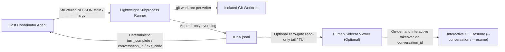

# Root-Cause Diagnosis and CLI Orchestration Architecture Assessment

- **Date**: 2026-11-13
- **Related Incident**: [2026-11-12-viewer-isolation-agy-handoff.md](2026-11-12-viewer-isolation-agy-handoff.md)
- **Scope**:
  1. Code-verified root-cause diagnosis of the `2026-11-12` multi-agent viewer isolation and `agy` termination incident;
  2. Architectural evaluation of orchestrating external Coding CLIs via `skill + tmux`, stability assessment, and recommended alternatives.

---

## 1. Code-Verified Root-Cause Diagnosis

Cross-checking the [incident postmortem](2026-11-12-viewer-isolation-agy-handoff.md) against the runtime source code shows that the outage was caused by **four compounding layers of failure**—and reveals one important misattribution in the initial postmortem.

### 1.1 Correcting the `reused_existing_viewer` Misattribution

Sections 5.1.3 and 6.1.2 of the initial postmortem attributed cross-session TTY sharing (`$35`, `$37`, and `$38` all appearing on `/dev/ttys001`) to `Viewer.open()` reusing an existing viewer (`reused_existing_viewer`).

**Source verification disproves that causal link:**

- In [`runtime/goals_tmux/viewer.py`](../../runtime/goals_tmux/viewer.py), `_registry_key(socket_path, session_id, server_instance_id)` (lines 429–513) scopes viewer reuse strictly to the **exact same `session_id`**. It never reuses a viewer record across distinct tmux sessions.
- Whenever `Viewer.open()` launches a viewer for a new `session_id`, `_APPLE_SCRIPT` (lines 26–44) executes `create window with default profile command commandText`, which allocates a fresh PTY in iTerm2 (such as `ttys006` and `ttys008` in the incident log).

**Actual code-level mechanism behind `viewer_client_session_changed`:**

1. **TTY-selector ambiguity in `Viewer.verify_visible()` (`viewer.py` lines 759–850)**:
   - At line 759, `_match_client()` verifies that `list-clients` contains an entry matching `(viewer_pid, session_id)` on `expected_tty`.
   - However, at line 822, `verify_visible()` queries the active view using:
     ```sh
     tmux display-message -p -c <expected_tty> "#{session_id}|#{window_id}|#{pane_id}|#{window_zoomed_flag}"
     ```
   - In tmux, `-c target-client` resolves clients by **TTY / client name**, not by `client_pid`. When multiple clients share `/dev/ttys001`—for example, user/host terminal attachments, `tmux -CC` Control Mode gateways, or `collector.watch()` (`runtime/goals_tmux/collector.py`, lines 445–463) spawning `tmux -C attach-session` without `start_new_session=True` (`setsid`) while inheriting the parent's controlling terminal—`display-message -c /dev/ttys001` can resolve to a sibling client attached to `$35` instead of `$38`, immediately tripping line 850 (`viewer_client_session_changed`).
2. **Interactive session switching on shared/mouse-enabled clients**:
   - `Service._create()` (`runtime/goals_tmux/service.py`, line 727) enables `mouse on` per created session. Any session switch on an attached client (via status-bar click, `choose-tree`, `switch-client`, or session teardown switching an attached client to another live session) mutates the client's `session_id` in place and emits `client_session_changed` during `watch`.

### 1.2 Layer 1 (Architectural Paradox): Coupling Machine Execution Gates to Volatile Human GUI State

`Service._require_tui_for_input()` (`service.py`, lines 1124–1213) and `Viewer.verify_visible()` (`viewer.py`, lines 673–1029) enforce a **hard execution gate** before every `dispatch`, `submit_dispatch`, `send_text`, and `send_keys`. Passing this gate requires simultaneous alignment of five external states:

1. Private viewer receipt and registry files match (`owner-<token>.json` and `viewers/<key>.json`);
2. Live tmux server PID and `ps lstart` incarnation match;
3. Live tmux client `(viewer_pid, client_tty, session_id, readonly, control_mode)` matches;
4. Active tmux window and zoom state on `expected_tty` expose the target pane;
5. Live AppleScript inspection of iTerm2 (`viewer.py`, lines 906–961) confirms the window is visible, not minimized, has the exact tab selected (`current session of window`), has no split panes (`count of sessions of aTab == 1`), and experiences **zero topology or view changes** across the multi-second `osascript` round-trip.

Even when a task explicitly launches a CLI in unattended `permission_mode=bypass` (`--dangerously-skip-permissions`), [`SKILL.md`](../../SKILL.md) forbids falling back to `tui.enabled=false`. Consequently, purely observational UI events—switching tabs, minimizing a window, parallel tasks contending for window focus, or AppleScript latency—turn into **100% fatal execution blockers** (leaving the earlier Claude task unable to send its initial prompt for ~80 minutes).

### 1.3 Layer 2 (State-Machine Deadlock): Dual-Ledger Desynchronization and Missing Escape Hatches

Once the TUI gate fails, the runtime's own defensive invariants lock out recovery:

- **Dual-ledger mismatch (`VIEWER_IDENTITY_MISMATCH`)**: `Service._show_viewer()` (`service.py`, lines 1238–1252) writes a new `viewer-receipts/<uuid>.json` on every `show_tui` attempt, whereas `Viewer.open()` overwrites a single per-session `viewers/<key>.json` slot (`viewer.py`, line 429). If a retry records `state="unknown"` or rotates `viewer_token`, calling `hide_tui` with an earlier receipt fails with `VIEWER_IDENTITY_MISMATCH` (`viewer.py`, lines 1068, 1085), while calling `open()` again refuses to launch a replacement (`no_retry`).
- **Lifecycle catch-22 (`FINALIZATION_REQUIRED` vs. `COORDINATOR_SETTLED`)**: `Service._close_plan()` (`service.py`, lines 1335–1338) forbids closing owned sessions while a task is `active`, forcing coordinators to record synthetic "accepted without dispatch" states just to reclaim slots. Conversely, once a task is `settled`, `Registry._guard_records()` (`runtime/goals_tmux/registry.py`, lines 400–401) rejects all mutations with `COORDINATOR_SETTLED`, stranding leftover sessions as permanent orphans on the shared `default.sock`.
- **Self-blocking settlement (`METADATA_TOO_LARGE`)**: Repeated `show_tui` retries accumulate `viewer-receipts/*.json` files. During `task settle` (`runtime/goals_tmux/cli.py`, line 209), the entire `resource_report` payload is serialized inline into one audit event's `details` JSON, tripping `MAX_EVENT_DETAILS_BYTES = 16 * 1024` (`runtime/goals_tmux/coordination.py`, line 26). The more a task struggles with viewer retries, the more likely settlement itself becomes impossible.

### 1.4 Layer 3 (Worker Termination): Three-Layer "Russian-Doll" Orchestration

Pane `%38` ended with `Pane is dead (status 0)` and printed `agy`'s normal resume banner (`agy --conversation=878cbf13-52a1-40b6-8ec5-531db62785b1`) without a crash traceback. Exit code `0` indicates a clean exit of `agy`'s interactive TUI event loop (triggered after an 18-minute reasoning turn, 15 research subagents, context compaction, and spawning 4 worktree-backed implementation subagents) rather than a segfault or tmux failure.

Because the setup nested **three layers of stateful orchestration**—Host Coordinator -> Interactive `agy` TUI in tmux -> 19 in-process `agy` subagents—and those subagents were bound to the interactive parent process's lifetime, parent TUI exit immediately tore down all 4 implementation subagents before any code changes were committed.

---

## 2. Is `skill + tmux` Orchestration Sound and Reliable?

### 2.1 Architectural Soundness: Valid Goal, Wrong Transport Layer

- **What is sound**: Routing work across heterogeneous Coding CLIs (Claude Code, Codex, Antigravity `agy`, Kiro) to leverage distinct model strengths, reuse existing CLI subscriptions and native repo toolchains, isolate noisy exploration from the coordinator's context window, and preserve human takeover capability.
- **What is unsound**: **Using an interactive human TUI + PTY keystroke injection + screen scraping + AppleScript window checks as a machine-to-machine RPC protocol.**
  - Modern Coding CLIs heavily use alternate screens, dynamic input redraws, bracketed paste, slash-command popups, and interactive confirmation menus. Driving them with `send-keys` + `capture-pane` is effectively **terminal RPA (screen scraping + synthetic keystrokes)**.
  - The fact that `goals-tmux-skill` already contains thousands of lines of careful CAS guards, PID/start-time checks, operation stores, and AppleScript verifiers—yet still deadlocked under parallel use—demonstrates that defensive bookkeeping cannot make a volatile human presentation layer behave like a deterministic transport.

### 2.2 Operational Stability Verdict

**In its current "interactive TUI + mandatory GUI visibility gate" form, this pattern cannot operate reliably for parallel multi-agent workloads.** Even if all Phase A/B viewer-isolation patches from the postmortem are implemented, structural instability remains:

1. **Desktop environment nondeterminism**: macOS TCC prompts, window focus stealing, `osascript` timeouts, user tab switching, or scrolling into tmux copy mode (`PANE_IN_MODE`) can still interrupt automated flows at any moment.
2. **No structured turn-completion signal or async wakeup**: Interactive TUIs do not emit machine-verifiable turn boundaries. Moreover, `tmuxctl watch` is a finite synchronous poll that cannot wake an idle host agent, forcing long-running turns to burn coordinator turns and context on repeated polling.
3. **Shared working tree collisions**: Running multiple implementation CLIs against the same Git working directory without `git worktree` isolation risks concurrent file clobbering and `.git/index.lock` contention.

---

## 3. Better Architectural Alternatives and Roadmap

### Option 1 (Recommended Target Architecture): Decoupled Headless Stream-JSON Control Plane + Sidecar Observability + `git worktree`

Every target CLI coordinated by this project natively supports a **non-interactive structured streaming protocol** built specifically for programmatic orchestration:

| CLI | Native Headless / Structured Streaming Invocation | Session Resume Capability |
| --- | --- | --- |
| **Antigravity (`agy`)** | `agy -p --input-format stream-json --output-format stream-json` | `agy --conversation=<id>` |
| **Claude Code (`claude`)** | `claude -p --input-format stream-json --output-format stream-json --verbose` | `claude --resume <id>` |
| **Codex (`codex`)** | `codex exec --json` | `codex exec resume <id>` |
| **Kiro (`kiro-cli`)** | `kiro-cli chat --no-interactive` / ACP | `kiro-cli chat --resume-id <id>` |



**Key design principles:**

1. **Control plane uses structured pipes, never synthetic keystrokes**: Launch the target CLI in `stream-json` / `exec --json` mode via `subprocess` and stream NDJSON events to `runs/<task_id>.jsonl`. Turn completion, tool calls, errors, exit codes, and `conversation_id` become 100% deterministic—eliminating `send-keys`, `capture-pane` heuristics, `PANE_IN_MODE`, and input-verification races.
2. **Observation plane is strictly sidecar and zero-gate**: Remove GUI window visibility as a prerequisite for `dispatch`. When the user wants live visibility, open an optional sidecar terminal tailing and formatting `runs/<task_id>.jsonl` (or running inside a task-private tmux server). Closing, minimizing, or switching tabs in that viewer has **zero effect** on execution. When human intervention is needed, attach interactively on demand using the recorded `conversation_id` (`agy --conversation=<id>` or `claude --resume <id>`).
3. **Mandatory `git worktree` per write worker**: Provision a dedicated `git worktree` and task branch for each mutating CLI worker, merging back only after coordinator acceptance checks pass.

### Option 2 (Optimal for Same-Ecosystem Work): Native Subagents, Swarm, or Official SDK

When the host coordinator is already Antigravity and the task does not require cross-vendor model diversity:

- **Intra-ecosystem parallel tasks**: Use built-in **`invoke_subagent`** (with `Workspace: "share"` or `"branch"` isolation and automatic reactive wakeup on completion—zero polling) or **`swarm`** (shared message board with zero-cost idle waiting), rather than shelling out through tmux to another interactive `agy` TUI.
- **External Python automation**: Use the official [`google-antigravity` Python SDK](https://github.com/google-antigravity/antigravity-sdk-python) (`async with Agent(config) as agent:`) to consume typed `response.thoughts` and `response.tool_calls` streams directly.
- **Practical rule of thumb**: Use **native subagents/swarm** for same-ecosystem implementation, and reserve **headless CLI JSON adapters** (or a thin MCP wrapper around them) for cross-vendor tasks such as independent Claude/Codex code reviews.

### Option 3 (Short-Term Stabilization Plan if Retaining `goals-tmux-skill`)

If the existing interactive tmux architecture must be kept operational in the short term, **re-order the roadmap from the postmortem** to eliminate shared blast radius before adding more viewer state-machine rules:

1. **Move per-task tmux socket isolation (`sockets/<task_id>.sock`) to Step 1 (ahead of Phase A)**:
   - Giving every task its own private tmux socket immediately eliminates cross-task session/TTY collisions, global 5-session quota exhaustion, and cross-task `client_session_changed` interference, while making post-task cleanup a clean per-socket `kill-server`.
2. **Fix the two concrete runtime bugs**:
   - Pass `start_new_session=True` when spawning `tmux -C attach-session` in [`runtime/goals_tmux/collector.py`](../../runtime/goals_tmux/collector.py) so Control Mode observers detach from the host's controlling TTY;
   - Write full settlement `resource_report` payloads to standalone files (`audits/<task_id>/settlement-report.json`) and store only the path, SHA-256 digest, and summary counts inside the 16 KB audit event in [`runtime/goals_tmux/cli.py`](../../runtime/goals_tmux/cli.py) / [`runtime/goals_tmux/coordination.py`](../../runtime/goals_tmux/coordination.py).
3. **Downgrade TUI visibility from Hard Gate to Advisory under `permission_mode=bypass`, and add `task abort`**:
   - When `permission_mode=bypass` is explicitly authorized, attempt `show_tui` best-effort for human observation without blocking `dispatch` if the window loses focus or switches tabs;
   - Add an explicit `task abort` transition and orphan GC command so stuck `active` sessions or leftover `settled` resources can be reclaimed cleanly.
4. **Bound dispatch granularity and forbid deep nested fan-out**:
   - Split delegated work into atomic phases with intermediate commits (e.g., Phase A implementation + tests committed before starting Phase B), and instruct inner CLIs not to spawn more than 1–2 concurrent in-memory subagents per turn.
