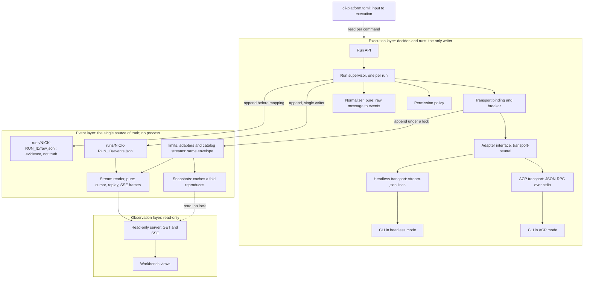
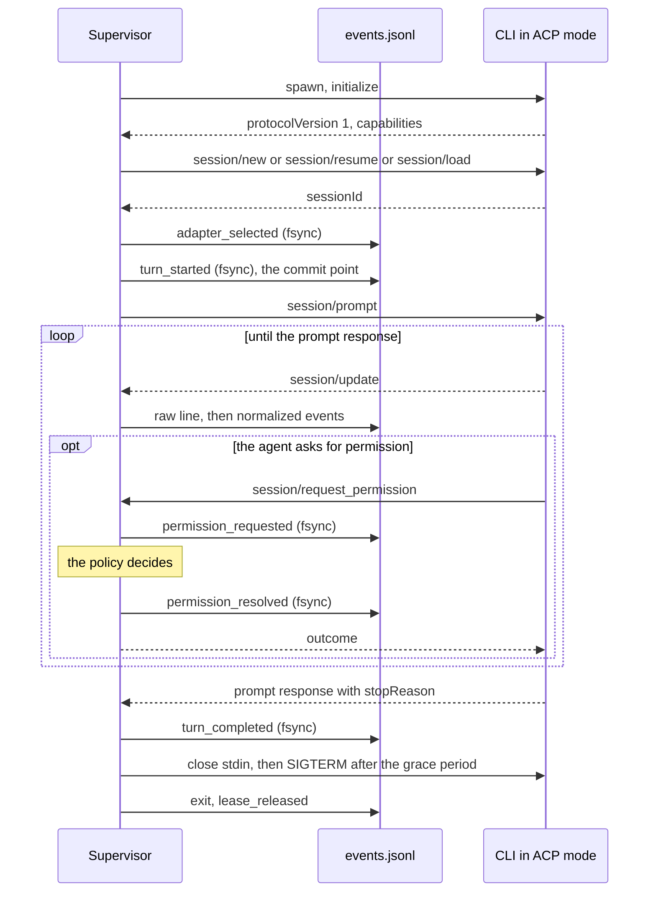
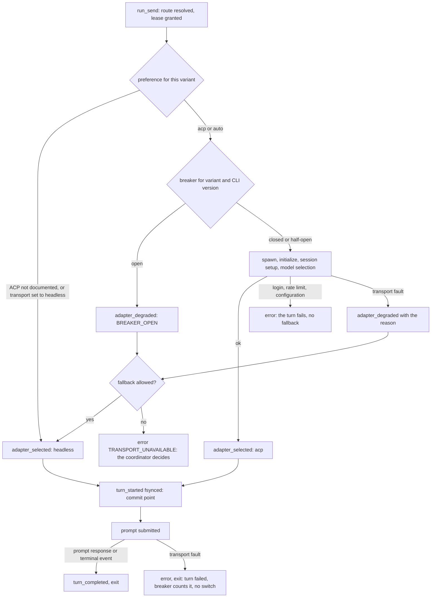
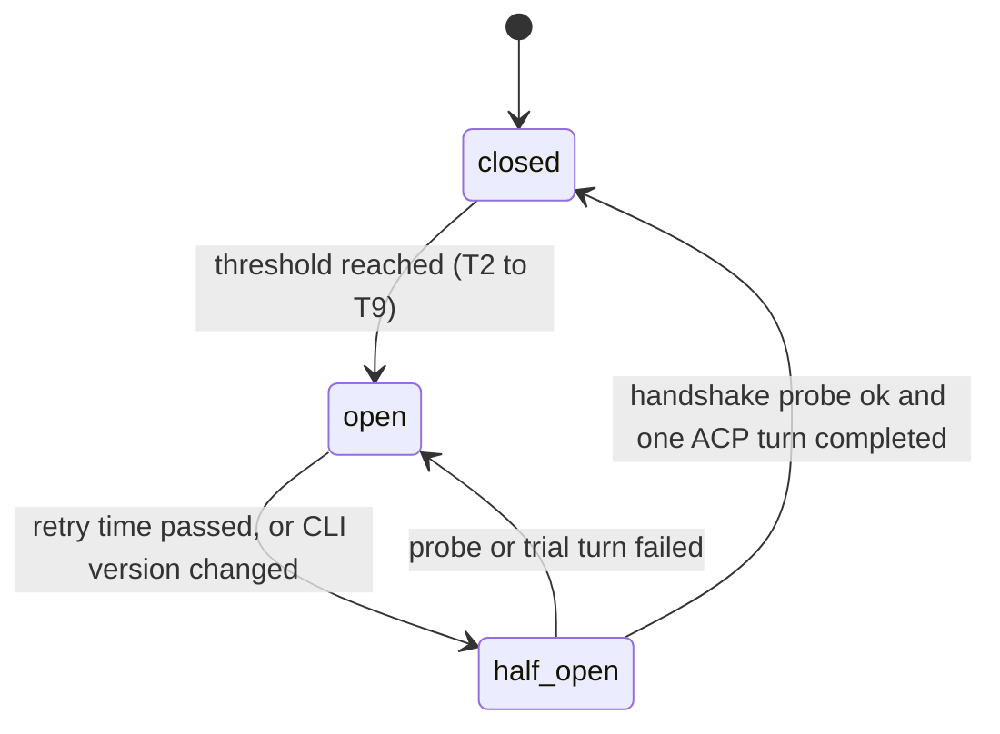
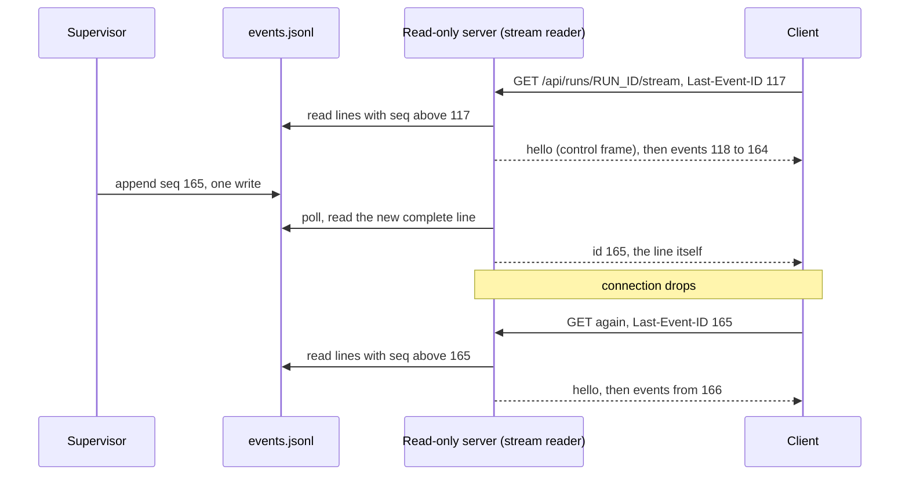

# ACP-first execution layer: layering assessment

Status: adjudicated, 2026-11-13. The user decided the fourteen questions of
sections 10.6 and 11. **[Appendix A](#appendix-a-decision-register) is the
authoritative decision register (D01 to D14) and fact register (F01 to
F10).** Sections 1 to 12 are kept as the assessment the user decided on;
where a decision differs from a recommendation below, the register wins,
and each affected section points to it. The decisions are applied in the
[final design](2026-11-13-cli-platform-final-design.md) (revision 4, its
section 21), the scaffold and the mockup. The ACP transport itself is still
not implemented.

- **Adjudication landed by**: `cli-platform-decisions-landing-20261113-g1-bb8d0b9c-C01-dd8fb85c`

- **Dispatch**: `cli-platform-acp-layering-20261113-g1-1963824a-C01-f68541b6`
- **Baseline commit**: `7499bf9` (final design, revision 3)
- **Assesses**: [CLI platform final design](2026-11-13-cli-platform-final-design.md)
  (called "the final design" below) and the
  [CLI gateway and workbench proposal](2026-11-13-cli-gateway-and-workbench.md)
  (called "the gateway proposal")
- **Verification host**: macOS (Darwin 27.0.0), Python 3.12.10
- **ACP**: the Agent Client Protocol, JSON-RPC 2.0 between a client and a
  coding agent that runs as the client's subprocess and talks over stdio

## 1. Summary and recommendation

**Recommendation.** Adopt the requested three-layer model, with **ACP as the
preferred transport and headless as the fallback, enabled per CLI only after
that CLI passes an evidence gate** (option B in section 10). Until a CLI
passes the gate it runs headless. "ACP-first" is therefore the steady-state
preference of the binding policy, not the build order.

**Why this and not ACP-only or headless-only.**

1. **Claude Code documents no ACP mode.** `claude --help` (2.1.311) has no
   ACP entry and `claude acp --help` prints the top-level help unchanged.
   Claude is the first candidate of three of the five stages in the sample
   configuration. The headless transport must be built whatever is decided
   here, so ACP-only is not available.
2. **ACP exists on the other two installed CLIs, with different maturity.**
   Cursor's `agent acp` answered an `initialize` handshake with protocol
   version 1, but the subcommand is hidden from `agent --help`. Kiro lists
   `kiro-cli acp` in its help, but the handshake could not be completed
   because the CLI is logged out on this host.
3. **ACP fixes the largest known gap of the headless path.** A headless CLI
   in default permission mode has nobody to answer an approval prompt (the
   gateway proposal rates this risk high). ACP turns the prompt into a typed
   request that a recorded policy can answer.
4. **No prompt-level behavior is verified on either transport.** No model
   call was made. Every statement about what a turn looks like is a design
   assumption until an authorized probe records fixtures (section 10.4).

**What changes, in one table.** Section 4 has the full comparison.

| Layer | Today (final design) | Proposed |
| --- | --- | --- |
| Execution | Headless only: an adapter is an argv builder plus a line mapper. ACP is named as a later optimization and, in revision 3, as an "alternative" per adapter. | One transport-neutral adapter interface with two implementations, a per-turn transport binding, a circuit breaker and a permission policy. |
| Event | Three append-only streams with three record shapes, plus snapshot files, one of which (`limits/state.json`) is primary state. | One envelope for every stream. Snapshots are caches that a fold of their stream reproduces. The cursor, replay and SSE framing rules belong to this layer. |
| Observation | The workbench reads event files, reads `cli-platform.toml` itself, and calls two execution evaluators. SSE is a deferred workbench route. | Read-only views over the log and its caches. The read-only server hosts SSE; it publishes only what it read from the log. |

**What does not change.** Nicknames, variants, the catalog, stage routing,
the lease protocol, lease per turn, one CLI process per turn, one writer per
file, the zero-gate rule, the GET-only workbench, the security rules and the
run state machine all stay as designed.

**Cost of the recommendation.** It adds one JSON-RPC client, a binding and
breaker component, a permission policy and their tests to work that already
includes the headless transport. The decision matrix puts it two points
ahead of the current plan out of fifty, which is inside the noise of
judgment scores. The deciding arguments are items 1 and 3 above, and the
user's stated preference.

## 2. Scope, method and limits

**Method.** The five required sources were read: the final design, the
gateway proposal, `docs/design/project-structure.md`, the `cli_platform/`
source and configuration, and `references/cli-adapters.md`. The final design
moved from revision 2 to revision 3 while this assessment was being written
(commit `7499bf9`). Revision 2 was read in full, then the revision 3 diff,
and its new section 19 (Sessions view data) in full, because that section
proposes event fields that overlap with section 8 here. Section 8.6
reconciles the two. The installed CLIs were probed with local help
and version commands. Two of them were also sent a single ACP `initialize`
request, which starts the agent process but creates no session and sends no
prompt. The ACP method tables and message shapes come from the protocol's
public schema files (section 12).

**Limits.**

- No model call was made. Session creation, prompt turns, streamed updates,
  permission requests, cancellation and resume are unverified for every CLI
  and both transports.
- `codex` and `agy` are not installed on the host. Nothing about them is
  verified.
- Kiro is logged out on the host, so its ACP handshake is unverified.
- The Mermaid diagrams were not rendered (section 12).

**Terms.**

| Term | Meaning |
| --- | --- |
| Transport | The way the supervisor talks to one CLI process: `acp` (JSON-RPC over stdio) or `headless` (argv in, JSON Lines out). |
| Adapter | As in the final design: the code that knows one CLI family. An adapter now provides one or two transports. |
| Binding | The choice of transport for one turn. Made once, before the prompt is sent. |
| Commit point | The fsync of `turn_started`. The prompt is submitted immediately after it. Before it, a fallback is possible; after it, never. |
| Transport fault | A failure of the channel itself (handshake, version, stream, process), as opposed to a failure the other transport would hit too (login, rate limit, refusal). |
| Breaker | A per-variant circuit breaker that stops ACP from being tried while it is failing. |
| Stream | One append-only JSONL file with its own gap-free `seq`. |

## 3. Target model



Rules of the target model. Sections 6 to 9 make each one concrete.

1. **One adapter interface.** The supervisor calls the same nine operations
   whichever transport is bound. Transports return normalized pre-events.
   They never write a file.
2. **One binding per turn.** The transport is chosen before the commit point
   and recorded. It never changes inside a turn.
3. **No silent fallback.** Every binding to a transport other than the
   preferred one is an `adapter_degraded` event, fsynced before the other
   transport starts, and is reported in the `run_send` response.
4. **The log is the truth.** An event exists when its line is in the stream
   file. Nothing is published, shown or acted on from memory.
5. **Append before act.** An event that precedes an external effect (prompt
   submission, a permission answer, a fallback, a cancel) is fsynced before
   the effect happens.
6. **Publish from the log.** The SSE publisher is a reader of the stream
   file. It has no other input, so it cannot publish what was not written.
7. **Observation reads the event layer only.** It takes no lock, writes
   nothing, and execution never waits for it (zero-gate, unchanged).

## 4. Gap assessment

### 4.1 Requested model against the current design

| Topic | Current design | Requested model | Gap | Verdict |
| --- | --- | --- | --- | --- |
| Adapter interface shape | "Argv builder and line-to-event mapping interface" (gateway proposal 8.1). `build_launch` renders argv. `RunSupervisor` in the scaffold has `start_turn`, `heartbeat`, `cancel`, `finish_turn`. One-way: argv in, lines out. | One unified interface over two transports. | No handshake, no capability record, no session object, no request the agent can send to the client, no cancel other than a signal. | Changes (section 6) |
| Transport preference | Headless is the only machine path. `kiro-cli acp` appears as a "later optimization" for streaming input (gateway proposal 5.1, 6.5). Revision 3 lists `agent acp` and `kiro-cli acp` as an "alternative" per adapter (19.1) without designing for them. | Prefer ACP, fall back to headless. | No binding step, no fallback policy, no record of which transport ran a turn. | Changes (section 7) |
| Turn and process model | One CLI process per turn. A lease per turn. No process while idle. | Not specified by the request. | ACP is a session protocol and invites a long-lived process. | Stays: one process per turn, also for ACP (section 6.5) |
| Permission prompts | Not answerable. Mapped to `error` with `PERMISSION_REQUIRED`; the turn timeout is the backstop (gateway proposal 6.5). | Implied by ACP: `session/request_permission` is a request that needs an answer. | No policy, no event types, no answer path. | Changes (section 6.6) |
| CLI scan | Capability map from help text: `headless`, `stream_json`, `resume`, `model_flag`, ... No ACP entry. | ACP detection with a handshake. | The scanner cannot say whether a CLI has an ACP mode. | Changes (section 6.3) |
| Event types for agent activity | The gateway proposal's eleven types and the platform's seven. Revision 3 proposes `thought`, `plan` and `permission_request`, and new fields on existing types (19.6), from the point of view of what the Sessions view needs. | Every event normalized. | No type for the binding, for a degraded adapter, for the two halves of a permission exchange, or for session metadata. | Extends 19.6 (section 8.6) |
| Event streams | Three, with three shapes: the run stream (v1 envelope, gap-free `seq`), the limiter journal (`ts`, `type` and ids; no `v`, no `seq`), catalog observations (the `Observation` record). The final design records the journal as a gap (5.4). | Every event normalized, appended to a JSONL log. | Two of three streams have no version, no sequence and no cursor. | Changes (section 8.2) |
| Source of truth | The run stream is authoritative for a run. For leases, `limits/state.json` is the primary state and the journal is a history. `nicknames/live/` is primary state for names. Lease facts are written twice: journal and run stream (11.3). | The log is the single source of truth. | Two snapshot families are primary state, and one fact has two records. | Changes in rule, staged in effect (section 8.2) |
| Where SSE sits | In the observation layer, as a deferred workbench route (`/api/runs/<run_id>/stream`, Phase 4). The contract is one sentence: "SSE resumes from an event `seq`" (5.4), with `Last-Event-ID` mapped to `seq` (gateway proposal 7.6). | Events are pushed over SSE from the log. | No stated ordering, replay, durability or reconnect rule. The contract lives with the viewer, not with the events. | Moves: the contract to the event layer, the socket stays in the read-only server (section 9) |
| The extra configuration input | "Three layers plus one shared input" (final design 4). Observation reads `cli-platform.toml` directly and calls two execution evaluators, the catalog merge and the variant check (5.2, the named exception to rule 2). Since revision 3 the shared input also holds the message catalogs (`i18n/core.py`). | Three layers. Observation is read-only views over the log. | Observation has a second input and an import from execution. | Changes: execution publishes what observation needs (section 8.2). The file and its editor stay. The message catalogs stay too: they are static package data that turns stored codes into text at the edge, not state. |
| Layer enforcement | `tests/test_layering.py`: a layer table, import rules, a write-free and lock-free read model. | Same intent. | New modules need a layer; the evaluator exception would go. | Extends |

### 4.2 What stays exactly as designed

- Session nicknames, the library, allocation and reuse (final design 6).
- CLI variants, settings-file rules, fingerprints, secret refusal (7).
- The two-layer model catalog and its merge rules (8).
- Stage routing, candidate order, pins, the explain trace (9). Routing
  selects a variant and model; it does not select a transport.
- Concurrency scopes, the lease protocol, the queue, cooldown and reaping
  (10). A lease is still held per turn.
- The run state machine (11.1). A pending permission request is an event
  inside `running`, not a new state.
- One CLI process per turn, the turn boundary rule "terminal event, then
  exit", and human takeover by resume identifier.
- One writer per file, `flock` for shared files, atomic replace for
  snapshots, 0600 files, redaction at write time.
- The zero-gate rule and the GET-only workbench.
- The settings editor as the only runtime writer of `cli-platform.toml`.

### 4.3 What changes

| # | Change | Layer | Section |
| --- | --- | --- | --- |
| 1 | Adapter interface with capabilities, handshake, sessions, permission requests, cancel, close | Execution | 6 |
| 2 | ACP transport: a JSON-RPC client and a version 1 mapper | Execution | 6, 8.3 |
| 3 | Headless transport implements the same interface | Execution | 6.4 |
| 4 | Per-turn binding, fallback triggers, breaker, `adapter_degraded` | Execution | 7 |
| 5 | Permission policy with recorded decisions | Execution | 6.6 |
| 6 | Scanner records an ACP entry point; a handshake probe records the negotiated version and capabilities | Execution | 6.3 |
| 7 | One envelope for all streams; new event types | Event | 8 |
| 8 | Snapshots become caches with a fold test | Event | 8.2 |
| 9 | Stream reader contract: cursor, replay, SSE frames, control frames | Event | 9 |
| 10 | Observation loses its configuration read and the evaluator exception | Observation | 8.2 |
| 11 | Configuration gains transport and permission settings | Input | 7.7 |

### 4.4 Amendments this would imply

Not applied. Listed so the user can see the blast radius before deciding.

| Document or file | Section | Amendment |
| --- | --- | --- |
| Final design | 3, 5.2 | Add transport, binding, breaker and permission policy to the execution layer. |
| Final design | 5.2, 5.3 | Remove the evaluator exception once registry and catalog snapshots are published. |
| Final design | 5.4 | One envelope; journal gains `v` and `seq`; snapshots declared caches; stream reader contract. |
| Final design | 7.1 | Scanner rows gain an ACP entry point and the handshake result. |
| Final design | 11.2, 11.3 | Binding step before `turn_started`; new event types. |
| Final design | 12 | New configuration keys (section 7.7). |
| Final design | 16 | Phase gates for the two transports. |
| Final design | 18 | Catalog keys in `en`, `ja` and `zh-Hant` for the new event types, reason codes and breaker states. The rule of 18.6 already fits: everything added here is a stable code. |
| Final design | 19.1, 19.3, 19.6 | The ACP column becomes a transport, not an "alternative". `permission_request` splits in two. The usage row changes (section 8.6). |
| Gateway proposal | 5.1 | ACP is a transport of the same per-turn model, not a later optimization. |
| Gateway proposal | 6.3 | Additive event types and envelope fields. |
| Gateway proposal | 6.5 | An ACP row per adapter. |
| Gateway proposal | 7.6 | The SSE rules of section 9. |
| Scaffold | `scanner.py`, `events.py`, `supervisor.py`, `i18n/*.json`, `tests/test_layering.py` | New capability flags, event types, supervisor contract, catalog keys, layer table entries. |

## 5. ACP capability matrix

### 5.1 Protocol facts used in this document

Taken from the public schema repository on 2026-11-13 (section 12). They
describe the protocol, not any CLI.

| Fact | Source |
| --- | --- |
| Version 1 agent methods: `initialize`, `authenticate`, `session/new`, `session/load`, `session/set_mode`, `session/set_config_option`, `session/prompt`, `session/cancel`, `session/list`, `session/delete`, `session/resume`, `session/close`, `logout` | `schema/v1/meta.json` |
| Version 1 client methods: `session/update`, `session/request_permission`, `fs/read_text_file`, `fs/write_text_file`, `terminal/*`, `elicitation/*` | `schema/v1/meta.json` |
| `initialize` carries an integer `protocolVersion`. The agent answers with the client's version if it supports it, otherwise with its own latest; the client should disconnect if it does not support the answer. The version changes only for breaking changes; everything else is a capability. | `schema/v1/schema.json` |
| A turn ends with the response to `session/prompt`, which carries `stopReason`: `end_turn`, `max_tokens`, `max_turn_requests`, `refusal` or `cancelled`. | `schema/v1/schema.json` |
| `session/load` needs the `loadSession` capability. `session/resume` resumes "without returning previous messages (unlike `session/load`)" and needs `sessionCapabilities.resume`. | `schema/v1/schema.json` |
| `session/update` has 14 variants in version 1 (section 8.3). Notifications carry no sequence number. | `schema/v1/schema.json` |
| A `schema/v2/` directory exists on the main branch. In it, `session/load`, `session/set_mode`, `authenticate` and the `fs/*` and `terminal/*` client methods are gone, and the `session/prompt` response only acknowledges the prompt: completion is reported by a `state_update` session update. | `schema/v2/meta.json`, `schema/v2/schema.json` |

The last row matters for the design. Version 2 is a breaking change to how
a turn ends. Whether any CLI ships it is unknown. The client must negotiate
the version and must treat an unknown version as a reason to fall back, not
as something to parse hopefully.

### 5.2 Matrix

"Verified" means the fact was observed on the verification host on
2026-11-13 by the command in the last column. Nothing else is claimed.

| | `claude` | `cursor` | `kiro` | `codex` | `agy` |
| --- | --- | --- | --- | --- | --- |
| Binary and version | `claude` 2.1.311 | `agent` 2026.04.08-a41fba1 (also `cursor-agent`) | `kiro-cli` 2.34.0 | not installed | not installed |
| ACP mode documented | **No** | **Yes** | **Yes** | unknown | unknown |
| Exact invocation | none | `agent acp` | `kiro-cli acp` | | |
| Where documented | No match for "acp" or "agent client protocol" in 314 lines of `claude --help`. `claude acp --help` prints the same text as `claude --help`. | `agent help acp` and `agent acp --help`: "Start the Cursor Agent as an ACP (Agent Client Protocol) server". **Not listed** in the commands of `agent --help`. | `kiro-cli --help-all`: "acp  Agent Client Protocol (ACP)". `kiro-cli acp --help`: "Start Agent Client Protocol (ACP) agent". | | |
| ACP launch options | | `-h` only. No model, effort or permission option on the subcommand. | `--agent`, `--model`, `--effort`, `-a/--trust-all-tools`, `--trust-tools`, `--agent-engine v1\|v2\|v3` (default `v2`), `--auth-method cli\|client`, `-v` | | |
| Protocol version stated in help | | Not stated | Not stated | | |
| `initialize` handshake | not applicable | **Answered in 0.74 s: `protocolVersion: 1`** | **Not completed.** The process exited with status 1 after 3.1 s and one stderr line, "You are not logged in, please log in with kiro-cli login", before any reply. `kiro-cli whoami` confirms "Not logged in". | | |
| Capabilities advertised | | `loadSession: true`; `promptCapabilities`: image yes, audio no, embedded context no; `mcpCapabilities`: http and sse; `authMethods`: `cursor_login`. No `agentInfo`. No `sessionCapabilities`, so `session/resume`, `session/close` and `session/list` are not advertised. | unknown | | |
| Process end | | Did not exit within 3 s of stdin closing; ended by SIGTERM. | | | |
| Status | **Verified absent** in this version | Flag and handshake **verified**. Session, prompt, updates, permissions, cancel, resume, model selection **unverified**. | Flag **verified**. Handshake and everything after it **unverified**. | **Unverified** | **Unverified** |
| Related headless fact | `-p`, `--output-format stream-json`, `--input-format stream-json`, `--permission-prompts host\|none` | `-p`, `--output-format stream-json`, `--stream-partial-output` | `chat --no-interactive`; `--output-format stream-json` is described as "The run's ACP events as JSON Lines on stdout" | | |

Other observations:

- **No ACP bridge is installed for Claude.** `claude-code-acp`,
  `claude-agent-acp`, `codex-acp` and `acp` are not on `PATH`, and no global
  npm package has a matching name. A bridge would be a separate dependency
  with its own verification. None was evaluated.
- **`gemini` 0.32.1 is installed** and its help lists `--experimental-acp`
  ("Starts the agent in ACP mode"). It is not one of the platform's five
  adapters, so no handshake was run. It is recorded only because the flag
  name shows the mode is experimental there too.
- **Kiro's headless stream is ACP-shaped** according to its help text. If
  that holds, one mapper serves both of Kiro's transports. Unverified.

The handshake that was sent, and Cursor's complete reply:

```json
{"jsonrpc": "2.0", "id": 0, "method": "initialize", "params": {
  "protocolVersion": 1,
  "clientCapabilities": {"fs": {"readTextFile": false, "writeTextFile": false},
                         "terminal": false},
  "clientInfo": {"name": "goals-tmux-acp-probe", "version": "0.0.0"}}}
```

```json
{"jsonrpc": "2.0", "id": 0, "result": {
  "protocolVersion": 1,
  "agentCapabilities": {
    "loadSession": true,
    "mcpCapabilities": {"http": true, "sse": true},
    "promptCapabilities": {"audio": false, "embeddedContext": false, "image": true}},
  "authMethods": [{"id": "cursor_login", "name": "Cursor Login",
    "description": "Authenticate using existing Cursor login credentials. Run 'agent login' first if not logged in."}]}}
```

### 5.3 What the probes establish

| Question | Answer today |
| --- | --- |
| Can every installed CLI run over ACP? | No. One of three has no ACP mode. |
| Is ACP stable where it exists? | Not shown. Cursor hides the subcommand from its main help; Kiro could not be reached. |
| Which protocol version is in the field? | Version 1 on Cursor. Unknown elsewhere. |
| Can a second process continue an ACP session? | On Cursor only through `session/load`, which replays the history. `session/resume` is not advertised. |
| Can the pinned model be selected over ACP? | Kiro: launch flags exist. Cursor: no launch flag on `acp`; a session configuration option may exist but is unverified. |
| Is a logged-out CLI a transport fault? | No. Kiro fails the same way on any transport. It must not trigger a fallback (section 7.3). |

## 6. Unified adapter interface

### 6.1 Shape

One interface, two implementations. It is written as a Python protocol
because the project is Python with no dependencies; the names are proposals.

```python
Transport = Literal["acp", "headless"]

class AgentTransport(Protocol):
    transport: Transport

    def detect(self, scan: CliScan) -> Detection:
        """Static check from the scan cache. No process is started."""

    def open(self, launch: LaunchSpec, *, deadline: float) -> Capabilities:
        """Start the channel and negotiate. ACP: spawn and `initialize`.
        Headless: no process yet; capabilities come from the scan."""

    def start_session(self, cwd: str, selection: Selection) -> SessionRef:
        """Create a conversation and apply model and effort."""

    def resume_session(self, ref: SessionRef, cwd: str) -> SessionRef:
        """Continue an existing conversation in this process."""

    def submit(self, session: SessionRef, instruction: str) -> None:
        """Send one prompt. Called once per turn, after the commit point."""

    def updates(self) -> Iterator[PreEvent]:
        """Normalized pre-events in arrival order, each with its raw_seq:
        Update, PermissionRequest, TurnEnd, TransportFault."""

    def answer(self, request_id: str, decision: Decision) -> None:
        """Reply to a PermissionRequest. Called after the decision is logged."""

    def cancel(self, reason: str) -> None:
        """Ask the agent to stop the turn."""

    def close(self, *, grace_seconds: float) -> ExitInfo:
        """End the session and the process. Always called, on every path."""
```

Contract rules for both implementations:

- **A transport writes nothing.** It returns pre-events. The supervisor is
  still the single writer of `events.jsonl` and `raw.jsonl`.
- **The mapper is pure.** Raw message in, pre-events out, no I/O. That makes
  golden tests possible for both transports with recorded fixtures.
- **One reader.** One thread reads the agent's stdout. Arrival order is the
  only order there is.
- **Every wait has a deadline.** A missed deadline is a `TransportFault`
  with a reason code, never a hang.
- **`close` is unconditional.** No path leaves a CLI process behind.

### 6.2 Capabilities

`open` returns one record, the same shape for both transports. The binding
compares it with what the turn needs.

```json
{"transport": "acp",
 "protocol_version": 1,
 "agent_info": null,
 "session": {"new": true, "resume": "load", "close": "signal"},
 "prompt": {"text": true, "image": true, "audio": false, "embedded_context": false},
 "permission_requests": true,
 "cancel": "notification",
 "model_select": "unknown",
 "effort_select": "unknown",
 "raw_digest": "sha256:..."}
```

| Field | Values | ACP source | Headless source |
| --- | --- | --- | --- |
| `protocol_version` | integer or null | `initialize` reply | null |
| `session.new` | bool | always, after a successful `initialize` | `--print` or `--no-interactive` in help |
| `session.resume` | `none`, `load`, `resume`, `flag` | `sessionCapabilities.resume`, else `loadSession` | `--resume` or `--resume-id` in help |
| `session.close` | `method`, `eof`, `signal` | `sessionCapabilities.close`, else observed | not applicable: the process exits with the turn |
| `permission_requests` | bool | true: the method is part of version 1 | false unless a verified host channel exists |
| `cancel` | `notification`, `signal` | `session/cancel` | SIGTERM to the process group |
| `model_select`, `effort_select` | `launch_flag`, `session_option`, `in_model_id`, `none`, `unknown` | launch options in help, or a `model` / `thought_level` option in the `session/new` reply | the launch table of final design 7.2 |

The example is what Cursor's reply supports today. `unknown` is a real
value: it means "not established", and a turn that needs the capability
treats it as missing.

What a turn requires:

| Turn | Required |
| --- | --- |
| Every turn | `session.new`, text prompts |
| Second turn onward | `session.resume` other than `none`, for the session the run recorded |
| Resolution names a model other than `@default` | `model_select` not `none` or `unknown`, and the applied model confirmed |
| `permission_mode: default` | A permission posture the transport can enforce (section 6.6) |

### 6.3 Detection, handshake and version negotiation

Three stages. Only the third needs a model call, and it is the turn itself.

| Stage | When | What | Cost | Result recorded |
| --- | --- | --- | --- | --- |
| D0, static | CLI scan | Binary on `PATH`. ACP entry point present in help: `kiro-cli --help-all` lists `acp`; `agent help acp` succeeds. | Help commands only | `capabilities.acp`, `acp_argv` in the scan |
| D1, handshake | On request, after a CLI version change, and when a breaker is half-open | Spawn the ACP command, send `initialize`, read one reply, close. No session, no prompt. | One process, under a second on Cursor | `adapter_probe` event: version, capabilities, elapsed time, outcome |
| D2, session | Each ACP turn | `initialize` again in the turn's process, then session setup and model selection. | Part of the turn | `adapter_selected` or `adapter_degraded` |

Negotiation, following the protocol's rule:

1. The client sends the highest version it implements. Today that is 1.
2. If the reply's `protocolVersion` is in the client's supported set, the
   mapper for that version is used.
3. Otherwise the client closes the connection. Reason
   `ACP_VERSION_UNSUPPORTED`, with both versions in the event.
4. Capabilities are read from the reply and never assumed. A method the
   agent did not advertise is not called.

Client capabilities advertised: `fs.readTextFile: false`,
`fs.writeTextFile: false`, `terminal: false`, and no `session.notices`,
`session.compaction` or `elicitation`. The agent then uses its own tools,
and the supervisor does not become a file or shell server for the agent. A
request for a method that was not advertised is answered with JSON-RPC
error `-32601` and logged as `adapter_unknown`.

The headless transport has no wire negotiation. Its "version" is the CLI
version string, compared with the versions its fixtures were recorded on. A
mismatch sets the existing `version_drift` flag and does not block the turn.

D1 outcomes: `ok`, `ACP_HANDSHAKE_TIMEOUT`, `ACP_HANDSHAKE_INVALID`,
`ACP_EXITED_EARLY`, `ACP_VERSION_UNSUPPORTED`, and `AUTH_REQUIRED`. The
last one is what Kiro returned on this host. It says nothing about the
transport.

### 6.4 Operations per transport

| Operation | ACP, version 1 | Headless |
| --- | --- | --- |
| `detect` | ACP entry point in help | Headless and stream-json flags in help |
| `open` | Spawn `<binary> <acp argv>`; `initialize` | No process. Capabilities from the scan cache. |
| Authentication | `authenticate` only for a method that needs no interaction; otherwise `AUTH_REQUIRED` | None. A login failure surfaces in the stream or the exit status. |
| `start_session` | `session/new {cwd, mcpServers: []}`; the reply's `sessionId` is the resume identifier | Preassigned identifier where the CLI has one, else the first stream event that carries it |
| Model and effort | Launch options where the ACP command has them (Kiro); else `session/set_config_option` on an option of category `model` or `thought_level`; then confirm from the reply | Launch flags, final design 7.2 |
| `resume_session` | `session/resume` if advertised; else `session/load`, with the replayed history suppressed (section 8.4) | `--resume <id>` or `--resume-id <id>` |
| `submit` | `session/prompt {sessionId, prompt: [{type: "text", text}]}` | The instruction as an argument or on stdin; this spawns the process |
| `updates` | `session/update` notifications and `session/request_permission` requests | One JSON object per stdout line |
| `answer` | The JSON-RPC response: `{outcome: {outcome: "selected", optionId}}` or `{outcome: {outcome: "cancelled"}}` | Not available. Permissions are fixed at launch. |
| Turn end | The response to `session/prompt` with `stopReason`, or a JSON-RPC error | The CLI's terminal stream event |
| `cancel` | `session/cancel` notification. Pending permission requests are answered `cancelled`. Expect `stopReason: cancelled` within the grace period. | SIGTERM to the process group |
| `close` | `session/close` if advertised; close stdin; wait the grace period; SIGTERM; SIGKILL | Wait for exit; SIGTERM and SIGKILL only after a cancel or timeout |

### 6.5 Process model: one process per turn, on both transports

ACP allows one process to serve many turns. This proposal does not use that,
for the reasons the gateway proposal gave for headless (5.1), which apply
unchanged:

- No process exists between turns, so nothing can be lost while idle.
- A lease is held per turn and an idle run holds nothing (final design 10.1).
- A crash is one failed turn with a known resume identifier.
- The turn boundary stays "terminal event, then `exit`".

An ACP turn is therefore: spawn, `initialize`, create or resume the session,
`session/prompt`, read until the response, close, exit.



Costs of this choice, to be measured by the probe of section 10.4:

- Each turn pays a handshake and a session setup. The handshake took 0.74 s
  on Cursor.
- Where only `session/load` is available (Cursor today), each later turn
  replays the whole conversation as notifications before the prompt can be
  sent. The replay is discarded, but its cost grows with the history.
- Mid-turn steering, which a long-lived process would allow, is not used.

A long-lived ACP process per run is a later optimization behind the same
interface. It would change the lease and crash rules and needs its own
decision (item 4 of section 11).

### 6.6 Permission requests

> **Decided differently: D06.** Permissions are a per-stage
> `permission_profile` (`bypass` or `read_only_auto`) passed at launch, not
> the run-level policy and allow-rule table below. `read_only_auto`
> auto-approves `read`, `search` and `fetch` only and never executes
> commands. The decision order below (record the request, answer, record
> the answer, never `allow_always`) still describes how the ACP transport
> answers, with the profile in place of the allow rules. See Appendix A and
> section 9.4 of the final design.

An ACP agent may send `session/request_permission` with the tool call and a
list of options, each of kind `allow_once`, `allow_always`, `reject_once` or
`reject_always`. The turn waits for the answer.

**Who may answer.** The observation layer writes nothing, so a button in the
workbench cannot answer. The answer comes from a policy inside the
supervisor. If the user wants a person or the coordinator to answer, that
needs a new mutating Run API operation; it is item 6 of section 11 and is
not assumed here.

**Decision order.**

1. The request is appended as `permission_requested` and fsynced.
2. If the run has a recorded bypass authorization (gateway proposal 6.6),
   choose the first `allow_once` option.
3. Else, if the run's allow rules match the tool call, choose the first
   `allow_once` option. The rules extend the existing `allowed_tools`
   argument of `run_create` with tool kinds and a path scope.
4. Else choose the first `reject_once` option.
5. If the chosen kind is not offered, the request is malformed, or the
   decision cannot be appended: answer `cancelled`, cancel the turn, and
   record `error` with code `PERMISSION_UNANSWERABLE`.
6. The decision is appended as `permission_resolved` and fsynced. Only then
   is the answer written to the agent.

Revision 3 of the final design proposes one `permission_request` event with
an `outcome` (19.3). Two events are needed instead, because the request has
to be on disk before the answer exists. The outcome vocabulary of 19.3 is
kept: `allowed`, `rejected`, `denied_auto`, `unanswered`, plus `cancelled`.

**Never chosen:** `allow_always` and `reject_always`. They change the
agent's state beyond this turn, where no event records them.

**Proposed default allow rules** (item 6 of section 11):

| Tool kind reported by the agent | Default |
| --- | --- |
| `read`, `search`, `think` | Allow when every reported location is under the run's working directory |
| `edit`, `delete`, `move` | Allow when the run was created as a writer and every location is inside its worktree |
| `execute`, `fetch`, `switch_mode`, `other` | Reject unless the run's rules list the tool by name |

**This is not a security boundary.** The tool kind and locations are the
agent's own description of what it is about to do. The policy records and
shapes consent; it does not confine the process. The CLI's own sandbox and
permission mode remain the boundary, as today.

**Headless.** Permissions are fixed at launch with the CLI's own flags
(`--allowed-tools`, `--trust-tools`, `--permission-mode`). Claude's help
also documents `--permission-prompts host`, where "the SDK host" answers.
That is a possible second answer path for one CLI; its wire shape is
unverified and it is not assumed.

## 7. Fallback policy

### 7.1 Binding



Rules:

- **Preference.** `auto` means ACP when the CLI documents it, the breaker is
  not open and the gate of section 10.4 has been passed for the adapter;
  otherwise headless. A variant or a pin may set `acp` or `headless`
  explicitly. An explicit transport is strict, like a model pin: it is never
  replaced.
- **Per-turn binding.** The decision is made once per `run_send`, before the
  commit point. It is recorded in `adapter_selected` and in
  `turn_started.payload.transport`.
- **Before the commit point** nothing has reached a model. A transport fault
  there may be followed by headless in the same `run_send`, if the checks of
  section 7.5 pass.
- **After the commit point** the transport never changes. A fault fails the
  turn. The failed turn is not retried automatically (final design 10.4);
  the coordinator decides, and the next `run_send` binds again.
- **"Fallback allowed?"** is the conjunction of: headless is documented for
  the CLI; the transport was not set explicitly; the conversation survives
  the change (section 7.5, rule 2); the permission posture does not widen
  (rule 4).

### 7.2 Fallback triggers

Every trigger has a reason code that appears in `adapter_degraded`. The
codes are stable codes in the sense of final design 18.6: stored as written
here, localized only when shown. Thresholds are proposed defaults (item 5 of
section 11).

| # | Trigger | Detected how | Reason code | Phase | This turn | Breaker |
| --- | --- | --- | --- | --- | --- | --- |
| T1 | ACP entry point missing | The scan no longer finds the ACP subcommand or flag for the installed version, or a configured bridge binary is not on `PATH` | `ACP_NOT_DOCUMENTED`, `ACP_BINARY_MISSING` | Before spawn | Headless | Not counted; re-checked on the next scan |
| T2 | Handshake failure | Spawn error; no valid `initialize` reply within 10 s; a reply that is not JSON-RPC; exit before the reply for a reason other than login | `ACP_SPAWN_FAILED`, `ACP_HANDSHAKE_TIMEOUT`, `ACP_HANDSHAKE_INVALID`, `ACP_EXITED_EARLY` | Before commit | Headless | Counted |
| T3 | Unsupported protocol version | Reply `protocolVersion` not in the client's supported set | `ACP_VERSION_UNSUPPORTED` | Before commit | Headless | Opens at once; stays open until the CLI version changes |
| T4 | Missing required capability | The turn needs resume and the agent advertises neither `resume` nor `loadSession`; the resolved model or effort cannot be applied or confirmed; a required method answers `-32601` | `ACP_CAPABILITY_MISSING:<name>` | Before commit | Headless | Opens for that capability until the CLI version changes |
| T5 | Session cannot be continued | `session/resume` or `session/load` answers `-32002` (not found) or fails | `ACP_SESSION_NOT_FOUND` | Before commit | Headless only if rule 2 of section 7.5 holds; else the turn fails | Counted |
| T6 | Repeated timeouts | Session setup exceeds 30 s (`ACP_SETUP_TIMEOUT`); or two consecutive ACP turns of the variant end in the quiet-turn timeout | `ACP_SETUP_TIMEOUT`, `ACP_TIMEOUTS` | Setup: before commit. Quiet turn: after. | Setup: headless. Quiet turn: fails. | Counted; two consecutive open it |
| T7 | Crash within N turns | Process exit or end of stdout before the prompt response; three consecutive unparsable lines | `ACP_STREAM_ENDED`, `ACP_STREAM_CORRUPT` | After commit | Fails | Opens at 2 of the last 5 ACP turns of the variant |
| T8 | Permission flow not answerable | A malformed permission request; no option of the kind the policy chose; a blocking request for a method the client did not advertise | `PERMISSION_UNANSWERABLE` | After commit | Answer `cancelled`, cancel, fail | Opens at once for the variant |
| T9 | Cancel not acknowledged | No `cancelled` stop reason within the grace period after `session/cancel` | `ACP_CANCEL_UNACKNOWLEDGED` | After commit | Ends by signal; state `cancelled` or `lost` as today | Counted |

### 7.3 Failures that are not fallback triggers

Falling back on these would repeat the failure on the second transport,
spend a second request against the same account, or hide a decision that
belongs to the user.

| Failure | Why no fallback | Result |
| --- | --- | --- |
| Not logged in (`AUTH_REQUIRED`, JSON-RPC `-32000`, or the stderr line Kiro printed) | The login belongs to the CLI, not to the transport | `error`, existing incident "Auth required" |
| Rate limit or quota | The account is the limit (final design 10.4) | `rate_limited`, cooldown |
| Stop reason `refusal`, `max_tokens`, `max_turn_requests` | The turn ran; this is its result | `turn_completed` with that stop reason |
| Cancel by the user or coordinator | Intended | `cancelled` |
| Pin or model errors | Routing rules decide (final design 9.2) | `PIN_UNSATISFIABLE` and the others |
| Lease lost, event append failed, settings file unsafe | The platform cannot run any turn | Existing behavior |
| A single quiet-turn timeout | Indistinguishable from a slow model | `error`, counted toward T6 |

### 7.4 Breaker

One breaker per variant and CLI version, for the ACP transport only.
Headless has no fallback below it, so it has no breaker; its failures are
ordinary failed turns.



- **Defaults.** Opens after 2 consecutive counted faults, or 3 in the last
  10 ACP turns. Retry after 30 minutes. T3, T4 and T8 open at once.
- **Half-open.** One D1 handshake (no model call). If it passes, the next
  turn of the variant is the trial turn. Other turns stay on headless until
  the trial ends.
- **State.** Every transition is an event in the `adapters` stream
  (section 8.2). `adapters/state.json` is a cache of the fold, written under
  the stream's lock. A breaker that cannot be read counts as open: the
  system fails toward the simpler transport.
- **Visibility.** An open breaker is an incident in the workbench and a
  field of `route_explain`.

### 7.5 What must never fall back silently

1. **Anything after the commit point.** There is no mid-turn switch at all,
   silent or announced. The agent may already have edited files.
2. **A fallback that loses the conversation.** A run's later turn may change
   transport only if the adapter is recorded as `resume_portable`: the
   identifier one transport produced has been shown to resume on the other.
   That is unverified for every CLI today. Until it is verified a run stays
   on the transport of its first turn, and a fault on a later turn fails
   with `TRANSPORT_UNAVAILABLE`. The coordinator may then start a new run,
   which makes the loss of context explicit.
3. **A fallback that changes the model or effort.** Model selection is the
   router's decision. If the fallback transport cannot apply the resolved
   selection, the turn fails.
4. **A fallback that widens permissions.** The fallback transport must
   enforce the same or a narrower posture. It never adds a bypass flag and
   never enlarges an allow-list to make an unanswerable prompt go away.
5. **Login, rate-limit and quota failures.** They are not transport faults
   (section 7.3).
6. **A fallback while a permission request is pending.** The request is
   answered `cancelled` and the turn ends first.
7. **An explicitly requested transport.** Like a strict pin, it fails rather
   than being replaced.

And for every fallback that is allowed:

- `adapter_degraded` is appended and fsynced **before** the fallback
  transport is started. If that append fails, the turn fails.
- The `run_send` response carries `transport` and, when they differ,
  `transport_fallback: {from, to, reason}`. `SKILL.md` already requires the
  coordinator to announce a fallback before work starts; this is the text
  it announces.

### 7.6 The `adapter_degraded` event

Written to the run stream by the supervisor, `source: "supervisor"`.

```json
{"v": 1, "stream": "run", "seq": 7, "event_id": "run-01JCQ8M4T7:7",
 "run_id": "run-01JCQ8M4T7", "task_id": "cli-platform-impl", "nickname": "kedo",
 "turn_id": "t0001", "ts": "2026-11-13T08:02:11.412+00:00",
 "type": "adapter_degraded", "source": "supervisor",
 "payload": {
   "variant": "cursor", "cli_version": "2026.04.08-a41fba1",
   "from": "acp", "to": "headless",
   "reason": "ACP_HANDSHAKE_TIMEOUT", "phase": "handshake",
   "detail": {"deadline_ms": 10000, "elapsed_ms": 10004},
   "committed": false, "context_preserved": true,
   "permission_posture": "unchanged",
   "breaker": {"state": "open", "consecutive": 2, "retry_after": "2026-11-13T08:32:11+00:00"}}}
```

| Field | Meaning |
| --- | --- |
| `from`, `to` | Transports. `to` is null when no fallback is allowed; an `error` follows. |
| `reason` | A code from section 7.2, or `BREAKER_OPEN` |
| `phase` | `detect`, `handshake`, `session`, `turn`, `cancel` |
| `committed` | Whether the commit point had passed. If true, `to` is null. |
| `context_preserved` | Whether the conversation continues on `to` |
| `permission_posture` | `unchanged` or `narrower`. `wider` is not a legal value. |
| `breaker` | The breaker's state after this event |

### 7.7 Configuration this would add

> **D05** adopts these defaults, all configurable. The keys are added to
> the loader together with the code that reads them.

Not applied. The loader refuses unknown keys, so these would be added to the
schema together with the code that reads them. They are additive;
`schema_version` stays 1.

```toml
[execution]
transport_order = ["acp", "headless"]

[execution.acp]
protocol_versions = [1]
handshake_timeout_seconds = 10
setup_timeout_seconds = 30
breaker_consecutive_faults = 2
breaker_window_turns = 10
breaker_window_faults = 3
breaker_retry_seconds = 1800

[variants.cursor]
transport = "auto"          # auto | acp | headless
```

A pin gains an optional `transport` with the same values.

## 8. Event normalization

### 8.1 Envelope

The v1 envelope of the gateway proposal (6.3) with the `nickname` field of
the final design, plus two optional fields. Both are additive, so the major
version stays 1.

```json
{
  "$schema": "https://json-schema.org/draft/2020-12/schema",
  "title": "normalized event, v1",
  "type": "object",
  "required": ["v", "seq", "event_id", "ts", "type", "source", "payload"],
  "properties": {
    "v": {"const": 1},
    "stream": {"enum": ["run", "limits", "adapters", "catalog"], "default": "run"},
    "seq": {"type": "integer", "minimum": 1},
    "event_id": {"type": "string", "pattern": "^[A-Za-z0-9][A-Za-z0-9._-]*:[0-9]+$"},
    "run_id": {"type": ["string", "null"]},
    "task_id": {"type": ["string", "null"]},
    "nickname": {"type": ["string", "null"]},
    "turn_id": {"type": ["string", "null"]},
    "ts": {"type": "string", "format": "date-time"},
    "type": {"type": "string"},
    "source": {"enum": ["adapter", "supervisor", "limiter", "binding", "scanner"]},
    "origin": {
      "type": "object",
      "properties": {
        "transport": {"enum": ["acp", "headless"]},
        "protocol": {"type": ["integer", "null"]},
        "kind": {"type": "string"},
        "raw_seq_last": {"type": ["integer", "null"]}
      }
    },
    "payload": {"type": "object"},
    "raw_seq": {"type": ["integer", "null"]},
    "redactions": {"type": "integer", "minimum": 0}
  }
}
```

- `stream` is new. An event without it is a run event, so existing logs stay
  valid. `run_id` and `task_id` remain required on the run stream.
- `origin` is new, and present on `source: "adapter"` events. `kind` is the
  wire name, for example `session/update:agent_message_chunk` or
  `headless:assistant`. With `raw_seq` and `raw_seq_last` it points at the
  raw lines the event was made from.
- `event_id` is `<stream key>:<seq>`: the `run_id` on a run stream,
  otherwise the stream name.
- `source` gains `limiter`, `binding` and `scanner` for the streams that the
  supervisor does not write.

New event types. All existing types keep their meaning.

| Type | Stream | Source | fsync | Payload |
| --- | --- | --- | --- | --- |
| `adapter_selected` | run | supervisor | yes | `transport`, `preference`, `reason` (`preferred`, `only_transport`, `fallback`, `explicit`), `protocol_version`, `capabilities`, `session_ref`, `resumed_via` (`new`, `resume`, `load`, `flag`), `replayed_updates` |
| `adapter_degraded` | run | supervisor | yes | Section 7.6 |
| `thought_delta`, `thought` | run | adapter | no | Like `message_delta` and `message`, for reasoning text, with `redacted`. Subject to the logging policy of final design 19.3 (off, summary or full). |
| `tool_call_update` | run | adapter | no | `call_id`, changed fields only: `status`, `title`, `paths` |
| `plan` | run | adapter | no | `entries: [{content, priority, status}]`, `source`, `digest`; replaces the previous plan |
| `permission_requested` | run | adapter | yes | `request_id`, `call_id`, `tool`, `kind`, `paths`, `options: [{option_id, kind, name}]` |
| `permission_resolved` | run | supervisor | yes | `request_id`, `outcome` (`allowed`, `rejected`, `cancelled`, `denied_auto`, `unanswered`), `wire_outcome` (`selected`, `cancelled`), `option_id`, `option_kind`, `decided_by` (`policy`, `bypass`, `cancel`, `cli`), `rule` |
| `session_meta` | run | adapter | no | `kind` (`mode`, `commands`, `config`, `info`) and the changed values |
| `usage` | run | adapter | no | `used`, `size`, `cost` |
| `adapter_probe` | adapters | scanner | yes | `variant`, `cli_version`, `outcome`, `protocol_version`, `capabilities`, `elapsed_ms` |
| `breaker_opened`, `breaker_half_open`, `breaker_closed` | adapters | binding | yes | `variant`, `cli_version`, `reason`, `counts`, `retry_after`, `evidence` (event ids) |

Fields added to existing types: `turn_started.payload.transport`;
`message_delta.payload.role` and `chunks`; `message.payload.complete_of`
(the `seq` range of the deltas it supersedes) and `sha256`;
`tool_call.payload.kind` and `status`; `turn_completed.payload.stop_reason`
takes the ACP values on an ACP turn.

### 8.2 Streams, snapshots and the single source of truth

> **D07** adopts the middle option: one envelope for the run, lease
> (`limits`), breaker (`adapters`) and catalog streams; snapshots are
> fold-verifiable caches. **D08**: observation reads `config_applied`
> events and published snapshots, not `cli-platform.toml`.

**One envelope, several streams.** Each stream keeps its own file, writer
and lock, as today. Only the record shape is unified.

| Stream | File | Writer | Today | Proposed |
| --- | --- | --- | --- | --- |
| `run` | `runs/<nickname>-<run_id>/events.jsonl` | The run's supervisor | v1 envelope | Unchanged, plus the new types |
| `limits` | `limits/journal.jsonl` | The limiter, under `limits/lock` | `ts`, `type`, ids; no `v`, no `seq` | v1 envelope, `seq` assigned under the lock |
| `adapters` | `adapters/journal.jsonl` (new) | The binding and the handshake probe, under `adapters/lock` | Does not exist | v1 envelope |
| `catalog` | `catalog/observed/<variant>.jsonl` | The supervisor and probes | The `Observation` record | The same record as the `payload` of a v1 event |

Order is total inside one stream and undefined across streams; readers
merge by `ts`, as the gateway proposal already says for runs.

**One fact, one stream.** A fact is authoritative in exactly one stream. A
copy elsewhere carries a reference instead of the data. Today
`lease_granted` is written to both the journal and the run stream. Proposed:
the `limits` stream is authoritative for leases, and the run stream's
`lease_granted` gains `ref: "limits:<seq>"`.

**Snapshots are caches.** `limits/state.json`, `adapters/state.json`,
`nicknames/live/` and `runs/*/state.json` each gain an `as_of_seq`, and a
test shows that folding the stream from `seq` 1 yields the same content.
For this to hold for leases, the limiter appends the journal event before
it replaces `state.json`, inside the same critical section. That is a
change of order, not of protocol.

This is staged. In the first step the snapshot remains what the limiter
reads on every call, because rebuilding from a growing journal on each
`acquire` is wasteful; the fold test proves the two agree. Making the
journal the recovery source after corruption (instead of failing closed) is
a later step. Item 7 of section 11 asks how strict the user wants this.

**`raw.jsonl` is evidence, not truth.** Each adapter line is appended to
`raw.jsonl` before it is mapped. Consumers never read it as state. It exists
so a mapping can be checked and a mapper bug repaired by hand.

**The configuration input.** `cli-platform.toml` stays the input of the
execution layer, and the settings editor stays its only runtime writer. What
changes is how the observation layer learns about it:

| Observation needs | Today | Proposed |
| --- | --- | --- |
| Stage candidates, caps, policies | Reads `cli-platform.toml` | A `config_applied` event (digest and the effective non-secret values) written by execution when it loads a changed file; a `config_rejected` event when a load fails |
| Variant availability | Calls `VariantRegistry.state` | A registry snapshot published by the scanner |
| Merged catalog | Calls `ModelCatalog` | A catalog snapshot published by the scanner |

The final design already names this direction ("Phase 1 can remove the
exception by publishing registry and catalog snapshots from the scanner").
One consequence: a configuration file broken by hand shows in the workbench
only when execution next loads it, not at the moment it is saved. Item 8 of
section 11.

### 8.3 Mapping ACP version 1 to events

Client-to-agent calls:

| ACP | Event | Notes |
| --- | --- | --- |
| `initialize` reply | `adapter_selected.payload` | Version and capabilities. A failed handshake becomes `adapter_degraded`. |
| `session/new` reply | `adapter_selected.payload.session_ref` | `sessionId` is the run's resume identifier, `resume_id_source: "acp_session_new"`. `modes` and `configOptions` become one `session_meta`. |
| `session/resume`, `session/load` | `adapter_selected.payload.resumed_via`, `replayed_updates` | Replayed history is not appended (section 8.4). |
| `session/set_config_option` | `session_meta` with `kind: "config"` | The applied model is compared with the resolution. |
| `session/prompt` request | `turn_started` | Appended and fsynced before the request is written. |
| `session/prompt` response | `turn_completed` | `stop_reason` copied. `end_turn`: `result: "ok"`. `max_tokens`, `max_turn_requests`: `"incomplete"`. `refusal`: `"refused"`. `cancelled`: `"cancelled"`. |
| `session/prompt` JSON-RPC error | `error` | `-32000` maps to `AUTH_REQUIRED`; others to `ADAPTER_ERROR` with the code and message. |
| `session/cancel` | `state_changed` to `cancelling` | Appended before the notification is written. |
| Process exit | `exit` | `expected: true` after a completed turn, also when the process had to be signalled. |

`session/update` variants. All 14 of version 1 are listed.

| Variant | Event | Notes |
| --- | --- | --- |
| `agent_message_chunk` | `message_delta`, then one `message` | `role: "assistant"`. Section 8.4 for boundaries. |
| `agent_thought_chunk` | `thought_delta`, then one `thought` | Same rules. |
| `user_message_chunk` | `message_delta`, then `message`, `role: "user"` | In a live turn this is an echo of the instruction. In a replay it is suppressed. |
| `tool_call` | `tool_call` | `toolCallId` to `call_id`; `name` or `title` to `tool`; `title`, `kind`, `status`; `locations` to `paths`; `rawInput` summarized and redacted to `input_summary`. The kind `switch_mode` is not in the list of final design 19.6 and is copied as it is. |
| `tool_call_update` | `tool_call_update`, or `tool_result` when `status` is `completed` or `failed` | `tool_result.ok` from the status; a `diff` content block gives `diff_stat`; `rawOutput` is summarized to 4 KiB. |
| `plan` | `plan` | The whole list each time; the previous plan is replaced. |
| `current_mode_update` | `session_meta`, `kind: "mode"` | |
| `available_commands_update` | `session_meta`, `kind: "commands"` | Names and count only. |
| `config_option_update` | `session_meta`, `kind: "config"` | If the model option now differs from the resolution: `error` with `MODEL_DRIFT`, and the turn is cancelled when the pin is strict. |
| `session_info_update` | `session_meta`, `kind: "info"` | |
| `usage_update` | `usage` | Context window `used` and `size`, and `cost`. No token counts, so the token fields of `turn_completed.usage` (final design 19.4) stay null on ACP. Coalesced: at most one per 5 s, and the last one before `turn_completed`. |
| `notice` | `adapter_unknown` | Sent only if the client advertised `session.notices`, which it does not. |
| `compaction_update`, `compaction_summary_chunk` | `adapter_unknown` | Same: not advertised. |
| Any other value | `adapter_unknown` | `kind: "session/update:<value>"`; the raw line is kept. |

Agent-to-client requests:

| ACP | Event | Reply |
| --- | --- | --- |
| `session/request_permission` | `permission_requested`, then `permission_resolved` | The outcome, after the second event is fsynced. `allowed` and `rejected` are sent as `selected` with the option id; `cancelled` as `cancelled`. |
| `fs/*`, `terminal/*`, `elicitation/*` | `adapter_unknown`, `kind: "request:<method>"` | JSON-RPC error `-32601`; the capability was not advertised |
| Any other request | `adapter_unknown` | JSON-RPC error `-32601` |

Headless lines map to the same types through per-CLI mappers (gateway
proposal 6.5). Their line shapes are unverified until fixtures exist. If
Kiro's stream-json really is ACP events, its headless mapper is the table
above.

### 8.4 Deduplication, ordering, gaps and unknown variants

**Deduplication.** Four different things can repeat. Each has its own rule.

| Repetition | Rule |
| --- | --- |
| Chunks, then the same text again as a whole message (a headless CLI with partial output on) | The `message` event is the durable record. It names the deltas it supersedes in `complete_of`. A consumer shows deltas until the `message` with the same `message_id` arrives, then shows only the message. |
| Chunks with no closing message (ACP version 1 has chunks only) | The normalizer closes the message itself and appends a synthesized `message` with the concatenated text. A message closes when the chunk's `messageId` changes; when a chunk of another role or kind, or any tool call, arrives and no `messageId` is in use; and at the turn end. Without a wire id, `message_id` is `<turn_id>-m<n>`. |
| History replayed by `session/load` | Not appended. Updates that arrive between the `session/load` request and its response are counted in `adapter_selected.payload.replayed_updates` and kept in `raw.jsonl` only. They were recorded when they first happened. |
| A patch that changes nothing (`tool_call_update`, `plan`, `usage_update`) | Dropped when the digest equals the last one for the same `call_id` or kind. Counted in the next `heartbeat`. |

Many small chunks are also **coalesced**: consecutive chunks of one message
are merged into one `message_delta` per 100 ms, with `chunks` and the
`raw_seq` range recorded. The buffer is flushed before any other event is
appended, so order is preserved. Re-delivery over SSE is a fifth kind of
repetition and is handled by `event_id` (section 9).

**Ordering.**

- ACP notifications have no sequence number. Order is the order of lines on
  one pipe, read by one thread.
- `raw_seq` is assigned per line read, gap-free. `seq` is assigned per event
  appended, gap-free. Events are appended in `raw_seq` order.
- Supervisor events (`heartbeat`, `state_changed`) go through the same
  single append path, so the stream has one total order.
- A `turn_completed` is appended only after every update read before the
  prompt response has been appended.

**Gaps.** The protocol cannot report a lost notification, so gaps are
detected by structure and never papered over.

| Situation | Handling |
| --- | --- |
| `tool_call_update` for a `toolCallId` never announced | Append a `tool_call` with `synthetic: true` from the fields present, then the update. |
| A chunk for a message already closed | Start a new message with `continues: <message_id>`. |
| An unparsable stdout line | Raw line kept; `adapter_unknown` with `kind: "unparsable"`. Three in a row is `ACP_STREAM_CORRUPT`: the turn fails. |
| A response with an unknown JSON-RPC id | `adapter_unknown`; ignored. |
| End of stdout before the prompt response | `error` with `ACP_STREAM_ENDED`, then `exit`. Open tool calls stay open in the log; they are not closed by invention. |
| A raw line the mapper produced nothing for | Counted in `heartbeat.payload.unmapped`. `raw_seq` makes it findable. |

**Unknown variants pass through.** An unknown `session/update` value, an
unknown content block type, an unknown tool kind or an unknown stop reason
never fails the turn and is never dropped silently. The raw line is kept,
`adapter_unknown` records its `kind` and `raw_seq`, and unknown enum values
are copied as strings into the normalized field. An unknown stop reason
still ends the turn, with `result: "unknown"`.

### 8.5 Example: one ACP turn

The fields `v`, `stream`, `event_id`, `run_id`, `task_id`, `nickname` and
`ts` are omitted for width. Payloads are shortened.

```json
{"seq": 5, "type": "lease_granted", "source": "supervisor", "payload": {"lease_id": "lease-6f0c2a91b3d4", "ref": "limits:118"}}
{"seq": 6, "type": "adapter_selected", "source": "supervisor", "turn_id": "t0001", "payload": {"transport": "acp", "preference": "auto", "reason": "preferred", "protocol_version": 1, "resumed_via": "new", "session_ref": {"id": "sess-8c1f", "source": "acp_session_new"}}}
{"seq": 7, "type": "turn_started", "source": "supervisor", "turn_id": "t0001", "payload": {"transport": "acp", "variant": "cursor", "model": "grok-4.7-xhigh", "resume_id": "sess-8c1f"}}
{"seq": 8, "type": "plan", "source": "adapter", "turn_id": "t0001", "raw_seq": 4, "origin": {"transport": "acp", "protocol": 1, "kind": "session/update:plan"}, "payload": {"entries": [{"content": "Read the decision file", "priority": "high", "status": "in_progress"}]}}
{"seq": 9, "type": "message_delta", "source": "adapter", "turn_id": "t0001", "raw_seq": 5, "origin": {"transport": "acp", "protocol": 1, "kind": "session/update:agent_message_chunk", "raw_seq_last": 9}, "payload": {"message_id": "t0001-m1", "role": "assistant", "text": "Reading the file first.", "chunks": 5}}
{"seq": 10, "type": "message", "source": "adapter", "turn_id": "t0001", "raw_seq": 5, "payload": {"message_id": "t0001-m1", "role": "assistant", "text": "Reading the file first.", "complete_of": [9, 9]}}
{"seq": 11, "type": "tool_call", "source": "adapter", "turn_id": "t0001", "raw_seq": 10, "payload": {"call_id": "call-1", "tool": "edit_file", "kind": "edit", "status": "pending", "paths": ["src/a.py"]}}
{"seq": 12, "type": "permission_requested", "source": "adapter", "turn_id": "t0001", "raw_seq": 11, "payload": {"request_id": "rpc-3", "call_id": "call-1", "kind": "edit", "options": [{"option_id": "allow", "kind": "allow_once"}, {"option_id": "reject", "kind": "reject_once"}]}}
{"seq": 13, "type": "permission_resolved", "source": "supervisor", "turn_id": "t0001", "payload": {"request_id": "rpc-3", "outcome": "allowed", "wire_outcome": "selected", "option_id": "allow", "option_kind": "allow_once", "decided_by": "policy", "rule": "writer:edit-in-worktree"}}
{"seq": 14, "type": "tool_result", "source": "adapter", "turn_id": "t0001", "raw_seq": 13, "payload": {"call_id": "call-1", "ok": true, "diff_stat": "+12 -3"}}
{"seq": 15, "type": "turn_completed", "source": "adapter", "turn_id": "t0001", "raw_seq": 19, "payload": {"result": "ok", "stop_reason": "end_turn", "resume_id": "sess-8c1f"}}
{"seq": 16, "type": "exit", "source": "supervisor", "turn_id": "t0001", "payload": {"exit_code": null, "signal": "SIGTERM", "expected": true}}
```

The identifiers and tool names are illustrative. No such turn was run.

### 8.6 Relation to section 19 of the final design

Revision 3 lists the event fields the Sessions view needs (19.6). That list
and this section were written independently. They agree on most points.
Where a name already exists in 19.6, it is used here.

| Final design 19 | This proposal | Reconciliation |
| --- | --- | --- |
| New type `thought` (`message_id`, `text`, `redacted`), with a logging policy | `thought`, plus `thought_delta` | Same type. The delta is added for streaming and follows the same policy. |
| New type `plan` (`entries`, `source`) | `plan` with `digest` | Same type; `digest` added for deduplication. |
| New type `permission_request` with `outcome` | `permission_requested` and `permission_resolved` | Split, so the request is durable before the answer (section 6.6). Outcome values kept. A headless CLI that only reports denials afterwards (Claude with `--permission-prompts none`) writes one `permission_resolved` with `denied_auto` and `decided_by: "cli"`. |
| `tool_call.kind`, `title` | Same, filled from ACP directly | ACP's `switch_mode` passes through as a string. `subagent` and `plan` in 19.6 have no ACP kind; they come from headless mappers. |
| `turn_started.permission_mode`, `observed_model`, `resume_id`, `variant`, ... | Adds `transport` | Compatible. On ACP, `observed_model` can come from a `model` configuration option in the `session/new` reply (unverified). |
| `turn_completed.usage` with token counts | New type `usage` from `usage_update` | Different data. ACP reports context use and cost, not token counts. Both are kept. |
| "ACP has no usage in its stable schema" (19.4) | `usage_update` is in `schema/v1/schema.json` as fetched on 2026-11-13 | The statement holds for token counts and does not hold for context use and cost. Which agents send the update is unverified. |
| Mode and command list updates: "stored as `adapter_unknown` or ignored" (19.3) | `session_meta` | A choice. `session_meta` keeps `adapter_unknown` meaning "the mapper did not know this", which the incident rules can then rely on. |
| `heartbeat.last_adapter_ts`, the lease, route and nickname fields, `state.json` | Unchanged | Not affected by the transport. `state.json` gains `transport` and `as_of_seq`. |
| Derived rows (`lost`, stale lease, incidents) are labeled "derived" and are not in `events.jsonl` (19.5) | Views, not events | Same rule. It is what "the log is the truth" requires: a view may derive, and must say that it did. |
| Resume id for Kiro: "an ACP `sessionId` in the stream is [doc]" (19.2) | `session/new` returns the `sessionId` before the prompt | On the ACP transport the identifier is known before the commit point for every agent. On Kiro's headless stream it stays unverified. |

## 9. SSE semantics

> **D09** adopts this section as written: the read-only server hosts SSE,
> frames are published after the write, and retention equals the log's.

### 9.1 Where it sits

The **contract** belongs to the event layer: a pure stream reader that
turns a stream file and a cursor into frames. The **socket** belongs to the
read-only server of the observation layer, which calls the reader. The
event layer still owns no process, and the final design's rule "the
observation layer writes nothing" still holds.

The supervisor does not publish. An in-process fan-out from the supervisor
was considered and rejected: a subscriber could then slow or crash the
writer (breaking zero-gate), and an event could reach a browser without
reaching the disk.

Coordinators do not depend on SSE. `run_wait`, `run_events` and the MCP
tools read the stream file directly, so a stopped server changes nothing
for execution.



### 9.2 Frames

```text
: hello {"stream":"run-01JCQ8M4T7","first_seq":1,"last_seq":164}
retry: 2000

id: 118
event: message_delta
data: {"v":1,"seq":118,"event_id":"run-01JCQ8M4T7:118", ...the log line, unchanged... }

: keepalive
```

- `id` is the event's `seq`. `event` is its `type`. `data` is the log line,
  byte for byte.
- **Control frames** are SSE comments or events without an `id`: `hello`,
  `keepalive` (every 15 s), `reset`, `end`. They are transport signals, not
  events. They are never written to a log and never move the cursor.
- The cursor comes from the `Last-Event-ID` header or `?after_seq=N`. The
  query parameter wins when both are present. No cursor means "from the
  start".
- `GET /api/runs/<run_id>/events?after_seq=N` returns the same lines for
  clients that cannot hold a stream.

### 9.3 Guarantees

| # | Guarantee | How it is met | Test |
| --- | --- | --- | --- |
| S1 | **Single source.** Every published event is a line of the log. | The reader's only input is the file. | Compare the bytes of a stream with the file. |
| S2 | **Write before publish.** No event is published before its complete line is in the file. | One `write` per line on an `O_APPEND` descriptor; the reader ignores a last line without a newline. | Tail a file while a writer is paused mid-line. |
| S3 | **Durable before act.** An event that precedes an external effect is fsynced before the effect. | The fsync list: lifecycle, lease, binding, permission and error events. Other events are fsynced at least every second (gateway proposal 6.3). | Fault injection: a failing `fsync` stops the effect. |
| S4 | **Order.** Within a stream, `seq` ascends by one. The reader never sends `n+1` before `n`. | It reads the file in order and stops at a gap. | Feed a file with a missing `seq`. |
| S5 | **At least once.** An event may arrive again after a reconnect. | The client resumes from its cursor. | Drop a connection after a frame was sent but before the cursor was stored. |
| S6 | **Deduplication key.** `event_id` identifies an event for all time within the retained log. | It is `<stream key>:<seq>`. | |
| S7 | **Replay.** Any cursor inside the retained log can be resumed. | The log is the replay buffer. There is no other. | Reconnect with every cursor from 0 to `last_seq`. |
| S8 | **Nothing only in memory.** No event is held for subscribers in a queue, cache or broker. | Each connection reads the file itself at its own pace. | Kill the server mid-stream; a new server serves the same data. |
| S9 | **Isolation.** A slow, stuck or crashed subscriber affects no other subscriber and no writer. | No shared buffer; the server takes no lock on state files. | A client that never reads; a held execution lock. |

Two points need plain statement.

**What "in memory" covers.** The normalizer holds a coalescing buffer of at
most 100 ms and per-call state for deduplication. Those are inputs being
processed, not events: nothing in them has been shown, published or acted
on. If the supervisor dies with a buffer unflushed, the turn is already
`lost` or `failed`, the raw lines are in `raw.jsonl`, and no consumer has
seen anything the log lacks.

**The gap between S2 and durability.** A published event is in the file but
may not be fsynced yet. A process crash cannot lose it. A kernel panic or
power loss can. After such a loss the writer truncates the torn tail and
continues from the last intact `seq`, and a client may hold a cursor ahead
of the log. The `reset` frame of section 9.4 handles that case. Publishing
only fsynced events would close the gap completely; it costs either an
fsync per event or a watermark file, and is item 9 of section 11. On macOS,
`fsync` does not force the drive to flush; full power-loss durability needs
`F_FULLFSYNC`, which is slower. The design does not rely on it.

### 9.4 Reconnect, reset and end

| Client state | Server response |
| --- | --- |
| Cursor inside the log | Replay from the next `seq`, then follow. |
| No cursor | Replay from `first_seq`. |
| Cursor greater than `last_seq` (the log lost its tail) | `event: reset` with `{"reason": "cursor_ahead", "last_seq": N}`. The client discards what it holds after `N` and continues from `N`. |
| Cursor below `first_seq` (retention removed the start) | `event: reset` with `{"reason": "cursor_expired", "first_seq": N}`. |
| The reader meets a gap or a corrupt line that is not the last | `event: reset` with `{"reason": "log_corrupt", "last_good_seq": N}`, then the connection closes. An incident is raised. The reader does not skip ahead. |
| The run is `closed` and the reader is at the end | `event: end`, then the connection closes. A reconnect is answered with status 204, which stops a browser's automatic retry. |
| Unknown stream | 404 |

### 9.5 Retention and limits

- **Retention is the log's retention** (gateway proposal 6.4: 30 days after
  task settlement, or a byte cap per run). The server stores nothing.
- **Under the byte cap** the log stops recording `message_delta` first.
  Deltas that are not recorded are not published: the rule holds in both
  directions.
- **One connection per stream.** There is no merged feed across runs in
  this proposal; it would need a cursor per stream. Browsers allow about
  six connections per host over HTTP/1.1, so the session list should keep
  using the polled read model and reserve SSE for the open session.
- **Following** is a poll of the file's size (100 to 250 ms) with the
  standard library. No file-watching dependency.
- **Security** is unchanged from the gateway proposal (6.6): loopback only,
  token, `Host` and `Origin` checks, GET only.

## 10. Decision

### 10.1 Options

| | Option | Meaning |
| --- | --- | --- |
| A | Current headless-first | The plan as written: headless transport only; ACP stays a later optimization with no interface reserved for it. |
| B | ACP-first with fallback | This proposal: one interface, ACP preferred per CLI after a gate, headless as the fallback and for CLIs without ACP. |
| C | ACP-only | Only CLIs with an ACP mode are supported. |
| D | Headless-only | Headless is the permanent single transport; ACP is ruled out. |

### 10.2 Scored matrix

Scores run from 1 (poor) to 5 (strong). Cost rows are scored so that 5 is
cheap. They are judgments from sections 4 to 9, not measurements.

| Criterion | A headless-first | B ACP-first + fallback | C ACP-only | D headless-only |
| --- | --- | --- | --- | --- |
| Covers the installed CLIs | 5 | 5 | 2 | 5 |
| Answers permission requests in default mode | 2 | 4 | 4 | 2 |
| One versioned contract for the agent stream | 2 | 3 | 4 | 2 |
| Deterministic turn boundary and process lifetime | 5 | 4 | 3 | 5 |
| Survives one transport regressing | 2 | 5 | 1 | 1 |
| Build and test cost | 4 | 2 | 3 | 5 |
| Operational simplicity | 4 | 2 | 3 | 5 |
| Fit with the final design | 5 | 4 | 2 | 5 |
| Evidence in hand today | 3 | 3 | 2 | 3 |
| Headroom: typed cancel, plans, usage, steering | 3 | 5 | 5 | 1 |
| **Total** | **35** | **37** | **29** | **34** |

Notes on the scores that decide the outcome:

- **C fails on coverage.** Claude has no ACP mode and is the first candidate
  of the `design`, `development` and `testing` stages. C also has no answer
  when an ACP mode regresses.
- **B and A are close.** B is ahead on permissions, on having a second
  transport when one breaks, and on headroom. A is ahead on cost and
  simplicity. Two points in fifty is not a finding by itself.
- **B does not remove any work from A.** The headless transport is needed
  for Claude in every option but C. B adds the ACP client, the binding, the
  breaker and the permission policy.
- **D is A without the option to change one's mind.** It gains a point each
  on cost and simplicity and loses three on headroom and resilience.
- **Evidence is thin everywhere.** Flags are verified for three CLIs, one
  handshake for one. No option has a verified turn.

### 10.3 Recommendation

> **D01** adopts option B. **D02**: Claude is headless-only in phase 1 and
> no third-party ACP bridge is installed.

**Adopt B, gated per adapter.** Concretely:

1. Accept the adapter interface (section 6), the event envelope and types
   (section 8) and the SSE rules (section 9). They are worth having under
   every option but D, and the last two are worth having under D too.
2. Build the headless transport first, for Claude. It is the only transport
   Claude has and the fallback for everything else.
3. Build the ACP transport second. Enable it for an adapter only when that
   adapter passes the gate below. Cursor is the first candidate, because its
   handshake is verified. Kiro follows once it is logged in.
4. Keep `auto` as the default preference. On this host today it resolves to
   headless for Claude and, until the gate passes, for Cursor and Kiro.

Reasons:

- It is the only option that covers all installed CLIs **and** gives a typed
  answer path for permission requests.
- It matches the requested model without betting the platform on a mode
  that one vendor hides from its help and another could not be reached on.
- The interface costs little now and is expensive to retrofit: a supervisor
  written around "argv in, lines out" has no place for a request from the
  agent.
- The fallback rules make the risk observable. A degraded adapter is an
  event, an incident and a line in the coordinator's announcement.

### 10.4 Gate for enabling ACP on an adapter

All of these, recorded as fixtures and events:

| # | Check | Needs a model call |
| --- | --- | --- |
| 1 | D0 and D1 pass on the installed version | No |
| 2 | One trivial prompt completes; the update stream maps with no `adapter_unknown` for known variants | Yes |
| 3 | A second process continues the session (`session/resume` or `session/load`) and the model shows it has the earlier context | Yes |
| 4 | The resolved model is applied and confirmed | Yes |
| 5 | `session/cancel` is acknowledged with `cancelled` inside the grace period | Yes |
| 6 | In default mode, a tool that needs approval produces a `session/request_permission` the policy can answer, both ways | Yes |
| 7 | Whether the headless transport can resume the same conversation (`resume_portable`) is recorded, either way | Yes |

Checks 2 to 7 need the authorized one-prompt probe that the gateway
proposal already asks for in its Phase 0, extended to both transports.

### 10.5 Risks

| Risk | Likelihood | Mitigation |
| --- | --- | --- |
| A vendor changes or removes an ACP mode that is hidden or experimental today | Medium | Version-keyed breaker, T1, headless always available |
| A CLI moves to protocol version 2, which ends a turn differently | Medium | Negotiation, a mapper per major version, T3 |
| Two transports double the mapping and test surface | High | One pure normalizer, fake agents for both transports, ACP enabled per adapter only after the gate |
| Fallback hides a real defect, or flaps | Medium | Breaker with a half-open trial, an incident per open breaker, the fallback in every `run_send` response |
| A retry after a failed ACP turn repeats side effects | Medium | No mid-turn switch, no automatic retry; the log shows the tool calls that ran |
| The permission policy allows too much | Medium | Default reject, never `allow_always`, every decision recorded with its rule; stated plainly not to be a sandbox |
| A conversation cannot move between transports | Unknown | Runs stay on one transport until portability is verified |
| A per-turn ACP process is slow where only `session/load` exists | Medium | Measured by the gate; a long-lived process is a later option |
| Chunk streams inflate the log | Medium | Coalescing, the existing byte cap |
| The breaker state becomes a new shared file | Low | Same lock and atomic-replace discipline as the limiter; unreadable counts as open |

### 10.6 Open questions

> Recorded as facts F01 to F09 in Appendix A, authorized for the Phase 0
> probe (D03) and pending. F10 was added by D06.

1. Does an identifier created over ACP resume in headless mode, and the
   reverse, for Cursor and for Kiro?
2. Can `agent acp` select a model: through a parent option, or a session
   configuration option?
3. Does `kiro-cli acp` complete the handshake once logged in, and with
   which protocol version and capabilities?
4. In default mode, do the agents send `session/request_permission`, and
   with which option kinds?
5. How does a rate limit appear over ACP: a JSON-RPC error, a stop reason,
   or text?
6. Does an ACP agent wait for background subagents before it answers
   `session/prompt`? (The gateway proposal asks the same of headless.)
7. Is Kiro's `stream-json` output exactly the ACP `session/update`
   payloads?
8. How long does `session/load` take on a long conversation?
9. Does the ACP handshake need more of the user's environment than the
   scanner's sanitized set? Both handshakes here ran with the full
   environment.

### 10.7 Evidence that would change the recommendation

| Evidence | New recommendation |
| --- | --- |
| The agents never send permission requests in practice, or send ones no policy can answer | A. The main advantage of ACP is gone. |
| Sessions cannot be continued in a second process on Cursor and Kiro | A, or B with a long-lived process, which reopens the lease and crash rules |
| ACP turns on the gate fail or fall back more than occasionally | Keep the interface, leave that adapter on headless |
| Claude gains a documented ACP mode, or the user accepts a bridge package | C becomes arguable; B still safer |
| Headless permission answering is verified for Claude (`--permission-prompts host`) and the others gain it | D becomes adequate; keep the interface |
| CLIs ship protocol version 2 with further breaking changes | Keep B, but leave the default preference on headless until the mapper catches up |
| The user wants the first working turn with the least code | A now, with the interface of section 6 reserved, and B later |

## 11. Adjudication list

> **Adjudicated.** The user's answers are D01 to D10 in Appendix A, which
> also records D11 to D14 (questions raised by section 10.6 item 9 and by
> section 20 of the final design). The list is kept as asked.

Decisions needed before implementation. Each has a recommended answer.

1. **Direction.** A, B, C or D? *Recommended: B, gated per adapter.*
2. **What "supported CLI" means.** Must a CLI have ACP to be supported, and
   may a third-party ACP bridge be installed for Claude? *Recommended: a CLI
   is supported when one transport passes its gate; Claude is headless-only;
   no bridge for now.*
3. **Evidence.** Is the one-prompt probe per installed CLI and transport
   authorized (section 10.4), and will Kiro be logged in for it?
   *Recommended: yes; without it every row past the handshake stays
   unverified.*
4. **Process model for ACP.** One process per turn, or one per run?
   *Recommended: per turn.*
5. **Fallback thresholds.** Handshake 10 s; setup 30 s; breaker at 2
   consecutive faults or 3 of 10 turns; retry after 30 minutes; T3, T4 and
   T8 open at once. *Recommended: these defaults, as configuration.*
6. **Permission policy.** (a) Policy only, default reject, the kind table of
   section 6.6; or (b) also a Run API operation through which the
   coordinator or a person answers, with a timeout that rejects. And: may
   `allow_always` ever be chosen? *Recommended: (a) first; never
   `allow_always`.*
7. **Scope of "single source of truth".** Run streams only; or also leases,
   breakers and nicknames, with snapshots as fold-verified caches; or the
   log as the recovery source too. *Recommended: the middle option now.*
8. **Observation and configuration.** Should the workbench stop reading
   `cli-platform.toml` and the two evaluators, and read published
   `config_applied` events and snapshots instead? *Recommended: yes, in the
   phase that builds the workbench server.*
9. **SSE.** Hosted by the read-only server, or by a separate process?
   Publish after write (with the `reset` frame), or only after fsync?
   Retention equal to log retention? *Recommended: the read-only server;
   after write; yes.*
10. **Cross-transport runs.** May a run's later turn change transport?
    *Recommended: only where `resume_portable` is verified; otherwise the
    turn fails with `TRANSPORT_UNAVAILABLE` and the coordinator decides.*

## 12. Verification log

Every command was local. None sent a prompt or created a session.

| Check | Command | Result |
| --- | --- | --- |
| Target | `echo $TMUX_PANE`, `pwd`, `git branch --show-current` | `%2`, the repository root, `master`: matches the dispatch |
| Installed binaries | `command -v claude agent cursor-agent kiro-cli codex agy antigravity gemini` | `claude`, `agent`, `cursor-agent`, `kiro-cli`, `gemini` found; `codex`, `agy`, `antigravity` not found |
| ACP bridges | `command -v claude-code-acp claude-agent-acp codex-acp acp`; `npm ls -g --depth=0` filtered for ACP names | None found |
| Versions | `claude --version`, `agent --version`, `kiro-cli --version`, `gemini --version` | 2.1.311, 2026.04.08-a41fba1, 2.34.0, 0.32.1 |
| Claude: ACP | `claude --help`; `claude acp --help` | 314 lines, no match for `acp` or "agent client protocol". The second command's output is identical to the first. |
| Cursor: ACP | `agent --help`; `agent help acp`; `agent acp --help` | Main help does not list `acp`. Both other commands print the `agent acp` usage quoted in section 5.2. |
| Kiro: ACP | `kiro-cli --help-all`; `kiro-cli acp --help`; `kiro-cli chat --help` | `acp` listed; options as in section 5.2; `stream-json` described as ACP events |
| Gemini: ACP | `gemini --help` | `--experimental-acp` listed. No handshake run. |
| Cursor handshake | `agent acp` with one `initialize` line on stdin, in an empty directory | Reply in 0.74 s, quoted in section 5.2. The process was ended by SIGTERM 3 s after stdin closed. |
| Kiro handshake | `kiro-cli acp` with the same line | Exit status 1 after 3.1 s, "not logged in", no reply |
| Kiro login state | `kiro-cli whoami` | "Not logged in", status 1 |
| Leftover processes | `pgrep -fl 'agent acp\|kiro-cli acp'` | None |
| ACP schema | `curl` of `schema/v1/` and `schema/v2/` `meta.json` and `schema.json` from `github.com/agentclientprotocol/agent-client-protocol`, main at `c392d7e9d1de` (2026-11-12) | Method tables, the 14 update variants, stop reasons, permission option kinds and error codes used in sections 5.1, 6 and 8.3 |
| Concurrent revision | `git log`, `git diff c1fdf9f 7499bf9` | The final design, the scaffold and the mockup were revised by another dispatch while this document was written. Sections 1 to 17 of the final design kept their numbers; 18 and 19 are new; the open questions are now section 20. This document was checked against revision 3. |
| Document checks | A script over this file | 17 JSON examples parse; every table has a consistent column count |
| Mermaid diagrams | none | Not rendered: no Mermaid renderer is installed on the host. Checked by reading only. |
| Model calls | none | None made |
| Existing tests | none | Not run; no existing file changed |

The handshake probes did start the two agent processes. They ran with the
user's normal environment, which the scanner's sanitized probes do not use.
Whether a process contacted its vendor while starting was not observed.

## Appendix A. Decision register

Authoritative record of the user's adjudication, 2026-11-13. The
[final design](2026-11-13-cli-platform-final-design.md) cross-references
this appendix and lists, in its section 17, the file that carries each
decision. Status values: **decided** (in force, nothing outstanding),
**decided, evidence pending** (in force; a fact from the probe is still
needed to implement or enable something), **not supported** (decided
against; no field or code path may be added for it).

### A.1 Decisions

| Id | Question | Decision | Status | Evidence needed |
| --- | --- | --- | --- | --- |
| D01 | Direction: A, B, C or D (section 10) | **B.** ACP is preferred per adapter, after that adapter passes the evidence gate of section 10.4. Headless is the fallback and the only transport of an adapter without a passing gate. | decided, evidence pending | Gate checks 1 to 7 per adapter: F01 to F04, F07, F08. Until an adapter passes, it runs headless. |
| D02 | What "supported CLI" means; a third-party ACP bridge for Claude | A CLI is supported when **any** transport passes its gate. Claude is **headless-only in phase 1**. **No third-party ACP bridge** is installed. | decided | None. Reopened only if Claude documents an ACP mode (section 10.7). |
| D03 | Is the Phase 0 one-prompt probe authorized; will Kiro be logged in | **Authorized**, including logging Kiro in for its handshake. Fact questions F01 to F10 are authorized and pending. | decided, evidence pending | The probe runs of A.2; each records fixtures and events. |
| D04 | ACP process model: per turn or per run | **One ACP process per turn**, the same as headless. | decided | F08 measures the cost of `session/load`; it does not reopen the decision. |
| D05 | Fallback thresholds | Handshake timeout **10 s**; setup timeout **30 s**; breaker opens at **2 consecutive faults or 3 of the last 10 turns**; retry after **30 minutes**. All configurable (section 7.7). | decided | None |
| D06 | Permission handling | A **per-stage `permission_profile`**, not a global policy. Values: `bypass`, `read_only_auto`. Defaults: `design`, `development`, `testing` and `ui_design` use `bypass`; `code_review` uses `read_only_auto`, which auto-approves **read, search and fetch only** and **never executes commands**. The CLI's own default permission configuration is **never modified**; the profile is passed at launch. Profiles and their defaults are editable in the workbench's configuration module. **Stages are a configurable list**: the Stage routing module adds, removes and reorders stages, because roles split work differently. | decided, evidence pending | F10: how each adapter expresses each profile at launch, per transport. F04: whether ACP agents ask in default mode. |
| D07 | Scope of the single source of truth | **One envelope** for the run, lease, breaker and catalog streams. Snapshots are **fold-verifiable caches**. | decided | None. A fold test per snapshot is part of the implementation. |
| D08 | How observation learns the configuration | Observation reads **`config_applied` events and published snapshots**, not `cli-platform.toml` directly. | decided | None |
| D09 | SSE hosting, publish point, retention | Hosted by the **read-only server**; **publish after write**; **retention equal to the log's**. | decided | None |
| D10 | May a run's later turn change transport | Only when **`resume_portable` is verified** for that adapter; otherwise the turn fails with **`TRANSPORT_UNAVAILABLE`** and the coordinator decides. | decided, evidence pending | F01 |
| D11 | Child environment | A **per-variant allowlist** at runtime. The **full environment only for the authorized probe**, with the authorization recorded. | decided, evidence pending | F09: whether the allowlist is enough for each handshake and auth check. |
| D12 | Per-model sub-cap inside an account | **Not implemented now.** | decided | Reopened only by evidence that a vendor limits per model inside one account. |
| D13 | tmux session names | **`gt-<nickname>` for new sessions only**; existing sessions keep their names. | decided | None |
| D14 | Capacity reservation for long tasks | **Never supported.** No reservation fields are added. | not supported | None |

### A.2 Facts

All ten are **authorized and pending** (D03). Each is answered by one probe
of the Phase 0 run below. A fact moves to "answered" only with a recorded
fixture or event; until then every design statement that depends on it is
an assumption.

| Probe | What it does | Model call |
| --- | --- | --- |
| P0-A | Help and version scan per installed CLI (stage D0 of section 6.3) | No |
| P0-B | ACP `initialize` handshake per ACP-capable CLI (stage D1), Kiro after login; run once with the D11 allowlisted environment and, under the recorded authorization, once with the full environment | No |
| P0-C | One trivial prompt per installed CLI and transport, with the pinned model (gate checks 2 and 4) | Yes |
| P0-D | A second process continues the P0-C session on the same transport and on the other one, timed (gate checks 3 and 7) | Yes |
| P0-E | In default mode, a prompt that needs a tool approval, answered once with allow and once with reject; repeated with each `permission_profile` rendered at launch (gate check 6) | Yes |
| P0-F | A prompt that starts a background subagent; record when the turn ends | Yes |

| Id | Question (source) | Answered by | Status |
| --- | --- | --- | --- |
| F01 | Does a session created over ACP resume headless, and the reverse, on Cursor and Kiro? (10.6 item 1) | P0-D | authorized, pending |
| F02 | Can `agent acp` select a model: a parent option or a session configuration option? (10.6 item 2) | P0-C on Cursor | authorized, pending |
| F03 | Does `kiro-cli acp` complete the handshake once logged in, with which protocol version and capabilities? (10.6 item 3) | P0-B on Kiro, after login | authorized, pending |
| F04 | In default mode, do the agents send `session/request_permission`, and with which option kinds? (10.6 item 4) | P0-E | authorized, pending |
| F05 | How does a rate limit appear over ACP: a JSON-RPC error, a stop reason or text? (10.6 item 5) | P0-C, recorded if a limit occurs; otherwise the first live occurrence. A limit is not provoked on purpose. | authorized, pending |
| F06 | Does an ACP agent wait for background subagents before it answers `session/prompt`? (10.6 item 6) | P0-F | authorized, pending |
| F07 | Is Kiro's `stream-json` output exactly the ACP `session/update` payloads? (10.6 item 7) | P0-C on Kiro, both transports, fixtures compared | authorized, pending |
| F08 | How long does `session/load` take on a long conversation? (10.6 item 8) | P0-D, timed on a conversation with many turns | authorized, pending |
| F09 | Does the ACP handshake (and the auth hint) need more of the user's environment than the per-variant allowlist? (10.6 item 9; final design section 20) | P0-B, allowlisted run compared with the full-environment run | authorized, pending |
| F10 | How does each adapter express `bypass` and `read_only_auto` at launch, per transport, without changing the CLI's own permission configuration? (D06) | P0-A for the flags, P0-E for the behavior | authorized, pending |

### A.3 Where a decision departs from the recommendation

| Recommendation | Decision | Effect on this document |
| --- | --- | --- |
| Section 11 item 6: one run-level policy, default reject, with the allow-rule table of section 6.6 | D06: a per-stage profile with two values; `fetch` is auto-approved under `read_only_auto`, edits are not | Section 6.6's allow-rule table is superseded. Its decision order and "never `allow_always`" stay. |
| Section 11 item 3: probe authorized | D03 also authorizes logging Kiro in and the full environment for the probe only | Section 12's note on the full environment now has an authorization to record (D11). |
| Final design section 20 items 2, 4, 5 (open) | D12, D13, D14 | Closed. The final design no longer lists them as open. |
