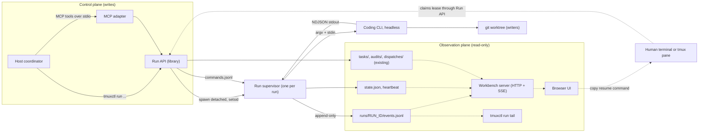
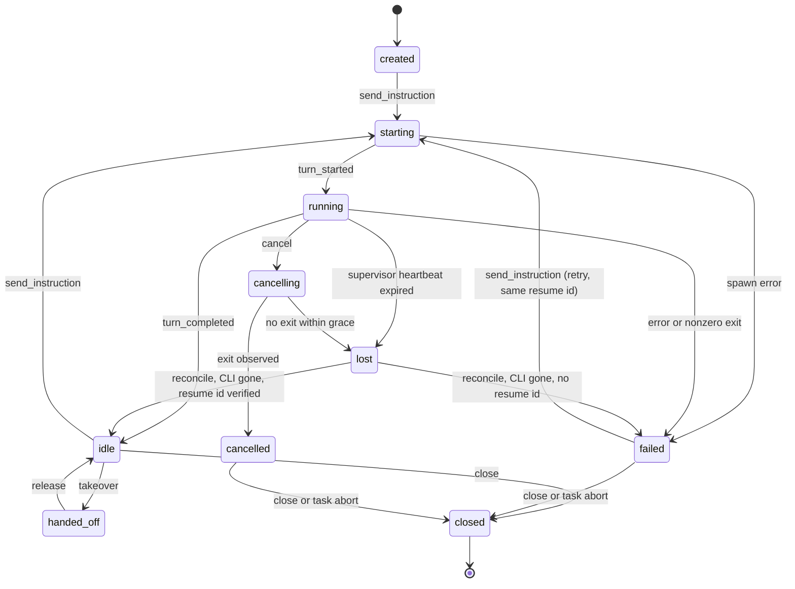
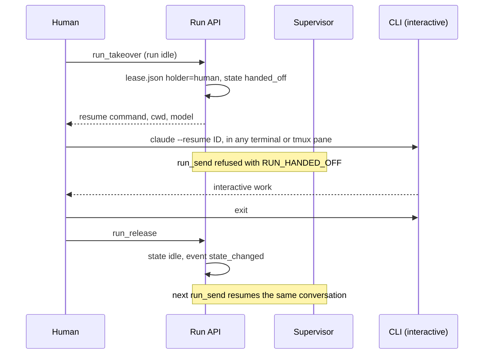

# CLI gateway and visualization workbench proposal

Status: proposal, 2026-11-13. Evaluation and design only. Nothing described
here is implemented; the runner still drives interactive CLIs through tmux.
No runtime code or test was changed to produce this document.

- **Dispatch**: `cli-gateway-eval-20261113-g1-9c494f45-C01-12df1d70`
- **Baseline commit**: `e1613de`, runtime version `0.4.1`
- **Inputs**: [2026-11-12 postmortem](../incidents/2026-11-12-viewer-isolation-agy-handoff.md),
  [2026-11-13 diagnosis](../incidents/2026-11-13-viewer-isolation-diagnosis-and-orchestration-plan.md),
  `runtime/goals_tmux/`, `references/`, and local `--help` output of the
  installed CLIs
- **Verification host**: macOS (Darwin 27.0.0), tmux 3.6a, Python 3.12.10

All `path:line` references are against the baseline commit and are relative to
`runtime/goals_tmux/` unless a longer path is given.

## 1. Summary and recommendation

**Decision.** Stop using keystroke injection and screen scraping as the
machine control path. Adopt **option 6, built in a strict order**: a headless
runner core first, an MCP adapter second, and a read-only HTTP/SSE workbench
third.

**What "gateway" means here.** The recommended gateway is a library plus one
detached supervisor process per run. It is **not** an always-on shared daemon,
and it does **not** expose a mutating HTTP API in its first releases. The
evidence does not justify a daemon today (section 4.3).

**Why.**

1. Every incident failure mode in section 3 sits in the presentation layer
   (viewer, TTY, AppleScript) or in bookkeeping created to defend that layer.
   None is in model execution. Patching the viewer keeps the coupling.
2. A new finding makes the current gate worse than the incident documents
   state. On tmux 3.6a, `display-message -p -c <tty>` without `-t` does not
   report the session of the client on that TTY. It reports the most recently
   active session on the server (section 3.5). With two or more attached
   sessions on one server, the visibility check is wrong for every viewer
   except the most recently active one.
3. The three CLIs installed on the verification host (`claude`, `agent`,
   `kiro-cli`) all document a headless mode with a JSON Lines stream and an
   exact resume identifier (section 6.5). Process exit plus a terminal event
   gives a deterministic turn boundary that a TUI cannot give.
4. Task, audit, dispatch, idempotent request, and policy records are sound and
   are reused unchanged (section 6.7).

**What is preserved from tmux.**

- On-demand interactive takeover by resume identifier, in a tmux pane or any
  terminal (section 7.5).
- The existing tmux runtime as a selectable backend for CLIs or features
  without a verified headless path, with the GUI check downgraded to advisory.
- The private decision-file dispatch protocol, unchanged.

**What is removed.** GUI visibility as a precondition for input. No state of
any window, tab, viewer process, or workbench may gate execution.

**Limits of this evaluation.** No model call was made, per the task
constraints. `codex` and `agy` are not installed on the verification host
(`doctor --cli-check` reports `available: false` for both), so their rows in
section 6.5 are unverified and carried from the 2026-11-13 diagnosis. Stream
payload shapes for all CLIs are unverified until the Phase 0 probe.

## 2. Scope and constraints

Kept from the current design: local execution, Python 3.12+ standard library
only (`runtime/pyproject.toml` declares `dependencies = []`), private state
under `${XDG_STATE_HOME:-~/.local/state}/goals-tmux-skill/`, one writing
coordinator per task generation, and no model calls for readiness checks.

Out of scope: SSH endpoints (`remote.py`), workflow YAML resolution
([workflow-config.md](workflow-config.md)), and multi-host scheduling.

## 3. Failure modes, verified against code

Each subsection states the claim, the code evidence, and whether the claim in
the incident documents was confirmed, corrected, or not reproduced.

### 3.1 GUI-state execution gate — confirmed

`Service._execute` calls `_require_tui_for_input` before `send_text`
(`service.py:455`), `send_keys` (`service.py:466`), and `dispatch` /
`submit_dispatch` (`service.py:490`). An unregistered pane with TUI enabled is
refused with `MANAGED_PANE_REQUIRED` (`service.py:1215-1232`).

`_require_tui_for_input` (`service.py:1124-1213`) passes only if all of the
following hold at once:

| Required state | Evidence |
| --- | --- |
| Pane capture succeeded | `service.py:1132-1138` |
| Viewer record `attached` with a GUI session ID and `verified` evidence | `service.py:1162-1164`, `1189-1192` |
| Private owner receipt and registry entry agree | `viewer.py:701`, `viewer.py:1015-1028` |
| tmux client matches `(pid, session, readonly, control_mode)` and TTY | `viewer.py:759-771` |
| Client's current view is the target session and window, not hidden by zoom | `viewer.py:822-871` |
| iTerm2 window visible, not minimized, tab selected, exactly one session in the tab | `viewer.py:906-961` |
| Nothing changed during the AppleScript round trip | `viewer.py:963-1013` (for example `tmux_view_changed_during_check`, `viewer.py:994`) |

Each `osascript` call may take up to 8 seconds (`viewer.py:1987-1999`). The
gate allows exactly one `show_tui` remediation (`service.py:1165-1181`), then
fails with `TUI_REQUIRED`.

Two viewer configurations can never pass. Native iTerm2 mode always returns
`native_mapped_visibility_unverified` (`viewer.py:784-788`), and any terminal
other than iTerm2 returns `gui_visibility_unavailable_for_terminal_app`
(`viewer.py:789-793`).

The only bypass is explicit headless mode (`service.py:1139-1143`), which
`SKILL.md` forbids as a fallback. A task that the user already authorized to
run unattended in `permission_mode=bypass` is therefore still blocked by a
minimized window.

### 3.2 Three viewer ledgers, not two — confirmed and extended

The incident documents describe a dual ledger. The code keeps three records
per viewer:

| Ledger | Path | Key | Writer |
| --- | --- | --- | --- |
| Session slot | `viewers/<sha256>.json` | socket, session ID, server instance (`viewer.py:1594-1599`) | `Viewer._write_registry`, overwritten on each open |
| Owner receipt | `viewers/owner-<token>.json` | viewer token (`viewer.py:1601-1608`) | `Viewer._write_entry` (`viewer.py:1610-1624`) |
| Service receipt | `viewer-receipts/<uuid>.json` | random UUID per `show_tui` call (`service.py:1247-1251`) | `Service._show_viewer` |

`hide_tui` loads the service receipt and passes its embedded copy of the
viewer record to `Viewer.hide` (`service.py:543-553`). `hide` rejects the
call when that copy no longer equals the session slot, or when the slot is
not `attached` (`viewer.py:1067-1068`, `1084-1085`). `Viewer.open` in turn
refuses to launch a replacement while the slot is uncertain
(`existing_viewer_client_check_failed_no_retry`, `viewer.py:490`;
`existing_viewer_verification_failed_no_retry`, `viewer.py:522`;
`prior_viewer_launch_outcome_uncertain_no_retry`, `viewer.py:2087`).

The result is the dead end seen in the incident: the stale viewer cannot be
hidden and a new one cannot be opened.

The 2026-11-13 diagnosis is right that `reused_existing_viewer`
(`viewer.py:500-513`) is scoped to one exact session and did not cause
cross-session TTY sharing.

### 3.3 `FINALIZATION_REQUIRED` versus `COORDINATOR_SETTLED` — confirmed, with one qualification

A task has three phases and no others (`registry.py:24`,
`coordination.py:376-388`). The task command group has no abort action
(`cli.py:65-76`).

- While `active`, `_close_plan` refuses to close owned resources with
  `FINALIZATION_REQUIRED` (`service.py:1335-1338`).
- After acceptance, no business dispatch is allowed (`service.py:285-286`,
  `coordination.py:714-715`).
- Once a record is `settled`, every guarded mutation fails with
  `COORDINATOR_SETTLED` (`registry.py:400-401`).
- Viewer cleanup itself requires `finalizing` or `settled`
  (`service.py:365-366`).

Qualification: `force` skips the finalization check (`service.py:1335`), but
needs the `allow_interrupt` grant (`service.py:242-243`) and a reason. It is
an interrupt path, not a lifecycle transition, and it does not help a record
that is already settled.

The coordinator's only clean way to reclaim a stuck session is to record a
synthetic acceptance, which is what happened to `workflow-resolver-20261112`.

### 3.4 `METADATA_TOO_LARGE` at settlement — confirmed

`task settle` passes the whole resource report inline
(`cli.py:208-209`). `TaskStore.settle` rejects any report above 16 KiB before
doing anything else (`coordination.py:26`, `coordination.py:1032`), and the
event writer enforces the same limit (`coordination.py:600`).

The report carries one entry per distinct viewer token
(`service.py:340-355`). A pending viewer appears four times: in `viewers`,
`pending_viewers`, `outstanding`, and `unsettled` (`service.py:309-327`).
Each failed viewer retry that produced a new token therefore adds up to four
copies, so the tasks that struggled most are the least able to settle.

### 3.5 TTY selector in `verify_visible` — corrected; the defect is broader

`verify_visible` reads the viewer's current view with
`display-message -p -c <expected_tty> <format>` and no `-t`
(`viewer.py:820-823`), then fails with `viewer_client_session_changed` when
the returned session differs (`viewer.py:849-850`).

The 2026-11-13 diagnosis attributes wrong answers to several clients sharing
one TTY. A probe on a private scratch socket shows the query is wrong even
when every client has its own TTY:

```text
clients:  pid 7885 /dev/ttys004 -> A      pid 8309 /dev/ttys005 -> B
display-message -p -c /dev/ttys004  ->  session B, client pid 8309
display-message -p -c /dev/ttys005  ->  session B, client pid 8309
```

After a Control Mode client attached to a third session `C`, both queries
returned `C`. After `switch-client` moved the second client to `A`, its query
returned `A`.

Observed behavior on tmux 3.6a: without `-t`, the format context comes from
the server's most recently active session and its best client. The `-c`
argument does not select it. Consequences:

- With one attached session the check happens to be right. With two or more
  it fails for every viewer except the most recently active one. This matches
  the incident, where single tasks worked and parallel tasks did not.
- Any new client attach changes the answer, including the runner's own
  `watch` client (section 3.6).

This is one host and one tmux version. Phase 0 must confirm it against the
real runner and at least one other tmux version before any patch relies on
it. The reproduction is in appendix A.

Session switching on a shared client remains a second, independent trigger.
New sessions enable `mouse on` (`service.py:727`), so a status-bar click can
switch an attached client.

### 3.6 Control Mode collector without `setsid` — partly confirmed

`watch` starts `tmux -C attach-session` with piped stdio and without
`start_new_session=True` (`collector.py:445-462`).

- **Confirmed**: the child stays in the caller's session and process group.
  The probe reported the same session ID and process group ID as the parent.
  A terminal hangup or interrupt aimed at the host can therefore kill an
  observer mid-read.
- **Not reproduced**: the claim that this client shares the host's TTY in
  tmux's client list. With piped stdin the client registered with an empty
  `client_tty` and the name `client-<pid>`. It cannot collide on a TTY path.
- **New**: the collector's attach makes its session the most recently active
  one, which flips the answer of the query in section 3.5 for every other
  viewer. Observation therefore perturbs the gate.

The clients seen sharing `/dev/ttys001` in the incident were more likely
`tmux -CC` gateways started from that terminal. The probe confirms that a
Control Mode client started with a TTY on stdin does register that TTY.

### 3.7 Nested subagent lifetime — confirmed from incident evidence, no runtime mitigation

This failure is not in runner code. Pane `%38` exited with status 0 right
after `agy` started four implementation subagents, and all of them died with
it (postmortem section 5.3, diagnosis section 1.4).

What the code shows is the absence of any defence. The runner is a
short-lived command with no supervisor: it reports
`"monitoring": "finite inline watch; no automatic host wakeup"`
(`cli.py:226`), and one `watch` is capped at 300 seconds
(`collector.py:30`). Nothing observes process exit as an event, bounds
fan-out, or checkpoints work. An interactive TUI can also exit while
background work is in flight, because its lifetime follows its event loop
rather than its turn.

### 3.8 Related findings

- **Copy mode blocks input.** `PANE_IN_MODE` (`input.py:69-70`) fires when a
  human scrolls the pane. Human observation and machine input share one
  channel.
- **Input is a keystroke payload.** Text is limited to 16384 bytes with no
  line breaks (`input.py:88-91`) and sent with `send-keys -l`
  (`input.py:96`). The decision-file protocol exists to work around this.
- **Headless flags are blocked today.** `launch_cli.extra_args` rejects
  `--print`, `-p`, `--no-interactive`, and `--output-format`
  (`cli_adapters.py:177-204`, `206-219`). The current adapter layer cannot
  express a headless launch.
- **Not found in code**: the "five session" cap from the postmortem. No such
  limit exists under `runtime/goals_tmux/`. It is likely a workflow rule or
  tmux configuration and should be confirmed by the user.

## 4. Option space and decision

### 4.1 Options

1. **Status quo plus postmortem Phase A/B.** Window policy, TTY exclusivity,
   `superseded` recovery, `doctor --viewers`.
2. **tmux isolation plus advisory TUI.** One socket and state directory per
   task; the GUI check reports but never blocks.
3. **Headless subprocess runner.** Spawn the CLI in its structured mode and
   append normalized events to a JSONL log. No daemon.
4. **Gateway daemon.** A long-lived local service (HTTP or JSON-RPC) that
   owns all processes and streams typed events over SSE or WebSocket.
5. **MCP server as the control plane.** Orchestration operations exposed
   directly as MCP tools, optionally with HTTP behind them.
6. **Hybrid.** Option 3 as the core, an MCP adapter over the same library,
   and an optional read-only HTTP/SSE workbench.

### 4.2 Decision matrix

Scores run from 1 (poor) to 5 (strong). Cost rows are scored so that 5 means
cheap. Scores are judgments from the evidence in section 3, not measurements.

| Criterion | 1 Patches | 2 Isolation | 3 Runner | 4 Daemon | 5 MCP only | 6 Hybrid |
| --- | --- | --- | --- | --- | --- | --- |
| Reliability under parallel tasks | 2 | 3 | 5 | 4 | 4 | 5 |
| Deterministic turn boundaries | 1 | 1 | 5 | 5 | 5 | 5 |
| Observability | 2 | 2 | 4 | 5 | 3 | 5 |
| Human takeover | 5 | 5 | 3 | 3 | 3 | 4 |
| Security and permission model | 3 | 3 | 4 | 3 | 3 | 4 |
| Latency | 3 | 3 | 4 | 5 | 4 | 4 |
| Install and operations cost | 4 | 4 | 5 | 2 | 3 | 4 |
| Migration cost | 5 | 4 | 3 | 2 | 2 | 3 |
| Compatibility with task, audit, registry records | 5 | 5 | 4 | 3 | 3 | 4 |
| **Total** | **30** | **30** | **37** | **32** | **30** | **38** |

Notes on the scores that decide the outcome:

- **Options 1 and 2 cannot fix turn boundaries.** A TUI emits no completion
  signal, so the coordinator keeps polling screens. Option 1 also keeps the
  hard gate and leaves section 3.5 in place.
- **Option 2 is still worth doing** as the stabilization of the tmux backend
  that remains. It removes cross-task blast radius cheaply.
- **Option 4 buys latency and push delivery** at the price of a daemon
  lifecycle: install, upgrade, crash recovery, a listening socket, and a new
  single point of failure. Turns last minutes, so saving a process start per
  turn is not material.
- **Option 5 alone couples run lifetime to an MCP server process** that the
  host client starts and stops. A host restart would orphan or kill runs
  unless a runner core exists underneath, which is option 6.
- **Option 6 costs one point of operations over option 3** and gains host
  integration and observability. Its parts are separable, so each phase can
  stop without stranding the previous one.

### 4.3 Why not a daemon now

A daemon is justified by needs that are absent today:

| Need | Present today? |
| --- | --- |
| Several machines or remote clients controlling one run | No. Local only. |
| Several coordinators writing to one run | No. One writer per generation is an existing rule. |
| Sub-second control latency | No. Turns take minutes. |
| Push wake-up of an idle host agent | Wanted, but a daemon cannot wake a host that is not listening. MCP notifications or a blocking `wait` call solve the same problem without one. |

Per-run supervisors give process ownership and crash isolation without a
shared service. If the first two rows change, option 4 becomes right, and the
event log and request schemas in section 6 are designed to sit behind it
unchanged.

## 5. Target architecture



Three rules define the architecture:

1. **One writer per file.** Only the supervisor appends to `events.jsonl`.
   Only the Run API appends to `commands.jsonl`.
2. **No arrow points from the observation plane into the supervisor.** The
   supervisor never reads workbench or viewer state.
3. **Files are the interface.** The MCP adapter, the command line, and any
   future daemon are thin clients of the same library and the same files.

### 5.1 Turn execution model

The default is **one CLI process per turn**. `send instruction` starts the
CLI with the instruction and the run's resume identifier, and the process
exits when the turn ends. The turn boundary is the terminal stream event
confirmed by process exit.

A persistent streaming-input session (for example Claude Code's
`--input-format stream-json`, or `kiro-cli acp`) is a later optimization for
mid-turn steering. It is not needed for the dispatch protocol, which sends
one instruction and waits.

Reasons for the default:

- It works the same way for every adapter that has a headless mode.
- No idle process exists between turns, so nothing can be lost while waiting.
- A crash is one failed turn with a known resume identifier.
- The process lifetime follows the turn, which addresses section 3.7 for the
  parent. Whether each CLI waits for background subagents in headless mode is
  an open question (section 10).

### 5.2 State layout

```text
<state-dir>/
  tasks/ audits/ dispatches/        existing, unchanged
  operations/                       existing idempotent request journal
  runs/<run_id>/
    run.json                        immutable creation record
    state.json                      current state, atomically replaced
    events.jsonl                    normalized events, append-only
    raw.jsonl                       adapter output after redaction, append-only
    commands.jsonl                  control inbox, append-only
    supervisor.json                 pid, process start time, heartbeat
    lease.json                      writer lease (runner or human)
  runs/index.jsonl                  run_id, task_id, cli, created_at
```

All files use the existing private-file helpers (`storage.py:67`,
`storage.py:192`, `storage.py:246`): mode 0600, no symlinks, atomic replace
for snapshots.

## 6. Contracts

### 6.1 Run lifecycle



| State | Meaning | CLI process |
| --- | --- | --- |
| `created` | Recorded; nothing started | None |
| `starting` | Supervisor spawned; no stream event yet | Starting |
| `running` | A turn is active | Alive |
| `idle` | Last turn completed; resume identifier known | None |
| `handed_off` | A human holds the lease | Human-owned |
| `cancelling` | Stop requested | Being terminated |
| `cancelled` | Stop confirmed | None |
| `failed` | Turn ended in error | None |
| `lost` | Supervisor identity or heartbeat cannot be confirmed | Unknown |
| `closed` | Terminal; no further writes | None |

Rules:

- `send_instruction` is legal only from `created`, `idle`, and `failed`.
  Anything else is refused with `RUN_BUSY`, `RUN_HANDED_OFF`, or
  `RUN_CLOSED`.
- `cancel` is legal in `starting` and `running`. It sends SIGTERM to the
  CLI's process group, waits a grace period (default 10 seconds), then sends
  SIGKILL. It is idempotent.
- `lost` is never resolved by guessing. `reconcile` checks the recorded pid
  and process start time, the same identity test the viewer already uses
  (`viewer.py:1763`). A live CLI without a supervisor stays `lost` until it
  exits or the user authorizes a kill.
- `close` and `task abort` are legal from any state without a live process.
  This is the escape hatch missing in section 3.3.

**Task phases.** Add `aborted` as a terminal task phase reachable from
`active`. `task abort --reason` cancels live runs, closes them, and records
`task_aborted`. It does not claim acceptance. Runs of an aborted or settled
task remain closable, because run cleanup is keyed by run state, not by
coordinator phase.

**Crash recovery.**

| Failure | Detection | Result |
| --- | --- | --- |
| CLI crashes | Exit code and missing terminal event | `error` then `exit`; state `failed` |
| Supervisor crashes | Heartbeat older than three intervals, or pid and start time mismatch | `lost`; `reconcile` decides |
| Host reboots | Same as supervisor crash | `lost`, then `idle` or `failed` |
| Torn last line in a JSONL file | Final line lacks a newline or fails to parse | Reader ignores it; next supervisor truncates it before appending |
| Coordinator loses a response | Same `request_id` replayed | Stored result returned, no second effect |

### 6.2 Request and response envelope

Requests reuse the current envelope (`contract.py:99-143`) with new
operations. Responses reuse `contract.result` (`contract.py:149-152`) and its
`status`, `code`, and `side_effects` semantics. `schema_version` stays `1`
because the change is additive.

```json
{
  "schema_version": 1,
  "request_id": "run-create-20261113-a1",
  "operation": "run_create",
  "arguments": {},
  "task_context": {"task_id": "T", "coordinator_id": "C", "generation": 1}
}
```

| Operation | Required arguments | Effect | Key refusals |
| --- | --- | --- | --- |
| `run_create` | `cli`, `cwd` | Writes `run.json`; state `created` | `TASK_CONTEXT_REQUIRED`, `BYPASS_NOT_AUTHORIZED`, `ADAPTER_UNAVAILABLE` |
| `run_send` | `run_id`, and `dispatch_id` or `text` | Starts one turn | `RUN_BUSY`, `RUN_HANDED_OFF`, `TASK_FINALIZING` |
| `run_cancel` | `run_id`, `reason` | Stops the active turn | `RUN_NOT_ACTIVE` |
| `run_state` | `run_id` | Reads `state.json` | none |
| `run_events` | `run_id` | Reads events after a cursor | none |
| `run_wait` | `run_id`, `until` | Blocks until a state or the timeout | none |
| `run_takeover` | `run_id`, `holder` | Moves `idle` to `handed_off` | `RUN_BUSY` |
| `run_release` | `run_id` | Moves `handed_off` to `idle` | `LEASE_NOT_HELD` |
| `run_close` | `run_id` | Moves to `closed` | `RUN_ACTIVE` |

Accept and settle stay task-level commands. `task accept` is unchanged.
`task settle` changes in one way: the full resource report is written to
`audits/<task_id>/settlement-report.json`, and the event stores only its
path, SHA-256, and counts. This fixes section 3.4 for both backends.

**Create run.**

```json
{
  "$schema": "https://json-schema.org/draft/2020-12/schema",
  "title": "run_create arguments",
  "type": "object",
  "additionalProperties": false,
  "required": ["cli", "cwd"],
  "properties": {
    "cli": {"enum": ["claude", "cursor", "codex", "agy", "kiro"]},
    "cwd": {"type": "string", "pattern": "^/"},
    "model": {"type": "string", "maxLength": 128},
    "effort": {"type": "string", "maxLength": 32},
    "permission_mode": {"enum": ["default", "bypass"], "default": "default"},
    "bypass_authorization": {
      "type": "object",
      "additionalProperties": false,
      "required": ["source", "scope"],
      "properties": {
        "source": {"type": "string", "maxLength": 1024},
        "scope": {"const": "task"}
      }
    },
    "allowed_tools": {"type": "array", "items": {"type": "string"}, "maxItems": 64},
    "worktree": {
      "type": "object",
      "additionalProperties": false,
      "properties": {
        "mode": {"enum": ["none", "create"], "default": "none"},
        "branch": {"type": "string", "maxLength": 200}
      }
    },
    "limits": {
      "type": "object",
      "additionalProperties": false,
      "properties": {
        "turn_timeout_seconds": {"type": "integer", "minimum": 30, "maximum": 86400},
        "max_log_bytes": {"type": "integer", "minimum": 1048576}
      }
    },
    "resume_id": {"type": "string", "pattern": "^[A-Za-z0-9][A-Za-z0-9._:-]{0,255}$"}
  }
}
```

`permission_mode: "bypass"` without `bypass_authorization` is refused before
anything is written. `resume_id` adopts an existing conversation and uses the
same pattern as the current validator (`cli_adapters.py:304-307`).

Response data:

```json
{"run_id": "run-01JCQ8...", "state": "created", "cli": "claude",
 "resume_id": "7b0e...", "resume_id_source": "preassigned",
 "events_path": "/abs/state/runs/run-01JCQ8.../events.jsonl", "last_seq": 0}
```

**Send instruction.**

```json
{"run_id": "run-01JCQ8...", "dispatch_id": "T-g1-9c494f45-C01-12df1d70"}
```

With `dispatch_id`, the prompt is the same one-line decision-file instruction
the runner generates today, passed as an argument instead of typed. With
`text`, the limit is 16384 bytes. Response:

```json
{"run_id": "run-01JCQ8...", "turn_id": "t0003", "state": "starting",
 "supervisor": {"pid": 4242, "started_at": "2026-11-13T05:48:22Z"},
 "after_seq": 117}
```

**Cancel.** `{"run_id": "...", "reason": "user cancelled"}` returns
`{"state": "cancelling"}`. A later `run_state` reports `cancelled` or `lost`.

**Query state.**

```json
{"run_id": "run-01JCQ8...", "task_id": "T", "state": "running",
 "turn_id": "t0003", "resume_id": "7b0e...", "last_seq": 164,
 "last_event_at": "2026-11-13T05:49:10Z", "heartbeat_at": "2026-11-13T05:49:12Z",
 "lease": {"holder": "runner"}, "exit": null,
 "counts": {"turns": 3, "tool_calls": 21, "errors": 0}}
```

**Read events.** `{"run_id": "...", "after_seq": 117, "limit": 500}` returns
`{"events": [...], "last_seq": 164, "more": false}`.

**Wait.** `{"run_id": "...", "until": ["idle", "failed", "cancelled", "lost"],
"timeout_seconds": 300}` blocks on the event log and returns the state. It
replaces repeated `watch` plus `read_screen` polling with one call that ends
at the turn boundary.

### 6.3 Event schema

```json
{
  "$schema": "https://json-schema.org/draft/2020-12/schema",
  "title": "run event",
  "type": "object",
  "additionalProperties": false,
  "required": ["v", "seq", "event_id", "run_id", "task_id", "ts", "type", "source", "payload"],
  "properties": {
    "v": {"const": 1},
    "seq": {"type": "integer", "minimum": 1},
    "event_id": {"type": "string", "pattern": "^run-[A-Za-z0-9]+:[0-9]+$"},
    "run_id": {"type": "string"},
    "task_id": {"type": "string"},
    "turn_id": {"type": ["string", "null"]},
    "ts": {"type": "string", "format": "date-time"},
    "type": {"enum": ["turn_started", "message_delta", "message", "tool_call",
                      "tool_result", "turn_completed", "error", "exit",
                      "state_changed", "heartbeat", "adapter_unknown"]},
    "source": {"enum": ["adapter", "supervisor"]},
    "payload": {"type": "object"},
    "raw_seq": {"type": ["integer", "null"]},
    "redactions": {"type": "integer", "minimum": 0}
  }
}
```

| Type | Payload fields | Emitted when |
| --- | --- | --- |
| `turn_started` | `dispatch_id`, `resume_id`, `model`, `argv_digest` | First adapter line, or spawn confirmed |
| `message_delta` | `message_id`, `text` | Partial assistant text, if the CLI streams it |
| `message` | `message_id`, `role`, `text` | A complete assistant message |
| `tool_call` | `call_id`, `tool`, `input_summary`, `paths`, `parent_call_id` | The CLI requests a tool |
| `tool_result` | `call_id`, `ok`, `output_summary`, `diff_stat`, `bytes` | A tool returns |
| `turn_completed` | `result`, `stop_reason`, `usage`, `duration_ms`, `resume_id` | The CLI's terminal event |
| `error` | `code`, `message`, `retryable`, `phase` | Adapter error, parse failure, timeout |
| `exit` | `exit_code`, `signal`, `expected` | The CLI process exited |
| `state_changed` | `from`, `to`, `reason`, `request_id` | Any lifecycle transition |
| `heartbeat` | `pid`, `rss_bytes`, `last_adapter_seq` | Every 15 seconds while running |
| `adapter_unknown` | `kind` | An unmapped adapter line; raw kept in `raw.jsonl` |

Guarantees:

- **Ordering.** `seq` is assigned by the single supervisor, starts at 1, and
  has no gaps within a run. Order is total per run and undefined across runs;
  the workbench merges runs by `ts`.
- **Durability.** One line is one `write` on an `O_APPEND` descriptor.
  The supervisor calls `fsync` after `turn_started`, `turn_completed`,
  `error`, `exit`, and `state_changed`, and at least every second otherwise.
- **Delivery.** At least once. Consumers keep a cursor and may see an event
  again after a reconnect. `event_id` is the deduplication key.
- **Turn boundary.** A turn is complete only when `turn_completed` or `error`
  is followed by `exit`. An `exit` without a terminal event is a failure.
- **Truncation.** Tool inputs and outputs are summarized to a bounded size
  (default 4 KiB) in `events.jsonl`. Full text stays in `raw.jsonl`.
- **Versioning.** `v` is the major version. Within a major version changes
  are additive: new types and new payload fields. Consumers must ignore
  unknown types and fields. A breaking change writes to a new file name
  (`events.v2.jsonl`), so an old reader never misparses a new log.

### 6.4 Durability and idempotency

- **Request identifiers.** Every mutating operation goes through the existing
  operation journal (`operation_store.py:325`, `384`, `417`). A replayed
  `request_id` with identical content returns the stored result. Different
  content is `REQUEST_ID_CONFLICT`.
- **Command inbox.** Each `commands.jsonl` line carries the `request_id`. The
  supervisor records the last applied command in `state.json` and skips
  duplicates.
- **Replay.** `state.json` is a cache. It can be rebuilt by folding
  `events.jsonl` from `seq` 1, which is also the recovery test.
- **Resume.** The resume identifier is recorded at the earliest reliable
  point: preassigned at create where the CLI allows it, otherwise from the
  first stream event that carries it. Until then a crash yields `failed`
  without a resume path, and the report says so.
- **Retention.** Default 30 days after task settlement, or a per-run byte
  cap. A capped log stops recording `message_delta` first and records an
  `error` with code `LOG_CAP_REACHED`.

### 6.5 CLI adapter mapping

Verified means the flag appears in local `--help` output on the verification
host on 2026-11-12. No model call was made, so payload shapes are unverified
everywhere.

| | `claude` | `cursor` | `kiro` | `codex` | `agy` |
| --- | --- | --- | --- | --- | --- |
| Binary and version | `claude` 2.1.311 | `agent` 2026.04.08 | `kiro-cli` 2.34.0 | not installed | not installed |
| Headless flag | `-p` / `--print` | `-p` / `--print` | `chat --no-interactive` | `exec` (unverified) | `-p` (unverified) |
| Structured output | `--output-format stream-json` | `--output-format stream-json` | `--output-format stream-json` (ACP events as JSON Lines; implies `--no-interactive`) | `--json` (unverified) | `--output-format stream-json` (unverified) |
| Partial text | `--include-partial-messages` | `--stream-partial-output` | not documented | unverified | unverified |
| Streaming input | `--input-format stream-json` | not documented | `kiro-cli acp` | unverified | unverified |
| Resume | `--resume <id>` | `--resume [chatId]` | `--resume-id <SESSION_ID>` | `exec resume <id>` (unverified) | `--conversation=<id>` (unverified) |
| Preassigned ID | `--session-id <uuid>` | `agent create-chat` prints an ID | none found | unverified | unverified |
| Bypass flag | `--dangerously-skip-permissions`, or `--permission-mode bypassPermissions` | `--force` | `--trust-all-tools` | `--dangerously-bypass-approvals-and-sandbox` | `--dangerously-skip-permissions` |
| Scoped permissions | `--allowed-tools`, `--permission-mode`, `--permission-prompts none` | `--mode plan\|ask`, `--sandbox` | `--trust-tools <names>` | unverified | unverified |
| Workspace trust | skipped in print mode, per help text | `--trust` (headless only) | `--trust-workspace` (V3 only) | unverified | unverified |
| Native worktree | not used | `-w` / `--worktree` | none | unverified | unverified |

Bypass flags come from the current adapter table (`cli_adapters.py:27-82`).

Known gaps and risks per adapter:

- **claude.** The help text does not say whether `stream-json` output also
  needs `--verbose`; the 2026-11-13 diagnosis lists it. The probe must
  settle this. `--bg` with `claude attach`, `logs`, and `stop` is a native
  background mode that may simplify takeover later; it is not used in the
  first design because it is specific to one CLI.
- **cursor.** Help states that print mode "has access to all tools, including
  write and shell". Default-mode behavior for unapproved commands in headless
  runs must be probed before `permission_mode: default` is offered.
- **kiro.** The repository's recovery notes were checked against 3.1.0
  (`references/cli-adapters.md`), while the installed binary is 2.34.0.
  The adapter must gate on the installed help, as the reference already
  requires. Engine selection (`--agent-engine`) may change the stream.
- **codex, agy.** Nothing verified. These adapters stay on the tmux backend
  until a host with the binaries completes the probe.
- **All.** In default permission mode a headless CLI has nobody to answer an
  approval prompt. The adapter must map this to a visible `error` with code
  `PERMISSION_REQUIRED`, never to a silent hang. The turn timeout is the
  backstop.

The adapter change requires relaxing the protected-flag list for runner-built
argv only. Caller-supplied `extra_args` keep the current restrictions
(`cli_adapters.py:177-219`).

### 6.6 Security

| Concern | Rule |
| --- | --- |
| Network exposure | The control plane has no listener. It is files plus a detached process. The MCP adapter uses stdio. |
| Workbench bind | `127.0.0.1` only, random port, never `0.0.0.0`. Requests with an unexpected `Host` or `Origin` header are rejected, which blocks DNS rebinding. |
| Workbench auth | A random 256-bit token in a 0600 file, sent as a bearer header. The start command prints a one-time URL that exchanges it for an `HttpOnly`, `SameSite=Strict` cookie. |
| Workbench verbs | `GET` only. No route mutates state. |
| Future control HTTP | If option 4 is adopted later: a Unix domain socket with mode 0600 first, TCP only with per-task tokens. |
| Per-task scope | The existing policy store gains `allow_run` and `allow_run_cancel` grants next to the current ones (`policy.py:144-199`). A run belongs to one task; cross-task `run_send` is refused the way cross-task pane writes are today (`registry.py:391-398`). |
| Bypass mode | Off by default. Needs `bypass_authorization` with the user's own authorization text. Recorded in `run.json`, in `turn_started`, and in the audit event. The workbench marks bypass runs. Never inferred, never global. |
| Child environment | The supervisor passes an allowlisted environment. `TMUX` and `TMUX_PANE` are removed, as today (`collector.py:41-45`). |
| Secret redaction | Applied before any line reaches disk: known token shapes, `Authorization` headers, URL credentials, and values of environment names matching `*_TOKEN`, `*_KEY`, `*_SECRET`. Each event counts its redactions. `raw.jsonl` is redacted too. |
| Untrusted content | Event text is data. Neither the coordinator nor the workbench executes it. The UI renders it as text and never as HTML. |
| Audit parity | Each run operation appends a task event with the same identifiers as today: task, coordinator, generation, dispatch ID, CLI round, plus `run_id`, `turn_id`, and the `seq` range. Dispatch files stay immutable with their digest. |

### 6.7 Compatibility with existing records

| Existing concept | Under the headless backend |
| --- | --- |
| Task record, audit index, daily logs | Unchanged |
| Dispatch file and dispatch ID | Unchanged; delivered as an argument |
| Dispatch status `prepared` | Unchanged |
| Dispatch status `submitted` | Recorded when the supervisor confirms the spawn |
| Dispatch status `observed` | Recorded automatically from `turn_started`, with the event ID as evidence |
| `input_verified` step | Not needed; no typed input exists to verify |
| Pane registry record | Not used. Its ID is derived from socket, server, and pane (`registry.py:101-103`), so runs get their own ledger instead of fake panes |
| `resource_report` | Gains a `runs` section; settled means every run is `closed` |
| `operation-status` | Unchanged; covers run operations |
| Recovery evidence | Simpler: the resume identifier comes from the stream, not from transcript inspection |
| Viewer receipts | Not created |

## 7. Visualization workbench

### 7.1 Zero-gate principle

The workbench is a reader of files that already exist for other reasons. It
can be closed, minimized, backgrounded, crashed, or never started, and no run
can observe the difference.

Enforced by construction:

1. The workbench opens state files read-only and holds no locks on them.
2. The supervisor and the Run API contain no code that reads workbench
   state, and the `runs` package must not import the `workbench` package.
   A test asserts the import graph.
3. The workbench has no mutating route. A test enumerates the routes.
4. Takeover is a command the human runs through the Run API. The UI only
   displays it.

### 7.2 Data sources

| Data | Source | Refresh |
| --- | --- | --- |
| Task list, phase, acceptance criteria | `tasks/`, audit events | On change |
| Dispatches and their status | `dispatches/`, audit events | On change |
| Run state, turn, lease, exit | `runs/<id>/state.json` | On change |
| Timeline | `runs/<id>/events.jsonl` | Tail |
| Liveness | `heartbeat` events, `supervisor.json` | 15 seconds |
| Resource ownership | `resource_report` logic, read-only | On demand |
| Legacy tmux panes | Pane registry, read-only | On demand |
| Incidents | Derived from events and state (section 7.4) | Continuous |

### 7.3 Views

```text
+------------------+-----------------------------------------------+
| Tasks            | Run: claude  running  turn 3  heartbeat 4s    |
|  T1 active    2  | [bypass] worktree: task/T1-claude             |
|  T2 finalizing 1 +-----------------------------------------------+
|  T3 aborted   0  | Timeline                    filter: all v     |
+------------------+  05:48:22 turn_started  dispatch ...C01       |
| Runs in T1       |  05:48:25 message       "Reading the file..." |
|  claude  running |  05:48:31 tool_call     Read  docs/...        |
|  kiro    idle    |  05:48:31 tool_result   ok  3.1 KiB           |
+------------------+  05:49:02 tool_call     Edit  src/a.py  +12-3 |
| Incidents (1)    |  05:49:10 error         PERMISSION_REQUIRED   |
|  T2 run lost     +-----------------------------------------------+
+------------------+ Resources | Takeover | Raw | Audit            |
```

- **Task list.** Phase, run count, last activity, and unsettled resources.
- **Run timeline.** Assistant messages, tool calls paired with results, file
  edits with diff statistics and an expandable diff, errors inline. Nested
  tool calls indent by `parent_call_id`, which makes subagent fan-out
  visible.
- **Progress and heartbeat.** Current state, time in state, time since the
  last adapter event, turn count, and usage where the CLI reports it. A run
  with a live heartbeat and no adapter event for a configurable period shows
  as "quiet", distinct from "lost".
- **Resource ownership.** Runs, worktrees, branches, legacy panes, and
  viewers per task, with cleanup status. This is the settlement report
  before the user asks for it.
- **Takeover.** The exact commands from section 7.5, ready to copy.
- **Raw and audit.** Links to the redacted raw log and the audit index.

### 7.4 Incident surfacing

Derived rules, evaluated by the workbench and also available as
`tmuxctl run doctor --json` for coordinators:

| Incident | Rule |
| --- | --- |
| Run lost | State `lost`, or heartbeat older than three intervals while `running` |
| Unexpected exit | `exit` without a preceding terminal event, including exit code 0 |
| Permission stall | `error` with code `PERMISSION_REQUIRED` |
| Quiet turn | No adapter event for N minutes while `running` |
| Fan-out above limit | More concurrent open `tool_call` events of a subagent kind than the task allows |
| Worktree conflict | Two writing runs share a working directory |
| Unsettled resources | Task `finalizing` beyond a threshold with open runs |
| Log cap reached | `error` with code `LOG_CAP_REACHED` |

The second rule would have flagged the 2026-11-12 `agy` exit at the moment it
happened, as an event rather than a dead pane found by inspection.

### 7.5 Human takeover



Rules that keep the run intact:

- Takeover is legal only from `idle`. For a running turn the human first
  waits or cancels. Two processes never drive one conversation.
- The lease is the single-writer guard. The runner checks it before every
  spawn.
- For a look without taking the lease, the workbench shows a fork command
  where the CLI has one (`claude --resume <id> --fork-session`). A fork
  cannot corrupt the run.
- Work done during a handoff is not in `events.jsonl`. `run_release` records
  the gap and the Git state before and after, so the coordinator knows to
  re-read the result.
- The interactive session may live in a tmux pane created by the existing
  runtime. The GUI check there is advisory only.

### 7.6 Transport, retention, search, and auth

| Topic | Choice | Reason |
| --- | --- | --- |
| Live transport | Server-Sent Events | The stream is one-way. SSE has built-in reconnect with `Last-Event-ID`, which maps to `seq`, and needs only the standard library. |
| WebSocket | Not used | Two-way transport is unnecessary for a read-only UI and needs a handshake and framing implementation or a dependency. |
| Polling | Fallback | `GET /api/runs/<id>/events?after_seq=N` serves the same data for clients that cannot hold a stream. |
| Server | `http.server` with a thread per connection | Local, few clients, no dependency. |
| Front end | One static HTML file with inline script, no build step and no CDN | Works offline and keeps the supply chain empty. |
| Retention | Same as the run logs (section 6.4) | The workbench stores nothing. |
| Search | Linear scan of the selected task's logs, bounded by size | Logs are small and local. An index is deferred until needed. |
| Redaction | Done at write time by the supervisor | The workbench never sees unredacted data. |
| Auth | Section 6.6 | |

Routes: `GET /api/tasks`, `/api/tasks/<id>`, `/api/runs/<id>`,
`/api/runs/<id>/events`, `/api/runs/<id>/stream` (SSE), `/api/incidents`,
and `/` for the page.

A terminal alternative, `tmuxctl run tail --follow <run_id>`, formats the
same events for users who prefer a pane. It can run inside a tmux window with
no gate attached.

## 8. Migration and phasing

### 8.1 Package layout

```text
runtime/goals_tmux/
  runs/
    __init__.py
    model.py          states, transitions, event types
    store.py          JSONL append, cursor reads, fold to state
    supervisor.py     detached per-run process, heartbeat, signals
    control.py        commands.jsonl inbox, lease
    api.py            run_create, run_send, run_cancel, ...
    redact.py         secret redaction
    worktree.py       git worktree provisioning for writers
    adapters/
      base.py         argv builder and line-to-event mapping interface
      claude.py  cursor.py  kiro.py  codex.py  agy.py
  mcp_server.py       stdio JSON-RPC adapter over runs.api
  workbench/
    server.py         read-only HTTP and SSE
    static/index.html
  cli.py              adds `run ...`, `task abort`, `workbench serve`
  contract.py         adds run operations to SCHEMAS
  coordination.py     adds `aborted`, settlement report by reference
tests/
  fixtures/streams/<cli>/*.jsonl
  fake_cli.py         scripted NDJSON emitter, no network
  test_runs_store.py  test_runs_supervisor.py  test_runs_api.py
  test_adapters_golden.py  test_redact.py
  test_workbench_readonly.py  test_zero_gate.py  test_mcp_server.py
```

Existing modules (`service.py`, `viewer.py`, `collector.py`, `registry.py`)
are not restructured. The headless backend is additive.

### 8.2 Phases

| Phase | Deliverable | Acceptance gate | Rollback |
| --- | --- | --- | --- |
| 0. Evidence and stabilization | Authorized one-prompt probe per installed CLI, saved as fixtures. Fixes to the tmux backend: `start_new_session=True` in the collector, settlement report by reference, `task abort`, and a corrected current-view query | Fixtures exist for each installed CLI. Section 3.5 is confirmed or refuted on the real runner. A task with 20 viewer receipts settles | Each fix is an independent commit |
| 1. Runner core | `runs/` package, `tmuxctl run ...`, `claude` adapter, then `cursor` and `kiro` | Four parallel runs on `fake_cli` complete with gap-free logs. Killing the CLI gives `failed`. Killing the supervisor gives `lost`, then `reconcile` resolves it. Replayed request IDs cause no second spawn | Backend selection stays `tmux` by default; remove the command group |
| 2. Task integration | Dispatch delivery through runs, automatic `observed`, worktree per writer, takeover lease, `runs` in the resource report | One real task per installed CLI goes from create to settle with no viewer. Takeover and release keep the conversation | Per-task `execution.backend: tmux` |
| 3. MCP adapter | `mcp_server.py` exposing the section 6.2 operations as tools, plus `run_wait` | A host client completes a task using only MCP tools. Restarting the host does not kill the run | Unregister the server; the command line still works |
| 4. Workbench | Read-only server, SSE, incident rules, `run tail` | `test_zero_gate` and `test_workbench_readonly` pass. Stopping the workbench mid-turn changes nothing in the run's log | Do not start it |
| 5. Gate deprecation | The GUI check becomes advisory on the tmux backend, then leaves the input path | Section 8.3 criteria | Config flag restores the hard gate for one release |

Phase 0 fixes are worth shipping even if every later phase is rejected.

### 8.3 What remains on tmux, and when the gate goes

Remaining on tmux:

- Adapters without a verified headless path (`codex` and `agy` until probed).
- Interactive takeover sessions.
- Borrowed or adopted panes the user started.
- Tasks whose user asks to watch a live TUI.

For that backend, adopt option 2: one socket per task, and an advisory GUI
check that reports `tui_evidence` without raising `TUI_REQUIRED`.

The hard gate is removed from the input path when all of these hold:

1. Three consecutive weeks of headless tasks with no incident caused by the
   control path.
2. At least three adapters pass the Phase 2 gate.
3. The workbench or `run tail` shows every event a human previously read
   from the pane.
4. `SKILL.md` and the references no longer require GUI proof, and state the
   replacement: the user's authorization plus the event log.

`viewer.py` stays for opening an optional display. Its verification code is
deleted one release after the flag in Phase 5 is removed.

### 8.4 Targeted test strategy

No phase needs the full suite. Each change runs only the listed files.

| Area | Test | Method |
| --- | --- | --- |
| Log integrity | `test_runs_store.py` | Concurrent readers during appends; torn final line; fold equals `state.json` |
| Lifecycle | `test_runs_supervisor.py` | `fake_cli.py` scripts: normal turn, nonzero exit, exit 0 without a terminal event, hang until timeout, ignored SIGTERM |
| Idempotency | `test_runs_api.py` | Replayed and conflicting request IDs; illegal transitions |
| Adapter mapping | `test_adapters_golden.py` | Recorded fixture in, normalized events out; unknown lines become `adapter_unknown` |
| Redaction | `test_redact.py` | Token shapes never reach either log file |
| Zero gate | `test_zero_gate.py` | Import graph; a run completes with no workbench and no terminal |
| Read-only | `test_workbench_readonly.py` | Route table has only `GET`; bad `Host`, `Origin`, or token is rejected |
| Existing behavior | `tests/test_coordination.py`, `tests/test_tui_gate.py` | Only when `coordination.py` or the gate changes |
| Live adapters | `tests/acceptance/` | Opt-in, user-authorized, one trivial prompt per CLI |

## 9. Risks

| Risk | Likelihood | Mitigation |
| --- | --- | --- |
| Headless mode behaves differently from the TUI: missing slash commands, skills, hooks, or plan mode | Medium | Phase 0 probe per CLI. Keep the tmux backend selectable per task. |
| Stream formats change between CLI versions | High | Adapters ignore unknown lines, keep raw logs, and record the CLI version in `turn_started`. Golden fixtures are versioned. |
| Approval prompts cannot be answered headless | High in default mode | Explicit allowed-tool lists, a visible `PERMISSION_REQUIRED` error, and bypass only with recorded authorization. |
| Subscription or login state is not honored in headless mode | Unknown | Probe. A failed login must surface as `error`, not as a hang. |
| Users lose the reassurance of a live terminal | Medium | Workbench and `run tail`. Takeover stays one command away. |
| Supervisor bugs become a new failure class | Medium | Small single-purpose process, state rebuilt from the log, `lost` instead of guessing. |
| Worktree per writer changes the merge flow | Medium | Opt-in per run at first. The coordinator reviews the branch diff before merging. |
| Event logs hold sensitive project content | Medium | 0600 files in private state, write-time redaction, retention limits, loopback-only workbench. |
| Two backends double the maintenance | Medium | Section 8.3 sets exit criteria. The tmux backend is frozen except for Phase 0 fixes. |

## 10. Open questions

1. Does each CLI wait for background subagents before exiting in headless
   mode? If not, the adapter needs a fan-out limit in the instruction and an
   incident rule, as in section 7.4.
2. Does Claude Code's `stream-json` output need `--verbose` on the installed
   version?
3. What do `cursor` and `kiro` do in default permission mode when a tool
   needs approval and nobody can answer?
4. Do `codex` and `agy` support the flags listed in the 2026-11-13
   diagnosis? This needs a host with both installed.
5. Where does the "five session" limit come from? It is not in the runtime.
6. Is the section 3.5 behavior the same on tmux 3.8, which the project also
   targets (`references/events38.md`)?
7. Should a worktree be mandatory for every writing run, or only when two
   writers share a repository?
8. Is the user willing to authorize the Phase 0 probe, which makes one small
   model call per installed CLI?

## 11. Evidence that would change the recommendation

| Evidence | New recommendation |
| --- | --- |
| Headless modes lack features the delegated tasks need, on most adapters | Option 2 as the main path; the runner only for review-style tasks |
| A CLI offers no headless mode or no exact resume | That adapter stays on tmux permanently |
| Subagents are killed at turn end in headless mode too | Keep the recommendation; add enforced fan-out limits and per-phase commits |
| Several hosts or coordinators must control the same runs | Option 4, a daemon, behind the same schemas |
| Hosts cannot run MCP servers reliably | Drop Phase 3; the command line and `run_wait` are enough |
| Users reject non-terminal observation after a trial | Keep the tmux display as an advisory sidecar that tails the event log |
| Section 3.5 is refuted on the real runner | The recommendation stands on sections 3.1 to 3.4 and 3.7; only the Phase 0 patch list changes |

## Appendix A. Reproduction of the client-selector finding

Run on a private scratch socket. It does not touch the runner's socket or
state. Each `attach` runs on its own pseudo-terminal.

```sh
tmux -S p.sock -f /dev/null new-session -d -s A
tmux -S p.sock -f /dev/null new-session -d -s B
# attach one regular client to A on pty1, then one to B on pty2
tmux -S p.sock list-clients -F '#{client_pid}|#{client_tty}|#{session_name}'
tmux -S p.sock display-message -p -c <pty1> \
  'sess=#{session_name}|cpid=#{client_pid}|ctty=#{client_tty}'
```

Observed on tmux 3.6a: the last command prints session `B` and the second
client's pid and TTY, although `<pty1>` is attached to `A`. A query that
names the client's own state, such as `list-clients -F` filtered by
`client_pid` with `#{client_session}` and `#{window_id}`, does not depend on
which session was most recently active.

## Appendix B. Verification log

| Check | Command | Result |
| --- | --- | --- |
| Adapter availability | `scripts/tmuxctl doctor --cli-check --json` | `claude`, `cursor`, `kiro` available; `codex`, `agy` unavailable |
| Claude flags | `claude --help` | Flags in section 6.5 present |
| Cursor flags | `agent --help` | Flags in section 6.5 present |
| Kiro flags | `kiro-cli chat --help`, `kiro-cli acp --help` | Flags in section 6.5 present |
| Client selector | Appendix A probe | Section 3.5 |
| Collector session | Piped `tmux -C attach-session` on the scratch socket | Empty `client_tty`; same session and process group as the parent |
| Model calls | none | none made |
| Test suite | none | not run; no runtime or test file changed |
