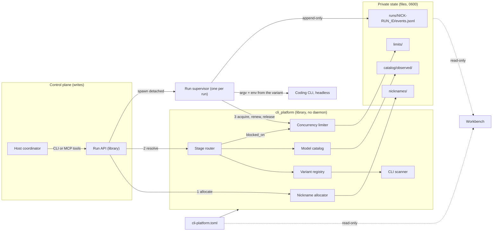
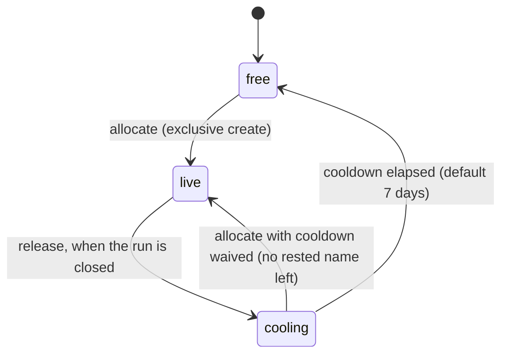
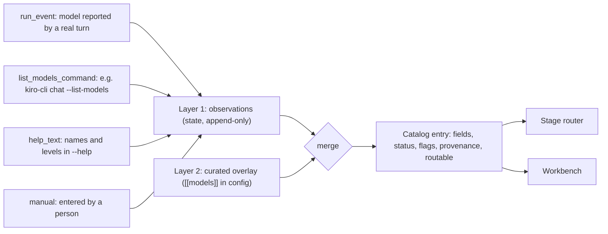
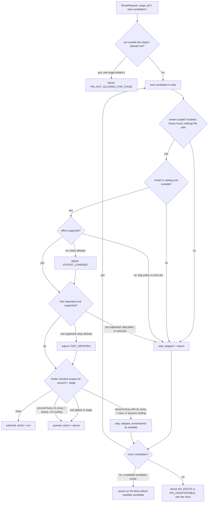
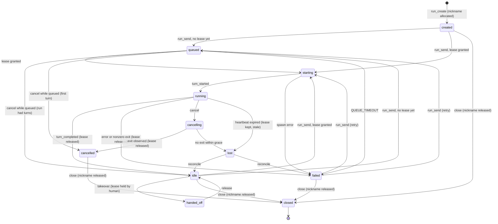

# CLI platform: final design

Status: final design, 2026-11-13. The design is final for the items listed in
section 2; the scaffold under `cli_platform/` implements and tests the
platform logic (nicknames, configuration, variants, catalog merge, routing,
limiter). The run supervisor, the MCP server and the workbench server are
still not implemented. No existing runtime file, test, reference or earlier
proposal was changed.

- **Dispatch**: `cli-platform-final-design-20261113-g1-7c9d2ec0-C01-6f530449`
- **Builds on**: [CLI gateway and workbench proposal](2026-11-13-cli-gateway-and-workbench.md)
  (called "the gateway proposal" below). Its recommendation stands: headless
  runner core, then MCP adapter, then read-only workbench, with no state of
  any window gating execution. Its terms (run, turn, supervisor, Run API,
  lease, resume identifier, zero-gate) keep their meaning here.
- **Companions**: [project structure](../design/project-structure.md),
  [workbench mockup](../design/workbench-mockup.html),
  [scaffold README](../../cli_platform/README.md)
- **Verification host**: macOS (Darwin 27.0.0), Python 3.12.10

## 1. Goals

The gateway proposal answers how one CLI turn is run and observed. This
design adds what is needed to run many of them, across several CLIs and
accounts, without a human having to track identifiers:

1. Every session has a short, speakable **nickname** that is unique among
   live sessions and appears wherever a human meets the session.
2. The platform knows which **CLIs** are installed, and supports **variants**
   of one binary that differ by settings file and environment.
3. Each variant has a **model catalog** with effort levels and fast-mode
   support, built from recorded observations plus a curated overlay.
4. Each development **stage** has an ordered list of allowed models, with
   fallback rules and a resolution result that explains itself.
5. **Concurrency caps** per account, per stage and globally are enforced
   across processes, with queueing, rate-limit cooldown and crash recovery.

Non-goals: SSH endpoints, multi-host scheduling, cost accounting, and
automatic discovery of rate limits from vendor documentation.

## 2. Final versus deferred

| Area | Final in this design | Deferred |
| --- | --- | --- |
| Nicknames | Library rules, the 1000-name file, allocation, cooldown, incarnation references, where the name appears | Renaming a live session; user-supplied names |
| CLI scan | Probe table, facts collected, auth probe as a hint | `codex` and `agy` rows (not installed on the host); Windows |
| Variants | Identity, settings-file rule, environment rule, fingerprint, launch rendering for model selection | Settings-file support for adapters other than `claude`; headless and permission flags (owned by the runner adapters) |
| Catalog | Two layers, provenance record, merge rules, flags, routability | The probes that write observations (`--list-models`, `run_event`); a review command for observed models |
| Routing | Candidate order, eligibility checks, fallback policy, explain trace, error codes | Cost- or latency-aware ordering; per-user overrides |
| Concurrency | Scopes, lease protocol, queue, backpressure, cooldown, reaping | Detecting rate limits in each CLI's stream (needs the Phase 0 fixtures); a fair-share policy between tasks |
| Run lifecycle | The `queued` state and the events in section 10 | The supervisor process itself (gateway proposal, Phase 1) |
| Workbench | Information architecture, routes, read model | The HTTP/SSE server (gateway proposal, Phase 4) |

Three points amend the gateway proposal. Everything else in it is unchanged.

| Gateway proposal | Amendment |
| --- | --- |
| Run directory `runs/<run_id>/` (section 5.2) | `runs/<nickname>-<run_id>/`. `runs/index.jsonl` gains `nickname` and `nickname_ref` columns and stays the lookup by `run_id`. |
| Run states (section 6.1) | Adds `queued` between a send request and `starting`. |
| `run_create` arguments `cli`, `model`, `effort` (section 6.2) | Adds `stage` (required) and `pin` (optional). `cli`, `model` and `effort` remain as the shorthand for a pin. Responses add `nickname`, `nickname_ref`, `resolution`. |

## 3. Terminology

| Term | Meaning |
| --- | --- |
| Session | One addressable unit of CLI work: a headless run, or a pane session of the tmux backend. One session has one nickname for its whole life. |
| Nickname | A 3-6 letter lowercase alias, unique among live sessions. |
| Nickname reference | `<nickname>#<incarnation>`, for example `kedo#2`. Unique for all time. |
| Adapter | The code that knows one CLI family: `claude`, `cursor`, `codex`, `agy`, `kiro`. |
| Variant | A stable id for adapter + binary + optional settings file + environment overrides + account. |
| Account | The unit a vendor rate-limits. Several variants may share one. |
| Stage | One of `design`, `development`, `testing`, `code_review`, `ui_design`. |
| Candidate | `variant/model[/effort][+fast]`, one entry of a priority list. |
| Pin | A candidate the user asked for explicitly. |
| Resolution | The router's result: the selected candidate, the action (`run` or `queue`) and the trace. |
| Lease | The right to have one turn in flight. Holds one slot in each of three scopes. |
| Ticket | A place in the lease queue. |

## 4. Architecture



The three architecture rules of the gateway proposal hold, with one
clarification for shared state:

1. **One writer per file.** A run's `events.jsonl` is written only by its
   supervisor. The shared files (`limits/state.json`, the nickname ledger)
   are written only inside an exclusive `flock`, so there is one writer at a
   time and every write is an atomic replace or an exclusive create.
2. **Nothing in the observation plane is read by the control plane.**
   `cli_platform` does not import its `adapters.workbench` module.
3. **Files are the interface.** There is still no daemon. The limiter and
   the allocator are libraries over files; any process that can read the
   state directory sees the same truth.

## 5. Session nicknames

### 5.1 Library rules

The library is `cli_platform/data/nicknames.txt`: one name per line, sorted,
ASCII, trailing newline. It is generated by a deterministic function and
checked by a validator; the file must equal the generator's output.

| Rule | Reason |
| --- | --- |
| Exactly 1000 names | Requirement. Far above any concurrency cap, so cooldowns never starve allocation. |
| `^[a-z]{3,6}$` | Requirement. Safe in tmux names, paths, URLs and shell words without quoting. |
| Unique | Requirement. |
| Prefix-free: no name is a prefix of another | tmux resolves `-t` targets by prefix. With a prefix-free library, `gt-kedo` can never match another session, and a human can type the first letters. |
| Same-length names differ in at least two letters | One mistyped letter never lands on another session. Enforced by the generator. |
| Alternating consonant and vowel, from `bdfgjklmnprstvz` and `aeiou` | Speakable, and free of pairs that sound alike (c/k, w/v, x/z, y/i). |
| No reserved words | `run`, `task`, `tmux`, `kiro`, `agy`, `codex`, `agent`, `null`, `true`, `dead`, `lost` and similar never appear as a session name. |
| No blocked substrings | Keeps generated syllables away from rude or alarming words. |

Length mix: 40 names of three letters, and 320 each of four, five and six.
Three-letter names are scarce because each one removes every longer name
that starts with it.

The library is versioned by its SHA-256 (`library_digest`). A future
library may add names. It must never remove or change one while a state
directory holds a live or cooling record for it.

### 5.2 Allocation, uniqueness, release, reuse



State under `<state-dir>/nicknames/`:

```text
lock                  flock target
live/<name>.json      one file per live session
released/<name>.json  last release of the name: incarnation, session, time
```

Algorithm for `allocate(session_id)`:

1. Take the lock.
2. If a live record already names this `session_id`, return it. Allocation
   is idempotent, so a replayed `run_create` gets the same nickname.
3. Start at index `sha256(session_id) mod 1000` and walk the library once.
   A name is *free* if it has no live record, and *rested* if it is free and
   was never released or was released at least `cooldown_days` ago.
4. Take the first rested name. If none is rested, take the free name
   released longest ago and set `cooldown_waived: true` in the record.
5. If no name is free, refuse with `NICKNAME_EXHAUSTED`. Nothing is created.
6. Create `live/<name>.json` with `O_CREAT | O_EXCL`, mode 0600. The
   incarnation is the previous incarnation plus one.

The exclusive create is the uniqueness guarantee. The lock only makes the
scan and the idempotency check consistent; even a process that ignored the
lock could not create a second live record for a name.

`release(nickname, session_id)` is refused with `NICKNAME_NOT_HELD` unless
the session holds the name. It writes the release record first and removes
the live record second, so a crash between the two steps leaves the name
live. A name is never free without a cooldown.

A nickname is bound at `run_create` and released at `run_close`. It does
not change across turns, queueing, takeover or failure. After a crash,
`reconcile` releases a name only when the Run API reports its run as
`closed`; a `lost` run keeps its name.

Example live record:

```json
{"nickname": "kedo", "incarnation": 1, "session_id": "run-01JCQ8M4T7",
 "task_id": "cli-platform-impl", "kind": "run",
 "allocated_at": 1794551462.0, "cooldown_waived": false}
```

### 5.3 Where the nickname appears

| Place | Form | Notes |
| --- | --- | --- |
| tmux session name | `gt-kedo` | Used by the tmux backend and by takeover panes. Address it with the exact form `-t =gt-kedo`. |
| Task record | `nickname`, `nickname_ref` on each run entry and in `resource_report.runs` | The task record keeps `run_id` as the key. |
| Run log path | `runs/kedo-run-01JCQ8M4T7/events.jsonl` | The directory name carries both, so `ls` is readable and the path is still unique after the name is reused. |
| Run events | `nickname` field on every event | Additive field in the v1 envelope. |
| Workbench URL | `/s/kedo` | Resolves to the live session. If none is live, it lists past incarnations. The permanent address is `/runs/<run_id>`. |
| Audit entries | `nickname`, `nickname_ref` next to `run_id`, `turn_id` | `kedo#1` is unambiguous years later. |
| Limiter records | `nickname` on leases, tickets and journal lines | So the concurrency view reads in names. |
| Commands | `tmuxctl run ... --run kedo` | Accepted wherever `--run-id` is. A nickname resolves only to a live session; closed runs need the `run_id` or the reference. |

Rule for readers: a bare nickname identifies a session **now**. Anything
stored for later must store the reference or the `run_id` with it.

## 6. CLI inventory and variants

### 6.1 Scan

The scanner looks up each adapter's binary on `PATH`, then runs only local,
non-model commands with a sanitized environment, closed stdin, an 8 second
timeout and a bounded output size.

| Adapter | Binaries tried | Version | Help read | Auth hint (shown, run only on request) |
| --- | --- | --- | --- | --- |
| `claude` | `claude` | `--version` | `--help` | `claude auth status --json` |
| `cursor` | `agent`, `cursor-agent` | `--version` | `--help` | `agent status` |
| `kiro` | `kiro-cli` | `--version` | `chat --help` | `kiro-cli whoami` |
| `codex` | `codex` | `--version` | `--help`, `exec --help` | none recorded |
| `agy` | `agy`, `antigravity` | `--version` | `--help` | none recorded |

Each result records `path`, `realpath`, `version`, a capability map derived
from the help text (`headless`, `stream_json`, `resume`, `model_flag`,
`effort_flag`, `settings_file`, `list_models`, ...), the auth hint and a
timestamp.

Results on the verification host, from `python -m cli_platform scan --auth`:

| Adapter | Path | Version | Notable capabilities | Auth probe |
| --- | --- | --- | --- | --- |
| `claude` | `/opt/homebrew/bin/claude` | 2.1.311 | `--settings`, `--model`, `--effort`, `--fallback-model`, `--session-id` | `ok` |
| `cursor` | `~/.local/bin/agent` (also `cursor-agent`) | 2026.04.08-a41fba1 | `--model`, `--list-models`; no `--effort` | `unknown`: `agent status` did not finish in 8 s |
| `kiro` | `~/.local/bin/kiro-cli` | 2.34.0 | `--model`, `--effort`, `--list-models` | `failed`: `whoami` exited non-zero under the sanitized environment |
| `codex` | not found | | | |
| `agy` | not found | | | |

Two names on this host are *not* the CLIs: `kiro` on `PATH` is the Kiro IDE
launcher, and there is no `cursor` binary. The probe table names the real
binaries for that reason.

The auth probe is a **hint**. A status command can fail for reasons that
have nothing to do with login (the two non-`ok` rows above are not proof of
a logged-out CLI), so it never blocks routing. The authoritative signal is a
turn that fails with `AUTH_REQUIRED`, which raises an incident.

### 6.2 Variant model

A variant never copies a binary. It is a named way to launch one.

```toml
[variants.claude]
adapter = "claude"
binary = "claude"
account = "anthropic-sub"

[variants.claude-gateway]
adapter = "claude"
binary = "claude"
account = "anthropic-gateway"
settings_file = "../../gateway.json"
env = { CLAUDE_CODE_DISABLE_NONESSENTIAL_TRAFFIC = "1" }
env_unset = ["ANTHROPIC_API_KEY"]
```

| Property | Rule |
| --- | --- |
| Id | `^[a-z][a-z0-9-]{1,31}$`. Permanent: it is written into run records, events and audit entries. To change what a variant means, add a new id and disable the old one. |
| Binary | A name resolved on `PATH`, or an absolute path. |
| Settings file | Referenced by path. Passed to the CLI as `--settings <path>`. Supported for the `claude` adapter only, which is the one CLI whose help documents such a flag. |
| Environment | `env` sets non-secret values. `env_unset` removes inherited variables that would override the variant (for example an ambient API key). |
| Account | Required. Decides which concurrency cap the variant consumes. Two variants with different endpoints must not share an account. |
| Fingerprint | A hash of adapter, binary realpath, settings path, settings metadata, environment *names* and extra arguments. Recorded in `turn_started`; a change between turns is visible as drift. |

**No secrets, by construction.**

- The config loader refuses any `env` entry whose name looks like a
  credential (`TOKEN`, `SECRET`, `PASSWORD`, `API_KEY`, `AUTH`, ...) or whose
  value has a known token shape, with `SECRET_IN_CONFIG`. The error names
  the variable and never echoes the value.
- The platform never opens a settings file. `check_settings_file` uses
  `lstat` only and requires: exists, regular file, not a symlink, owned by
  the current user, no group or world permission bits. A failure makes the
  variant unavailable (`SETTINGS_FILE_MISSING`, `SETTINGS_FILE_IS_SYMLINK`,
  `SETTINGS_FILE_FOREIGN_OWNER`, `SETTINGS_FILE_GROUP_OR_WORLD_ACCESS`), and
  `build_launch` refuses with `SETTINGS_FILE_UNSAFE`.
- The change detector for a settings file is built from size, mtime, mode
  and inode. The content is not hashed, so no digest of a secret is stored.
- Logs and events carry `loggable_argv`, where the path is replaced by
  `<settings:claude-gateway>`, plus an `argv_digest`. Environment values are
  never logged; names are.
- The repository's `gateway.json` holds a live credential. It is listed in
  `.gitignore`, has mode 0600 on the verification host, and is referred to
  by path only in this design, the sample config and the tests.

Launch rendering for model selection (headless and permission flags are
added by the runner adapter of the gateway proposal):

| Adapter | Model | Effort | Fast |
| --- | --- | --- | --- |
| `claude` | `--model <id>` | `--effort <level>` | no rendering known |
| `cursor` | `--model <id>` | none; the effort is part of the model id | no rendering known |
| `kiro` | `chat --model <id>` | `--effort <level>` | no rendering known |
| `codex` (unverified) | `-m <id>` | `-c model_reasoning_effort="<level>"` | `-c service_tier="priority"` |
| `agy` (unverified) | `--model <id>` | `--effort <level>` | no rendering known |

The model id `@default` means "pass no model flag".

## 7. Model catalog

No installed CLI offers a model list that is both complete and stable, and
two of them need an account call to list anything. The catalog therefore
keeps what was *seen* apart from what is *allowed*.



**Layer 1, observations.** `<state-dir>/catalog/observed/<variant>.jsonl`,
append-only:

```json
{"variant": "kiro", "model_id": "@default", "method": "help_text",
 "command": "kiro-cli chat --help", "cli_version": "2.34.0",
 "observed_at": "2026-11-13T06:20:00+00:00",
 "efforts": ["low", "medium", "high", "xhigh", "max"], "fast": "unverified"}
```

Methods, strongest first: `run_event` (a turn reported this model id),
`list_models_command`, `help_text`, `manual`. Every observation carries the
CLI version and a timestamp.

**Layer 2, curated overlay.** `[[models]]` in the config:

```toml
[[models]]
variant = "codex"
id = "gpt-6.1-sol"
efforts = ["low", "medium", "high", "xhigh"]
default_effort = "high"
fast = "yes"
fast_via = '-c service_tier="priority"'
```

`fast` has three values. `unverified` exists because a missing flag in
`--help` does not prove a missing feature; the router treats it as `no`
whenever fast mode is requested.

**Merge rules.**

| Case | Result |
| --- | --- |
| Curated, any observations | Curated fields win. Status is the curated status. Routable when `enabled`. |
| Curated, never observed | Flag `unconfirmed`. Still routable: the curator's word is enough. |
| Latest observation older than `stale_after_days` (default 14) | Flag `stale`. |
| Latest observation made on a different CLI version from the installed one | Flag `version_drift`. |
| Observed efforts differ from curated efforts | Flag `effort_mismatch`. |
| Observed only | Status `unreviewed`. Routable only if `catalog.allow_unreviewed = true` (default false). |

Flags never block routing. They surface in the workbench and as the "catalog
stale" incident, and they tell a person what to re-check after a CLI update.
The workbench shows the most significant flag in the status column.

Facts recorded for the sample catalog, and where each comes from:

| Variant / model | Efforts | Fast | Source |
| --- | --- | --- | --- |
| `claude` / `opus`, `sonnet`, `fable` | low, medium, high, xhigh, max | unverified | `claude --help` 2.1.311 names the aliases and the levels; the word "fast" does not occur in that help |
| `claude-gateway` / `opus`, `sonnet` | same | unverified | Curated. The settings file decides the upstream model; the platform does not read it |
| `cursor` / `grok-4.7-xhigh` | none (in the id) | no | `references/cli-adapters.md`; `agent --help` has `--model` and `--list-models`, no `--effort` |
| `kiro` / `@default` | low, medium, high, xhigh, max | no | `kiro-cli chat --help` 2.34.0 |
| `codex` / `gpt-6.1-sol` | low, medium, high, xhigh | yes, service tier | `references/cli-adapters.md`; binary not installed, unconfirmed |
| `agy` / `gemini-4-argon-high` | high | no | `references/cli-adapters.md`; binary not installed, unconfirmed |

## 8. Stage routing

### 8.1 Configuration

```toml
[stages.development]
max_parallel = 3
on_busy = "queue"            # queue | next
effort_fallback = "lower"    # lower | skip
fast_fallback = "drop"       # drop | skip
allow_pins_outside = false
candidates = [
  { variant = "claude", model = "opus", effort = "high" },
  { variant = "codex", model = "gpt-6.1-sol", effort = "high", fast = true },
  { variant = "cursor", model = "grok-4.7-xhigh" },
  { variant = "kiro", model = "@default", effort = "high" },
]
```

The list is two things at once: the **allowed set** for the stage (its
variant/model pairs) and the **priority order**. All five stages are
required. The sample configuration:

| Stage | 1 | 2 | 3 | 4 | on_busy | Cap |
| --- | --- | --- | --- | --- | --- | --- |
| `design` | claude/opus/max | claude-gateway/opus/high | codex/gpt-6.1-sol/xhigh | | queue | 2 |
| `development` | claude/opus/high | codex/gpt-6.1-sol/high+fast | cursor/grok-4.7-xhigh | kiro/@default/high | queue | 3 |
| `testing` | claude/sonnet/medium | kiro/@default/medium | cursor/grok-4.7-xhigh | | next | 2 |
| `code_review` | codex/gpt-6.1-sol/xhigh | cursor/grok-4.7-xhigh | claude-gateway/opus/high | | next | 2 |
| `ui_design` | agy/gemini-4-argon-high/high | claude/opus/high | cursor/grok-4.7-xhigh | | queue | 1 |

### 8.2 Resolution algorithm

Candidate order, highest priority first:

1. **Pin**: the candidate named in the request. Strict by default.
2. **Task candidates**: a list stored on the task.
3. **Stage candidates**: `stages.<stage>.candidates`.
4. **Default candidates**: `routing.default_candidates`.

A pin without `allow_fallback` is the only entry in the list. This carries
the existing rule from `references/cli-adapters.md`: if the user asked for a
model or effort, a different one is never launched silently.



Rules behind the diagram:

- **Eligibility is checked before capacity.** A candidate that cannot run at
  all is never waited for.
- **Shared scopes are not a reason to move on.** If only the global cap or
  the stage cap is full, every candidate of the stage is equally blocked, so
  the router queues on the current one.
- **A cooling account is always skipped first**, even when `on_busy =
  "queue"`. A cooldown means the vendor pushed back; sending the next turn
  elsewhere is better than waiting in line for it. If nothing else can
  serve, the request queues on the cooling account.
- **A strict pin queues rather than falls back** when its account is busy.
- **Effort lowering** picks the highest supported level below the requested
  one. It never raises effort.
- **Adjustments and fallbacks are reported**, never hidden:
  `fallback_used` is true when the selected candidate is not first in the
  list or was adjusted. `SKILL.md` requires the coordinator to announce a
  fallback before work starts; the resolution is the text it announces.

Skip reasons: `VARIANT_UNKNOWN`, `VARIANT_DISABLED`, `BINARY_NOT_FOUND`,
`SETTINGS_FILE_*`, `NOT_ALLOWED_FOR_STAGE`, `MODEL_NOT_IN_CATALOG`,
`MODEL_DISABLED`, `MODEL_UNREVIEWED`, `EFFORT_UNSUPPORTED`,
`FAST_UNSUPPORTED`, `ACCOUNT_BUSY`, `ACCOUNT_COOLDOWN`, `STAGE_BUSY`,
`GLOBAL_BUSY`. Adjustments: `EFFORT_LOWERED:<from>-><to>`, `FAST_DROPPED`.

### 8.3 Explainable result

Real output of `python -m cli_platform resolve code_review` on the
verification host, where `codex` is not installed:

```text
stage=code_review action=run selected=cursor/grok-4.7-xhigh account=cursor-pro source=stage fallback=yes
1. [stage] codex/gpt-6.1-sol/xhigh -> skipped (BINARY_NOT_FOUND)
2. [stage] cursor/grok-4.7-xhigh -> selected
```

The same result as stored in the `route_resolved` event:

```json
{"stage": "code_review", "action": "run",
 "selected": "cursor/grok-4.7-xhigh", "requested": "cursor/grok-4.7-xhigh",
 "source": "stage", "account": "cursor-pro", "fallback_used": true,
 "blocked_on": [],
 "steps": [
   {"order": 1, "source": "stage", "candidate": "codex/gpt-6.1-sol/xhigh",
    "outcome": "skipped", "reasons": ["BINARY_NOT_FOUND"], "adjustments": []},
   {"order": 2, "source": "stage", "candidate": "cursor/grok-4.7-xhigh",
    "outcome": "selected", "reasons": [], "adjustments": []}]}
```

A refusal carries the same trace in its `details`, so "why did nothing run"
has the same answer format as "why did this run".

Routing is resolved **once per turn**, at `run_send`. A run keeps its stage.
A resumed conversation must stay on its variant, because a resume identifier
belongs to one CLI: from the second turn on, the Run API sends the run's
recorded variant and model as a strict pin, and only effort and fast may be
re-resolved.

## 9. Concurrency limits

### 9.1 Scopes and what a lease is

| Scope | Config | Why |
| --- | --- | --- |
| Account | `accounts.<id>.max_parallel` | Vendors rate-limit per account or key, not per binary. Variants of one binary with different endpoints have different accounts. |
| Stage | `stages.<id>.max_parallel` | Keeps one kind of work from taking every slot. |
| Global | `concurrency.global_max_parallel` | Bounds load on the machine. |

A **lease** is held per turn, not per session. The gateway proposal runs one
CLI process per turn, and an idle run has no process and makes no requests,
so it holds nothing. A human takeover holds a lease too (holder `human`),
because it uses the same account.

Sample caps: global 6; `anthropic-sub` 3, `anthropic-gateway` 2,
`cursor-pro` 2, `kiro-idc` 2, `openai-codex` 2, `google-agy` 1.

The "five session" limit mentioned in the 2026-11-12 postmortem was not
found in the runtime (gateway proposal, section 3.8). With this design that
kind of limit is an explicit, visible number.

### 9.2 Lease protocol

State: `<state-dir>/limits/state.json` (leases, queue, per-account rate-limit
record), `limits/lock`, and `limits/journal.jsonl` (append-only history,
written with the lock held).

Every operation takes an exclusive `flock` on `limits/lock`, reads the
state, changes it, and replaces the file atomically. A lease takes its three
slots inside one critical section, so partial holds and lock-ordering
deadlocks cannot occur. `flock` is released by the kernel when its holder
dies, so a crashed process cannot leave the lock held.


Lease record:

```json
{"lease_id": "lease-6f0c2a91b3d4", "session_id": "run-01JCQ8M4T7",
 "nickname": "kedo", "account": "anthropic-sub", "stage": "development",
 "holder": "runner", "pid": 4242, "pid_started": "Fri Nov 13 14:48:20 2026",
 "acquired_at": 1794552500.1, "expires_at": 1794552560.1}
```

`acquire` is idempotent per session: a session that already holds a lease or
a ticket gets the same one back, so a retried call cannot take two slots.

### 9.3 Queue and backpressure

- **Order.** First in, first out. A ticket is granted when, after every
  *earlier* ticket that could run has been given its slots, its own three
  scopes still have room. A later ticket therefore cannot overtake an
  earlier one, and a ticket stuck on a full account does not hold up a
  ticket for another account.
- **Who waits.** The run's own supervisor holds the ticket and polls. There
  is no dispatcher process. The coordinator sees state `queued` and can
  call `run_wait`, which also returns the queue position.
- **Bounded queue.** At `queue_max_depth` (default 32) a new request is
  refused with `QUEUE_FULL`. That is the backpressure signal to the
  coordinator: stop fanning out.
- **Bounded wait.** A ticket older than `queue_timeout_seconds` (default
  1800) fails with `QUEUE_TIMEOUT`; the run goes to `failed` with a
  retryable error.
- **Abandoned tickets.** A ticket whose holder has not polled for
  `lease_ttl_seconds` is dropped by the next caller.
- **Leaving.** `run_cancel` on a queued run removes the ticket.
- **Non-queueing callers.** `acquire(queue=False)` returns `busy` with the
  blocked scopes. The router uses the same check (`blocked_on`) to decide
  between waiting and the next candidate.

### 9.4 Rate-limit detection and cooldown

Detection belongs to the runner adapters: a stream error, a recognizable
stderr line or a specific exit status is mapped to an `error` event with
code `RATE_LIMITED` and, when the vendor supplies one, `retry_after`. The
exact signals per CLI are unknown until the Phase 0 fixtures exist; an
unrecognized failure is an ordinary `failed` turn.

On `report_rate_limit(account, retry_after)`:

1. `strikes += 1`.
2. Cooldown = `min(cooldown_max, cooldown_base * 2^(strikes-1))`, raised to
   `retry_after` if that is longer. Defaults: base 60 s, maximum 900 s.
3. `effective_cap = max(1, effective_cap // 2)`.
4. No new lease is granted for the account until the cooldown ends. Turns
   already running continue.

On `report_success(account)`: after `recover_after_turns` (default 5) clean
turns the effective cap grows by one, until it is back at the configured
cap, at which point the strikes reset. Halve on trouble, add one on
success: the cap settles at what the account tolerates.

The router sees the cooldown as `ACCOUNT_COOLDOWN` and prefers another
account (section 8.2). The failed turn itself is not retried automatically;
the coordinator decides, with the resume identifier intact.

### 9.5 Crash recovery

| Failure | What remains | Recovery |
| --- | --- | --- |
| Supervisor dies while holding a lease | A lease that is no longer renewed | The next limiter call reclaims it once it has expired **and** its holder (pid plus process start time) is gone. Pid reuse does not keep it alive. |
| Supervisor hangs but lives | An expired lease with a live holder | The slot stays counted and the lease is reported `stale`. Releasing it could put more turns on the account than the cap allows. An incident is raised; `reconcile` or the user resolves it. |
| Supervisor dies while queued | A ticket that is no longer polled | Dropped after `lease_ttl_seconds`. |
| Process dies inside the critical section | Lock released by the kernel; the old `state.json` is intact because the new one is written to a temporary file and renamed | Nothing to do. |
| Host reboots | Leases with dead holders | Reclaimed on first use after expiry. |
| `limits/state.json` is deleted | Empty state | Leases are re-created as supervisors renew: a `renew` for an unknown lease returns `LEASE_NOT_HELD`, and the supervisor must re-acquire or stop its turn. |
| Run is `lost` | Its lease, stale | Kept until the run is reconciled, matching the rule that `lost` is never resolved by guessing. |

## 10. Run and session lifecycle

### 10.1 State machine

The gateway proposal's machine with `queued` added. Only new or changed
edges are labelled in bold terms; the rest is as before.



A lease is held in `starting`, `running`, `cancelling`, `handed_off` and
`lost`. No process exists in `queued`, so cancelling there is immediate.

### 10.2 One turn, end to end

1. `run_create(stage, cwd, pin?)`: allocate the nickname, create
   `runs/<nickname>-<run_id>/`, write `run.json`, append
   `nickname_assigned`. Record the nickname in the task record and audit
   entry. No routing yet, no lease.
2. `run_send`: resolve the route. On refusal, append `error` with the trace
   and return the refusal; nothing was spawned. Otherwise append
   `route_resolved`.
3. Spawn the supervisor. It acquires the lease or queues (`lease_queued`,
   state `queued`), then appends `lease_granted`.
4. The supervisor builds the launch from the variant (`build_launch`), adds
   the adapter's headless flags, checks the settings file again, and starts
   the CLI. `turn_started` records `variant`, `variant_fingerprint`,
   `model`, `effort`, `fast`, `argv_digest` and the CLI version.
5. Every `heartbeat_seconds` the supervisor appends `heartbeat` and renews
   the lease.
6. At exit it reports success or a rate limit, releases the lease
   (`lease_released`) and records the model it actually saw as a
   `run_event` observation for the catalog.
7. `run_close` releases the nickname (`nickname_released`).

`Platform.open_session` in the scaffold performs steps 1 to 3 and returns
the launch spec; `python -m cli_platform plan <stage>` runs it in a
temporary state directory.

### 10.3 Events

New types in the v1 envelope, all with `source: "supervisor"`:

| Type | Payload |
| --- | --- |
| `nickname_assigned` | `nickname`, `ref`, `cooldown_waived` |
| `route_resolved` | The resolution of section 8.3 |
| `lease_queued` | `ticket_id`, `position`, `blocked_on` |
| `lease_granted` | `lease_id`, `account`, `stage` |
| `lease_released` | `lease_id`, `reason` |
| `rate_limited` | `account`, `retry_after`, `cooldown_until`, `effective_cap` |
| `nickname_released` | `nickname`, `ref` |

Every event also gains a top-level `nickname` field. Both changes are
additive, which the gateway proposal's versioning rule allows within major
version 1. `error` gains the codes `RATE_LIMITED`, `AUTH_REQUIRED`,
`QUEUE_TIMEOUT`, `NO_ROUTE` and `PIN_UNSATISFIABLE`.

Example:

```json
{"v": 1, "seq": 2, "event_id": "run-01JCQ8M4T7:2", "run_id": "run-01JCQ8M4T7",
 "task_id": "cli-platform-impl", "nickname": "kedo", "turn_id": null,
 "ts": "2026-11-13T06:31:02.114+00:00", "type": "lease_granted",
 "source": "supervisor",
 "payload": {"lease_id": "lease-6f0c2a91b3d4", "account": "anthropic-sub",
             "stage": "development"}}
```

### 10.4 Request changes

`run_create` arguments gain:

```json
{"stage": {"enum": ["design", "development", "testing", "code_review", "ui_design"]},
 "pin": {"type": "object", "additionalProperties": false,
         "required": ["variant", "model"],
         "properties": {"variant": {"type": "string"}, "model": {"type": "string"},
                        "effort": {"type": "string"}, "fast": {"type": "boolean"}}},
 "allow_fallback": {"type": "boolean", "default": false}}
```

New refusals: `STAGE_UNKNOWN`, `PIN_NOT_ALLOWED_FOR_STAGE`,
`PIN_UNSATISFIABLE`, `NO_ROUTE`, `NICKNAME_EXHAUSTED`, `QUEUE_FULL`. Read
operations added to the command line and the MCP adapter: `cli_scan`,
`variant_list`, `catalog_list`, `route_explain`, `concurrency_status`,
`session_lookup`. All run operations accept a nickname in place of a
`run_id` for live sessions.

## 11. Configuration

One file, `cli-platform.toml`, TOML, read with the standard library. The
complete example is `cli_platform/config/cli-platform.toml`.

| Table | Keys |
| --- | --- |
| top level | `schema_version = 1` |
| `[platform]` | `state_dir` |
| `[nicknames]` | `library`, `cooldown_days`, `tmux_prefix` |
| `[concurrency]` | `global_max_parallel`, `lease_ttl_seconds`, `heartbeat_seconds`, `queue_max_depth`, `queue_timeout_seconds` |
| `[concurrency.rate_limit]` | `cooldown_base_seconds`, `cooldown_max_seconds`, `recover_after_turns` |
| `[catalog]` | `stale_after_days`, `allow_unreviewed` |
| `[accounts.<id>]` | `vendor`, `max_parallel` |
| `[variants.<id>]` | `adapter`, `binary`, `account`, `enabled`, `settings_file`, `env`, `env_unset`, `extra_args`, `note` |
| `[[models]]` | `variant`, `id`, `efforts`, `default_effort`, `fast`, `fast_via`, `status`, `verified_at`, `note` |
| `[stages.<id>]` | `candidates`, `max_parallel`, `on_busy`, `effort_fallback`, `fast_fallback`, `allow_pins_outside` |
| `[routing]` | `default_candidates` |

Loader rules: unknown keys are errors; every reference must resolve
(variant to account, model to variant, candidate to a curated model); all
five stages must be present; caps are positive integers;
`lease_ttl_seconds` is at least twice `heartbeat_seconds`; relative paths
resolve against the config file's directory. Errors are `CONFIG_INVALID` or
`SECRET_IN_CONFIG` and name the offending key.

Relation to the workflow YAML proposals (`workflow-config.md`): those
describe per-user and per-project workflow layers that the runner does not
load today. This file is machine-level platform configuration. When a
workflow resolver exists, its "effective CLI/model/effort" becomes a pin or
a task candidate list passed to the router; the mandatory disclosure in
`SKILL.md` is then fed by the resolution trace.

## 12. Workbench information architecture

The workbench stays a read-only reader of files (gateway proposal, section
7). The mockup at `docs/design/workbench-mockup.html` shows every view with
sample data.

| View | Shows | Source |
| --- | --- | --- |
| Sessions | Nickname, state, task, stage, selection, turn, heartbeat age, lease or queue position | `nicknames/live/`, `runs/*/state.json`, `limits/state.json` |
| Session detail | Reference, `run_id`, tmux session name, log path, URL, resume id, bypass marker, copyable takeover command, timeline with type filter | `runs/<nickname>-<run_id>/events.jsonl` |
| CLI registry | Scan results and variants: binary, version, settings path and check, account, auth hint, availability reasons | Scan cache, config, `lstat` |
| Model catalog | Per variant: model, efforts, fast, status and flags, provenance | `catalog/observed/`, config |
| Stage routing | The matrix of section 8.1, policies, and recent resolution traces | Config, `route_resolved` events |
| Concurrency | Meters per scope with effective caps and cooldown countdowns, queue, leases | `limits/state.json` |
| Incidents | Derived list, also counted in the navigation | Rules below |

Routes (all `GET`): `/`, `/s/<nickname>`, `/api/sessions`,
`/api/sessions/<nickname>`, `/api/runs/<run_id>`, `/api/runs/<run_id>/events`,
`/api/runs/<run_id>/stream`, `/api/registry`, `/api/catalog`, `/api/routing`,
`/api/concurrency`, `/api/incidents`.

Incident rules added to those of the gateway proposal:

| Incident | Rule |
| --- | --- |
| Rate limited | `rate_limited` event; open while the account's cooldown runs |
| Queue wait | A ticket older than a threshold (default 5 minutes) |
| Lease stale | A lease past `expires_at` whose holder is still alive |
| Catalog stale | An entry with `stale`, `version_drift` or `unconfirmed` that a stage lists |
| Settings file | A variant whose settings file fails its check |
| Auth required | An `error` event with code `AUTH_REQUIRED` |
| Nickname cooldown waived | A `nickname_assigned` event with `cooldown_waived: true` |

Derived incidents are shown inline in a session's timeline at the time they
were first seen. The workbench reads the limiter state without taking its
lock; because the file is replaced atomically, a reader always sees a
complete snapshot.

## 13. Security

Additions to section 6.6 of the gateway proposal:

| Concern | Rule |
| --- | --- |
| Secrets in configuration | Refused at load (section 6.2). The config file can be committed. |
| Settings files | Never opened, hashed or copied by the platform. Permission-checked before every launch. Shown as a path and a check result. |
| Credential in the repository directory | `gateway.json` stays ignored by Git. A variant should point at a file outside the repository where possible; the sample points inside only because that is where the file is today. |
| Child environment | The supervisor's allowlisted environment, then `env_unset`, then `env`. Values are never written to events. |
| Scan | Sanitized environment, no shell, no model call, bounded time and output. The auth probe stores a verdict only, not the command's output, which can contain an account email. |
| State files | Mode 0600, directories 0700, `O_NOFOLLOW` on every write. |
| Nickname as input | Validated against `^[a-z]{3,6}$` before it touches a path, a tmux target or a URL route. |
| Bypass mode | Unchanged. Routing never adds a permission flag. |
| Untrusted text | Model ids from observations are validated against the id pattern before they can reach an argv. Observed-only models are not routable by default. |

## 14. Failure handling

| Failure | Behavior |
| --- | --- |
| Config invalid | Every command refuses with the key named. Running sessions are unaffected; they hold their own resolved values. |
| Nickname library file missing or invalid | `NICKNAME_LIBRARY_INVALID`; no session can be created. Existing sessions keep their names. |
| All nicknames live | `NICKNAME_EXHAUSTED`. Unreachable below 1000 live sessions. |
| Binary removed after resolution | Spawn fails; the turn is `failed` with `ADAPTER_UNAVAILABLE`; the next resolution skips the variant. |
| Settings file permissions loosened | Variant unavailable; incident raised; routing falls back per stage policy. |
| No candidate usable | `NO_ROUTE` with the trace. Nothing is spawned or queued. |
| Pin cannot be served | `PIN_UNSATISFIABLE` with the trace. No silent substitute. |
| Account rate limited | Section 9.4. |
| Queue full or wait too long | `QUEUE_FULL` at the call; `QUEUE_TIMEOUT` as a failed turn. |
| Limiter state unreadable (corrupt JSON) | The call fails; no lease is granted. The file is replaced by the operator or rebuilt from live supervisors. Failing closed here is deliberate: guessing would break the caps. |
| Clock jumps backwards | Leases live longer than intended, never shorter than their holder. Cooldowns may extend. No cap is exceeded. |
| Two coordinators create the same run | Idempotent nickname allocation and lease acquisition return the same records. |

## 15. Phased delivery

Phases follow the gateway proposal's numbering; each row says what the
platform adds to that phase.

| Phase | Platform deliverable | Acceptance gate |
| --- | --- | --- |
| P0. Scaffold (this change) | `cli_platform/` package, config, nickname library, tests, mockup | Library validator passes. The targeted tests pass. `python -m cli_platform check-config`, `scan`, `resolve` and `plan` run on the host. |
| P1. With the runner core | Supervisor calls `open_session`, renews and releases leases, writes the section 10.3 events. `tmuxctl run` accepts nicknames. Scan results cached in state. | Six parallel runs on `fake_cli` with an account cap of 2 never show more than two turns in flight for that account. Killing a supervisor frees its slot after the TTL. A killed queued run leaves no ticket. |
| P2. With task integration | Nickname in task records, audit entries and `resource_report`. `stage` and `pin` on `run_create`. Fallback disclosure text from the resolution. Rate-limit mapping in each verified adapter. | A real task shows the nickname in its record, log path and audit index. A pin for an unavailable model is refused, not replaced. A recorded rate-limit fixture produces a cooldown. |
| P3. With the MCP adapter | The read tools of section 10.4, nickname addressing | A host completes a task using stage names only, and can explain each choice from `route_explain`. |
| P4. With the workbench | The views and routes of section 12 | `/s/<nickname>` opens the live session. Every route is `GET`. Stopping the workbench changes nothing in `limits/` or any run. |
| P5. Catalog probes | `list_models_command` and `run_event` observation writers; a review command that turns an observation into a curated entry | After a CLI upgrade the catalog flags `version_drift` and clears it after a re-probe. |

Rollback at every phase: remove the `stage` argument and pass `cli`,
`model`, `effort` as before; the platform is then not consulted. Setting
every cap high disables queueing without code changes.

## 16. Scaffold and verification

The scaffold is described in [its README](../../cli_platform/README.md) and
in [project-structure.md](../design/project-structure.md).

| Check | Command | Result |
| --- | --- | --- |
| Installed binaries | `command -v claude agent cursor-agent kiro-cli codex agy` | `claude`, `agent`, `cursor-agent`, `kiro-cli` found; `codex`, `agy`, `antigravity` not found |
| Versions | `claude --version`, `agent --version`, `kiro-cli --version` | 2.1.311, 2026.04.08-a41fba1, 2.34.0 |
| Claude flags | `claude --help` | `--settings <file-or-json>`, `--model`, `--effort (low, medium, high, xhigh, max)`, `--fallback-model`; no occurrence of "fast" |
| Cursor flags | `agent --help` | `--model`, `--list-models`, `status`, `models`; no `--effort` |
| Kiro flags | `kiro-cli chat --help`, `kiro-cli --help-all` | `--model`, `--effort`, `--list-models`, `whoami` |
| Settings file | `lstat` through `python -m cli_platform variants` | `gateway.json`: regular file, mode 0600, check passes; contents not read by the platform. For this design only its key names were listed, with values hidden. |
| Nickname library | `python3 scripts/nicknames.py validate` | 1000 names, 1000 unique, lengths 3/4/5/6 = 40/320/320/320, matches the generator |
| Targeted tests | `python3 -m unittest discover -s tests -t tests` in `cli_platform/` | 100 tests, all pass |
| Mockup | Headless Chrome screenshots at 1440 and 1024 px | Six views render; no external requests in the file |
| Model calls | none | none made |
| Existing test suite | none | not run; no existing file changed |

## 17. Open questions

1. What does each CLI emit when rate-limited in headless mode? Section 9.4
   depends on the Phase 0 fixtures of the gateway proposal.
2. Is a vendor's limit per account or per model within an account? If per
   model, the account scope gains an optional per-model sub-cap; the lease
   record already carries enough to add it.
3. Does Claude Code expose fast mode to a headless launch (a setting or an
   environment variable)? Until verified it stays `unverified` and is
   never selected as fast.
4. Do `agent status` and `kiro-cli whoami` need more of the user's
   environment than the sanitized probe passes? The probe results on the
   host were inconclusive.
5. Should the tmux backend's existing `create_session.name` values be
   migrated to `gt-<nickname>`, or only new sessions?
6. Should a task be able to reserve capacity (for example one slot of
   `anthropic-sub`) so a long task is not starved by short ones?
