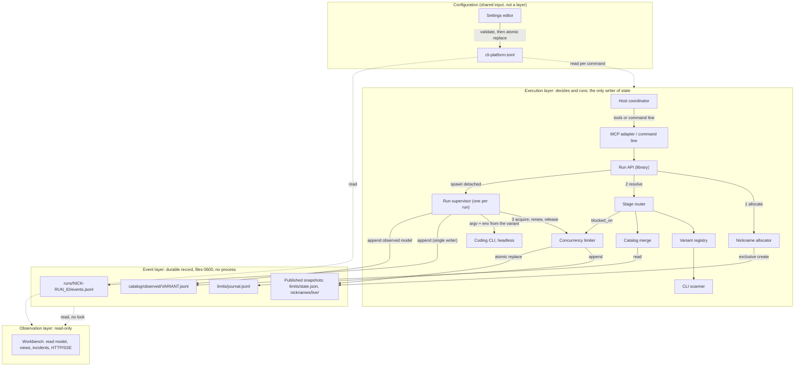
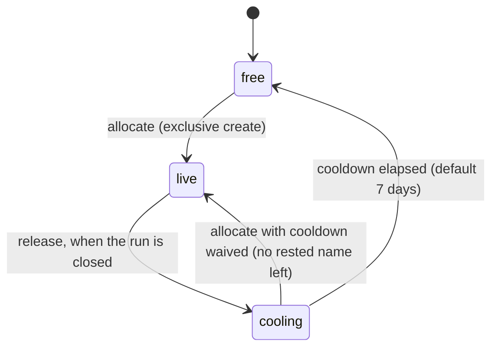
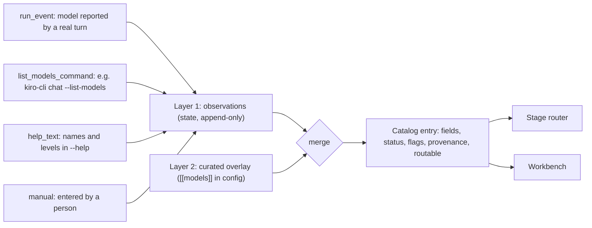
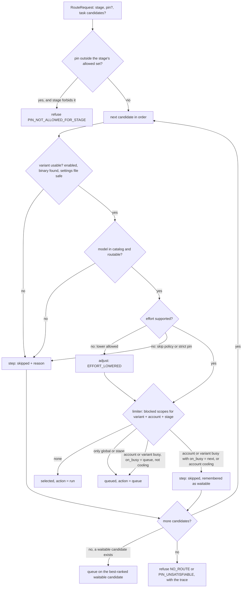
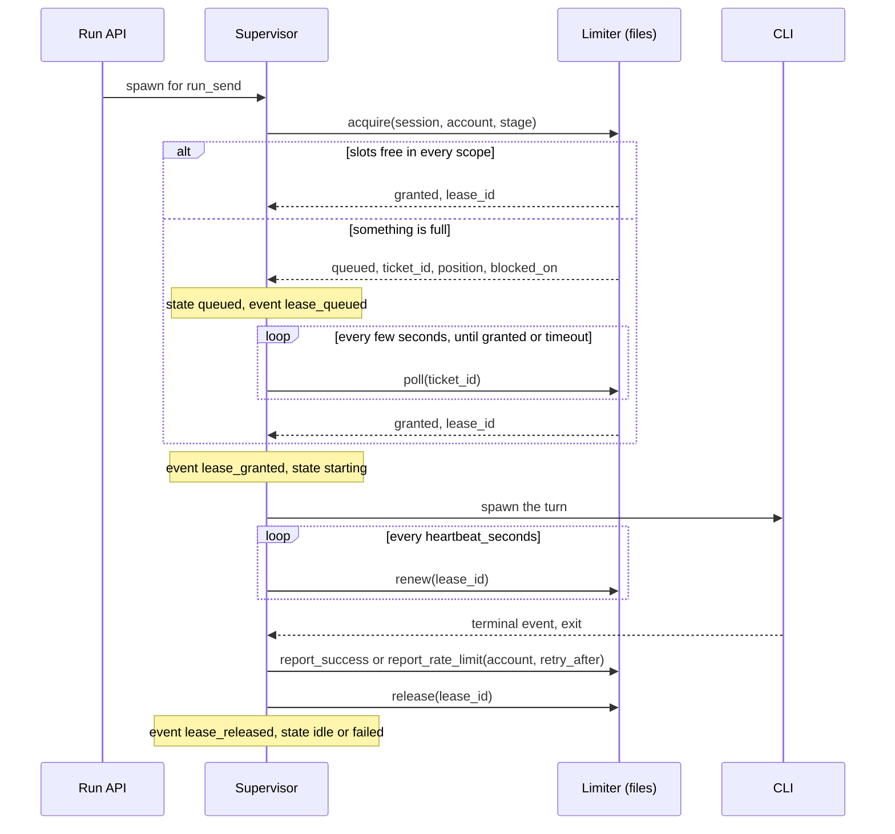
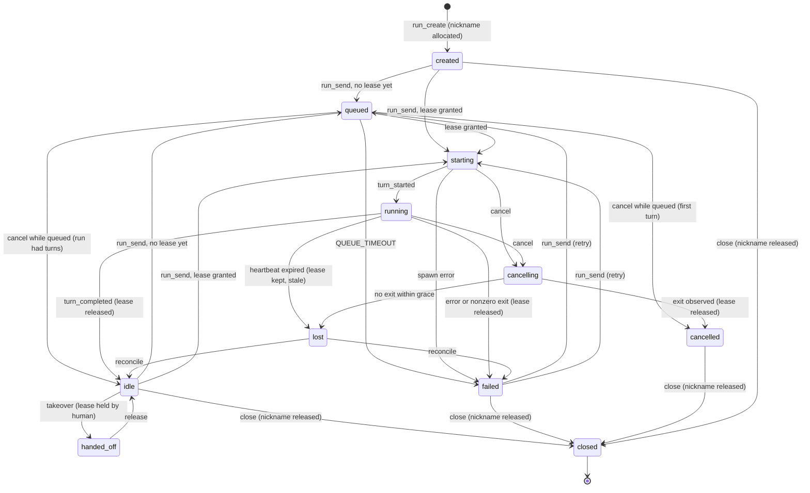

# CLI platform: final design

Status: final design, 2026-11-13, revision 3. The design is final for the
items listed in section 2. The scaffold under `cli_platform/` implements and
tests the platform logic (nicknames, configuration, variants, catalog merge,
routing, limiter) and the layer boundaries. The run supervisor, the MCP
server, the workbench server and the settings editor are still not
implemented. No existing runtime file, test, reference or earlier proposal
was changed.

Revision 2 removes the per-candidate service-tier option entirely: the
router, configuration, catalog, launch rendering and mockup no longer know
it, and a config that still sets one of its keys is refused as having an
unknown key. It adds the layering model (section 5) and the settings interaction model
(section 5.7, and the mockup's Configure pages).

Revision 3 adds internationalization for English, Japanese and Traditional
Chinese (section 18): locale negotiation, message catalogs with a loader and
tests, the `[ui] locale` setting, a `--locale` option, and a language
switcher in the mockup. It also adds a feasibility check of every element of
the Sessions view against real data sources (section 19).

- **Dispatch**: `cli-platform-final-design-20261113-g1-7c9d2ec0-C01-6f530449`;
  revision 2: `cli-platform-design-v2-20261113-g1-43213fb6-C01-f2cd19b6`;
  revision 3: `cli-platform-i18n-20261113-g1-795fafa8-C01-676c7fd6`
- **Builds on**: [CLI gateway and workbench proposal](2026-11-13-cli-gateway-and-workbench.md)
  (called "the gateway proposal" below). Its recommendation stands: headless
  runner core, then MCP adapter, then read-only workbench, with no state of
  any window gating execution. Its terms (run, turn, supervisor, Run API,
  lease, resume identifier, zero-gate) keep their meaning here.
- **Companions**: [project structure](../design/project-structure.md),
  [workbench mockup](../design/workbench-mockup.html),
  [scaffold README](../../cli_platform/README.md)
- **Verification host**: macOS (Darwin 27.0.0), Python 3.12.10

## 1. Goals

The gateway proposal answers how one CLI turn is run and observed. This
design adds what is needed to run many of them, across several CLIs and
accounts, without a human having to track identifiers:

1. Every session has a short, speakable **nickname** that is unique among
   live sessions and appears wherever a human meets the session.
2. The platform knows which **CLIs** are installed, and supports **variants**
   of one binary that differ by settings file and environment.
3. Each variant has a **model catalog** with effort levels and descriptive
   fields (display name, context window, cost tier), built from recorded
   observations plus a curated overlay.
4. Each development **stage** has an ordered list of allowed models, with
   fallback rules and a resolution result that explains itself.
5. **Concurrency caps** per account, per stage and globally are enforced
   across processes, with queueing, rate-limit cooldown and crash recovery.

Non-goals: SSH endpoints, multi-host scheduling, cost accounting, and
automatic discovery of rate limits from vendor documentation.

## 2. Final versus deferred

| Area | Final in this design | Deferred |
| --- | --- | --- |
| Nicknames | Library rules, the 1000-name file, allocation, cooldown, incarnation references, where the name appears | Renaming a live session; user-supplied names |
| CLI scan | Probe table, facts collected, auth probe as a hint | `codex` and `agy` rows (not installed on the host); Windows |
| Variants | Identity, settings-file rule, environment rule, fingerprint, launch rendering for model selection | Settings-file support for adapters other than `claude`; headless and permission flags (owned by the runner adapters) |
| Catalog | Two layers, provenance record, merge rules, flags, routability | The probes that write observations (`--list-models`, `run_event`); a review command for observed models |
| Routing | Candidate order, eligibility checks, fallback policy, explain trace, error codes | Cost- or latency-aware ordering; per-user overrides |
| Concurrency | Scopes, lease protocol, queue, backpressure, cooldown, reaping | Detecting rate limits in each CLI's stream (needs the Phase 0 fixtures); a fair-share policy between tasks |
| Run lifecycle | The `queued` state and the events in section 11 | The supervisor process itself (gateway proposal, Phase 1) |
| Layering | Three layers and the shared configuration input, placement of every component, dependency rules, contracts, failure isolation, import and behavior tests | Versioning the limiter journal (section 5.4) |
| Workbench | Information architecture, routes, read model over files only | The HTTP/SSE server (gateway proposal, Phase 4) |
| Settings | Pages, fields, validation, save, cancel, reset, delete confirmation, unsaved-changes guard (mockup); the write protocol of section 5.7 | The editor's entry point and server |
| Internationalization | Locales `en`, `ja`, `zh-Hant`; negotiation and fallback; catalog format, key naming, interpolation, plurals, number and date formats; codes versus text; what stays English; `ui.locale` and `--locale`; mockup switcher for chrome and settings labels (section 18) | Field hints and validation messages in the catalogs; more locales; right-to-left scripts |
| Sessions view data | Source, required fields and verdict for every element; fallbacks for what a CLI does not report (section 19) | The adapter mappings themselves (Phase 0 fixtures); the event fields of section 19.6 |

Three points amend the gateway proposal. Everything else in it is unchanged.

| Gateway proposal | Amendment |
| --- | --- |
| Run directory `runs/<run_id>/` (section 5.2) | `runs/<nickname>-<run_id>/`. `runs/index.jsonl` gains `nickname` and `nickname_ref` columns and stays the lookup by `run_id`. |
| Run states (section 6.1) | Adds `queued` between a send request and `starting`. |
| `run_create` arguments `cli`, `model`, `effort` (section 6.2) | Adds `stage` (required) and `pin` (optional). `cli`, `model` and `effort` remain as the shorthand for a pin. Responses add `nickname`, `nickname_ref`, `resolution`. |

## 3. Terminology

| Term | Meaning |
| --- | --- |
| Session | One addressable unit of CLI work: a headless run, or a pane session of the tmux backend. One session has one nickname for its whole life. |
| Nickname | A 3-6 letter lowercase alias, unique among live sessions. |
| Nickname reference | `<nickname>#<incarnation>`, for example `kedo#2`. Unique for all time. |
| Adapter | The code that knows one CLI family: `claude`, `cursor`, `codex`, `agy`, `kiro`. |
| Variant | A stable id for adapter + binary + optional settings file + environment overrides + account. |
| Account | The unit a vendor rate-limits. Several variants may share one. |
| Stage | One of `design`, `development`, `testing`, `code_review`, `ui_design`. |
| Candidate | `variant/model[/effort]`, one entry of a priority list. |
| Pin | A candidate the user asked for explicitly. |
| Resolution | The router's result: the selected candidate, the action (`run` or `queue`) and the trace. |
| Lease | The right to have one turn in flight. Holds one slot in every scope that applies (section 10.1). |
| Ticket | A place in the lease queue. |
| Execution layer | The components that decide and run a turn and write all state (section 5.2). |
| Event layer | The durable record: append-only streams, published snapshots, their formats and lock-free readers. |
| Observation layer | Read-only views over the event layer and the configuration. |
| Settings editor | The only writer of `cli-platform.toml` besides a person; it writes nothing else. |

## 4. Architecture

The platform has three layers, the **execution layer**, the **event layer**
and the **observation layer**, plus one shared input, the
**configuration**. Section 5 defines them; this section shows where each
component sits. The gateway proposal's "control plane" is the execution
layer, its "observation plane" is the observation layer, and its run log
and "files are the interface" rule are the event layer.



Architecture rules. Section 5 states them in full and names the test that
enforces each one.

1. **The execution layer is the only writer of state.** One writer per
   file: a run's `events.jsonl` is written only by its supervisor. The
   shared files (`limits/state.json`, the nickname ledger) are written only
   inside an exclusive `flock`, so there is one writer at a time, and every
   write is an atomic replace or an exclusive create.
2. **The observation layer reads the event layer and the configuration,
   nothing else.** It takes no lock, writes no file and does not import the
   router, the limiter, the nickname allocator or the supervisor.
3. **The execution layer never depends on the observation layer** (the
   zero-gate rule). No execution path imports, calls or waits for the
   workbench.
4. **Files are the interface.** There is still no daemon. The limiter and
   the allocator are libraries over files, and any process that can read
   the state directory sees the same truth.
5. **Configuration is written only by the settings editor or a person.**
   No layer writes it at runtime, and the settings editor writes nothing
   else (section 5.7).

## 5. Layering model

### 5.1 Diagnosis: did the design already separate the three layers?

**Short answer: partly.** Before this revision the design separated a
control plane from an observation plane, and it had an append-only run log.
But it named only two planes. It never treated events as a layer of their
own. It left the platform library, the supervisor and the state files in
neither plane, and it enforced none of its boundaries. In one place the
scaffold contradicted the design: the read model took the execution
layer's lock.

Assessment against explicit criteria (state before this revision):

| Criterion | What the document and scaffold had | Verdict |
| --- | --- | --- |
| Named layers | Section 4 drew "Control plane (writes)" and a workbench box. The `cli_platform` library, the supervisor and the state directory sat outside both. | Partial: two of three |
| Responsibilities per layer | Implied by "writes" and "read-only". The event record was spread over three sections: run events (11.3), limiter journal (10.2), catalog observations (8), with no common owner. | Implicit |
| Allowed dependency direction | One rule: `cli_platform` does not import `adapters.workbench`. Nothing said what the observation side may depend on. | Partial: one direction only |
| Write ownership | "One writer per file", with `flock` for the shared files. Correct. | Exists |
| Data contracts | The v1 run event envelope (gateway proposal 6.3). The journal had another, unversioned shape. The files the workbench reads (`limits/state.json`, `nicknames/live/`) had no declared read contract. | Partial |
| Failure isolation | The zero-gate rule was stated. The scaffold broke it: `adapters/workbench.read_model` took a `Platform`, the execution wiring, and called `limiter.snapshot()`. That call takes the limiter's exclusive `flock` and creates `limits/` when it is missing. A slow reader could therefore delay a lease grant, and a reader could create state. Section 13 said the opposite ("reads the limiter state without taking its lock"). | Conflated |
| Enforcement tests | None. The import rule of section 4 was not tested. | Missing |

What already existed and is kept:

- the control/observation split and the zero-gate rule of the gateway
  proposal;
- one writer per file, atomic replace, exclusive create and `flock` for
  shared state;
- the append-only run log, with gap-free `seq`, torn-line recovery and the
  v1 envelope;
- a GET-only route table for the workbench.

What was only implicit:

- the event layer itself: three append-only streams and two snapshot files
  with no common contract;
- the observation layer's read set;
- where the MCP adapter's read tools belong.

What was missing or conflated, and what this revision does about it:

| Gap | Change in this revision |
| --- | --- |
| No event layer | Section 5.2 names it. `snapshots.py` is its lock-free read side, next to `events.py`. |
| Workbench read model built on execution wiring and the limiter lock | `read_model(config, state_dir)` reads files only. `summarize_limits` is one pure projection that the limiter and the workbench share, so the two cannot disagree. |
| No rule for observation's dependencies | Section 5.3, with one named exception (the two pure evaluators). |
| No contract for snapshot files | Section 5.4: versioned `limits/state.json`, the live-nickname records, and the reader functions. |
| No enforcement | `tests/test_layering.py` (section 5.6). |
| No place for configuration writes | Section 5.7: the settings editor writes configuration only and never gates execution. |
| Journal envelope differs from the run log | Not changed in code. Section 5.4 records it as a gap for P1. |

### 5.2 Layers and responsibilities

| Layer | Responsibility | Writes | Components | Scaffold modules |
| --- | --- | --- | --- | --- |
| Configuration (shared input) | Say what may run, where and with which limits; message catalogs every layer renders with | `cli-platform.toml`, through the settings editor only | Loader, settings editor, translator | `config.py`, `errors.py`, `fsutil.py`, `i18n/core.py` |
| Execution | Decide and run: name, route, admit, launch, supervise, report back | Every file under the state directory, in event-layer formats | MCP adapter and command line, Run API, nickname allocator, stage router, variant registry, catalog merge, CLI scanner, concurrency limiter, run supervisor | `scanner`, `variants`, `catalog`, `nicknames`, `router`, `limiter`, `supervisor`, `__main__`, `adapters/mcp` |
| Event | Keep the durable, ordered record and its formats. Give lock-free readers. Make no decision and own no process. | Nothing on its own; its write functions run inside execution components | Event log writer and reader, limiter journal, catalog observation store, published snapshots and their readers | `events.py`, `snapshots.py` |
| Observation | Show state, derive incidents, stream events to people | Nothing | Workbench read model, views, incident rules, HTTP/SSE server (P4) | `adapters/workbench.py` |

Placement of each named component, exactly one layer each:

| Component | Layer | Why there |
| --- | --- | --- |
| Stage router | Execution | It decides what runs. It is a pure function of configuration, catalog, registry and the limiter's `blocked_on`, and it writes nothing itself. |
| Concurrency limiter | Execution | It admits, queues or refuses a turn. It is the single writer of `limits/state.json` (a published snapshot) and `limits/journal.jsonl` (an event stream). |
| Nickname allocator | Execution | It binds a name at `run_create` and releases it at `run_close`. It writes `nicknames/live/` (a published snapshot) and `nicknames/released/`. |
| Run supervisor | Execution | It owns the CLI process and is the single writer of its run's event log. |
| Event log | Event | Format, sequence and append discipline, whoever calls `append`. `EventLog`, `read_events`, the journal and observation formats, and the snapshot readers live here. |
| MCP adapter | Execution (ingress) | Its mutating tools are the Run API. Its read tools (`route_explain`, `concurrency_status`, `catalog_list`, ...) answer a coordinator that is about to decide its next call, so they belong to the decision path and may use execution libraries. The workbench never calls them, and they never call the workbench. |
| Workbench | Observation | Read-only views over the event layer and the configuration. |
| Settings editor | Configuration (its only writer) | It changes what the execution layer will read next. It touches no run, lease, name or event (section 5.7). |

Two execution modules are pure **evaluators** that the observation layer
may call: the catalog merge (`ModelCatalog`) and the variant check
(`VariantRegistry.state`, which uses only `which` and `lstat`). They hold no
state, take no lock and write nothing. The registry and catalog views
therefore apply the same rules the router applies. This is the one
exception to rule 2 of section 4. The import test lists it by name, and a
behavioral test shows that the read model built on the evaluators leaves
the state directory unchanged. Phase 1 can remove the exception by
publishing registry and catalog snapshots from the scanner.

### 5.3 Dependency rules

| From \ To | Configuration | Execution | Event | Observation |
| --- | --- | --- | --- | --- |
| Configuration | yes | **no** | **no** | **no** |
| Execution | read | yes | append, replace, read for recovery and idempotency | **no** (zero-gate) |
| Event | types only (caps for `summarize_limits`) | **no** | yes | **no** |
| Observation | read | **no**, except the two evaluators of section 5.2 | read, without a lock | yes |
| Settings editor | write, after validation | **no** | **no** | **no** |

Forbidden, spelled out:

- **Execution → observation.** No import, call, wait or read of anything
  the workbench produces. A stopped, crashed or slow workbench changes
  nothing.
- **Observation → execution.** No import of the router, limiter, nickname
  allocator, supervisor, scanner or MCP adapter. No `flock` on an execution
  lock file. No file or directory creation. No signal or request to a
  supervisor. No Run API call. No process spawn and no model call.
- **Event → anything above it.** Event code makes no decision. It may read
  configuration types, nothing else.
- **Any layer → configuration.** Only the settings editor (or a person
  with a text editor) writes `cli-platform.toml`, and the editor writes
  nothing else.

### 5.4 Contracts

| Layer | Contract it exposes | Consumers |
| --- | --- | --- |
| Configuration | `cli-platform.toml`, `schema_version = 1` (section 12). `load_config` and `parse_config` refuse with `CONFIG_INVALID` or `SECRET_IN_CONFIG` and name the key. The settings editor validates with the same function. | Execution, observation, settings editor |
| Execution | Run API and MCP tools (section 11.4) with their refusals. Library results `Resolution` (section 9.3), `Outcome` (lease, queue or busy, with `blocked_on`) and `LaunchSpec`. Only this layer produces them. | Host coordinator |
| Event: run stream | `runs/<nickname>-<run_id>/events.jsonl`. v1 envelope plus `nickname`. `seq` is gap-free from 1 per run. One writer. Types from the closed list in `events.py`. Additive changes only within v1. Readers ignore a torn last line. Lifecycle, route, `nickname_assigned`, `lease_granted` and `rate_limited` events are fsynced before the writer continues. Reader: `read_events(path, after_seq)`. | Observation (timeline, SSE cursor), execution (recovery) |
| Event: limiter journal | `limits/journal.jsonl`. One record per line: `ts`, `type` (`lease_queued`, `lease_granted`, `lease_released`, `lease_reaped`, `rate_limited`) and the lease, session, account, stage and variant ids. Written with the limiter lock held. **Gap:** no `v` field and no `seq`. Phase 1 adds both, or mirrors these records into the run stream (section 11.3). | Observation (concurrency history, incidents) |
| Event: catalog observations | `catalog/observed/<variant>.jsonl`, the `Observation` record of section 8. Readers ignore lines with a bad model id, and fields they do not know. | Catalog merge |
| Event: published snapshots | `limits/state.json` (`{"v": 1, "leases", "queue", "accounts"}`), written only by atomic replace. `nicknames/live/<name>.json`, written only by exclusive create and removed on release. `runs/<nickname>-<run_id>/state.json` (P1, supervisor, atomic replace). Readers: `snapshots.read_limits`, `snapshots.read_live_nicknames`. Projection: `snapshots.summarize_limits`, used by both `Limiter.snapshot` and the workbench. | Observation, execution |
| Observation | GET routes and the read model JSON (section 13). SSE resumes from an event `seq`. No mutating route. | People, scripts |

### 5.5 Failure isolation

| Failure | Contained in | Effect on the other layers |
| --- | --- | --- |
| Workbench stopped, crashed, slow or hung | Observation | None. It holds no lock, and nothing in execution waits for it. A test holds both execution locks while the read model runs. |
| Workbench bug | Observation | Cannot change state: the layer has no write path, and a test checks that the state tree is unchanged. Phase 4 adds a server test that every route is GET and that state files are opened read-only. |
| Corrupt `limits/state.json` | Event | Execution fails closed: no lease is granted (section 15). Observation marks concurrency as unreadable and keeps rendering the other views. Both are tested. |
| Torn last line after a crash | Event | The writer truncates it on reopen. Readers skip it. |
| Event append fails (disk full, I/O error) | Event, surfacing in execution | The supervisor must not start a turn it cannot record. If appending `turn_started` fails, the turn fails before the CLI is spawned. A failing `heartbeat` append stops the turn like a failing lease renewal does. (Phase 1 supervisor test.) |
| Supervisor dies | Execution | The lease is reaped (section 10.5) and the run shows as `lost`. The event log stays intact and readable. |
| Invalid configuration saved by hand | Configuration | New commands refuse with the key named. Running turns keep their resolved values. Observation shows the loader error. |
| Settings saved while turns run | Configuration | New values apply at the next resolution or acquisition. A lowered cap revokes no lease and stops no turn. A deleted variant stays in history under its id. |

### 5.6 Enforcement tests

`cli_platform/tests/test_layering.py`:

| Test | Rule |
| --- | --- |
| `test_every_module_has_exactly_one_layer` | Each module of the package has one entry in the layer table. A new module fails the test until it is placed. |
| `test_imports_follow_the_allowed_direction` | Every internal import follows the matrix of section 5.3, with the evaluator exception listed by name. |
| `test_observation_never_imports_the_deciding_components` | The workbench imports neither the router, limiter, allocator, supervisor or scanner nor the MCP adapter. |
| `test_loading_the_execution_layer_never_loads_the_workbench` | Zero-gate. Checked in a fresh interpreter. |
| `test_workbench_routes_are_read_only` | Every route is GET. |
| `test_read_model_on_a_missing_state_dir_creates_nothing` | Observation creates no directory. |
| `test_read_model_writes_nothing` | Path, mtime and size of every state file are unchanged after a read. |
| `test_read_model_does_not_wait_for_execution_locks` | The read model completes while the limiter and nickname locks are held. |
| `test_observation_and_execution_agree_on_concurrency` | One projection: the workbench view equals `Limiter.snapshot()`. |
| `test_corrupt_limiter_state_fails_closed_in_execution_only` | Execution refuses; observation degrades. |

Existing tests that also guard a boundary:

- `test_nickname_appears_everywhere_it_must`: gap-free `seq` and the
  `nickname` field in the run stream.
- `test_platform_state_is_private`: 0600 files and 0700 directories.

Planned tests: the supervisor's append-failure behavior (P1); the server
test of section 5.5 (P4); the settings editor's write test (section 5.7).

### 5.7 Settings and execution

The settings pages of the mockup (Configure: CLIs and variants, Models,
Stage routing, Concurrency, Nicknames, General) edit `cli-platform.toml` and
nothing else.

- **Write protocol.** The editor reads the file and remembers its digest.
  It validates the draft with `parse_config`, the same function the
  execution layer uses. It then writes a temporary file and renames it over
  the original. The save is refused if the digest changed in the meantime,
  so two editors cannot overwrite each other silently. An invalid draft
  cannot be saved, so a save cannot leave the execution layer without a
  valid configuration.
- **No gate.** The editor never touches the state directory and never
  signals a supervisor. Execution reads the configuration on each command
  and resolution, so a save takes effect at the next `run_send` or
  `acquire`. A running turn keeps the values it was resolved with. Leaving
  the editor with unsaved changes affects nothing.
- **Separate from observation.** The editor is its own entry point, not a
  route of the workbench server, so the workbench keeps "every route is
  GET". The mockup shows both in one shell but in separate navigation
  groups, and it states the rule on every settings page.
- **Permanent ids.** Variant ids and model ids appear in run records. The
  editor makes both read-only after their first save, keeps a saved model
  under its variant, and suggests disabling over deleting. Only `enabled`
  models are routed; `disabled` and `deprecated` are both skipped with
  `MODEL_DISABLED`. Deleting a variant or a model that a stage lists removes
  those candidate rows only after a confirmation that names the stages. It
  is refused if a stage would be left with no candidate.
- **Fields the pages need.** `variants.<id>.max_parallel` (section 10.1),
  and `display_name`, `context_tokens` and `cost_tier` on `[[models]]`
  (section 8). The scaffold's loader accepts and validates all of them.

The editor itself is deferred (section 2). Its interaction design is final
in the mockup.

## 6. Session nicknames

### 6.1 Library rules

The library is `cli_platform/data/nicknames.txt`: one name per line, sorted,
ASCII, trailing newline. It is generated by a deterministic function and
checked by a validator; the file must equal the generator's output.

| Rule | Reason |
| --- | --- |
| Exactly 1000 names | Requirement. Far above any concurrency cap, so cooldowns never starve allocation. |
| `^[a-z]{3,6}$` | Requirement. Safe in tmux names, paths, URLs and shell words without quoting. |
| Unique | Requirement. |
| Prefix-free: no name is a prefix of another | tmux resolves `-t` targets by prefix. With a prefix-free library, `gt-kedo` can never match another session, and a human can type the first letters. |
| Same-length names differ in at least two letters | One mistyped letter never lands on another session. Enforced by the generator. |
| Alternating consonant and vowel, from `bdfgjklmnprstvz` and `aeiou` | Speakable, and free of pairs that sound alike (c/k, w/v, x/z, y/i). |
| No reserved words | `run`, `task`, `tmux`, `kiro`, `agy`, `codex`, `agent`, `null`, `true`, `dead`, `lost` and similar never appear as a session name. |
| No blocked substrings | Keeps generated syllables away from rude or alarming words. |

Length mix: 40 names of three letters, and 320 each of four, five and six.
Three-letter names are scarce because each one removes every longer name
that starts with it.

The library is versioned by its SHA-256 (`library_digest`). A future
library may add names. It must never remove or change one while a state
directory holds a live or cooling record for it.

### 6.2 Allocation, uniqueness, release, reuse



State under `<state-dir>/nicknames/`:

```text
lock                  flock target
live/<name>.json      one file per live session
released/<name>.json  last release of the name: incarnation, session, time
```

Algorithm for `allocate(session_id)`:

1. Take the lock.
2. If a live record already names this `session_id`, return it. Allocation
   is idempotent, so a replayed `run_create` gets the same nickname.
3. Start at index `sha256(session_id) mod 1000` and walk the library once.
   A name is *free* if it has no live record, and *rested* if it is free and
   was never released or was released at least `cooldown_days` ago.
4. Take the first rested name. If none is rested, take the free name
   released longest ago and set `cooldown_waived: true` in the record.
5. If no name is free, refuse with `NICKNAME_EXHAUSTED`. Nothing is created.
6. Create `live/<name>.json` with `O_CREAT | O_EXCL`, mode 0600. The
   incarnation is the previous incarnation plus one.

The exclusive create is the uniqueness guarantee. The lock only makes the
scan and the idempotency check consistent; even a process that ignored the
lock could not create a second live record for a name.

`release(nickname, session_id)` is refused with `NICKNAME_NOT_HELD` unless
the session holds the name. It writes the release record first and removes
the live record second, so a crash between the two steps leaves the name
live. A name is never free without a cooldown.

A nickname is bound at `run_create` and released at `run_close`. It does
not change across turns, queueing, takeover or failure. After a crash,
`reconcile` releases a name only when the Run API reports its run as
`closed`; a `lost` run keeps its name.

Example live record:

```json
{"nickname": "kedo", "incarnation": 1, "session_id": "run-01JCQ8M4T7",
 "task_id": "cli-platform-impl", "kind": "run",
 "allocated_at": 1794551462.0, "cooldown_waived": false}
```

### 6.3 Where the nickname appears

| Place | Form | Notes |
| --- | --- | --- |
| tmux session name | `gt-kedo` | Used by the tmux backend and by takeover panes. Address it with the exact form `-t =gt-kedo`. |
| Task record | `nickname`, `nickname_ref` on each run entry and in `resource_report.runs` | The task record keeps `run_id` as the key. |
| Run log path | `runs/kedo-run-01JCQ8M4T7/events.jsonl` | The directory name carries both, so `ls` is readable and the path is still unique after the name is reused. |
| Run events | `nickname` field on every event | Additive field in the v1 envelope. |
| Workbench URL | `/s/kedo` | Resolves to the live session. If none is live, it lists past incarnations. The permanent address is `/runs/<run_id>`. |
| Audit entries | `nickname`, `nickname_ref` next to `run_id`, `turn_id` | `kedo#1` is unambiguous years later. |
| Limiter records | `nickname` on leases, tickets and journal lines | So the concurrency view reads in names. |
| Commands | `tmuxctl run ... --run kedo` | Accepted wherever `--run-id` is. A nickname resolves only to a live session; closed runs need the `run_id` or the reference. |

Rule for readers: a bare nickname identifies a session **now**. Anything
stored for later must store the reference or the `run_id` with it.

## 7. CLI inventory and variants

### 7.1 Scan

The scanner looks up each adapter's binary on `PATH`, then runs only local,
non-model commands with a sanitized environment, closed stdin, an 8 second
timeout and a bounded output size.

| Adapter | Binaries tried | Version | Help read | Auth hint (shown, run only on request) |
| --- | --- | --- | --- | --- |
| `claude` | `claude` | `--version` | `--help` | `claude auth status --json` |
| `cursor` | `agent`, `cursor-agent` | `--version` | `--help` | `agent status` |
| `kiro` | `kiro-cli` | `--version` | `chat --help` | `kiro-cli whoami` |
| `codex` | `codex` | `--version` | `--help`, `exec --help` | none recorded |
| `agy` | `agy`, `antigravity` | `--version` | `--help` | none recorded |

Each result records `path`, `realpath`, `version` (the first line the
version command prints, for example `2.1.311 (Claude Code)` or
`kiro-cli 2.34.0`), a capability map derived
from the help text (`headless`, `stream_json`, `resume`, `model_flag`,
`effort_flag`, `settings_file`, `list_models`, ...), the auth hint and a
timestamp.

Results on the verification host, from `python -m cli_platform scan --auth`:

| Adapter | Path | Version | Notable capabilities | Auth probe |
| --- | --- | --- | --- | --- |
| `claude` | `/opt/homebrew/bin/claude` | 2.1.311 | `--settings`, `--model`, `--effort`, `--fallback-model`, `--session-id` | `ok` |
| `cursor` | `~/.local/bin/agent` (also `cursor-agent`) | 2026.04.08-a41fba1 | `--model`, `--list-models`; no `--effort` | `unknown`: `agent status` did not finish in 8 s |
| `kiro` | `~/.local/bin/kiro-cli` | 2.34.0 | `--model`, `--effort`, `--list-models` | `failed`: `whoami` exited non-zero under the sanitized environment |
| `codex` | not found | | | |
| `agy` | not found | | | |

Two names on this host are *not* the CLIs: `kiro` on `PATH` is the Kiro IDE
launcher, and there is no `cursor` binary. The probe table names the real
binaries for that reason.

The auth probe is a **hint**. A status command can fail for reasons that
have nothing to do with login (the two non-`ok` rows above are not proof of
a logged-out CLI), so it never blocks routing. The authoritative signal is a
turn that fails with `AUTH_REQUIRED`, which raises an incident.

### 7.2 Variant model

A variant never copies a binary. It is a named way to launch one.

```toml
[variants.claude]
adapter = "claude"
binary = "claude"
account = "anthropic-sub"

[variants.claude-gateway]
adapter = "claude"
binary = "claude"
account = "anthropic-gateway"
settings_file = "../../gateway.json"
env = { CLAUDE_CODE_DISABLE_NONESSENTIAL_TRAFFIC = "1" }
env_unset = ["ANTHROPIC_API_KEY"]
```

| Property | Rule |
| --- | --- |
| Id | `^[a-z][a-z0-9-]{1,31}$`. Permanent: it is written into run records, events and audit entries. To change what a variant means, add a new id and disable the old one. |
| Binary | A name resolved on `PATH`, or an absolute path. |
| Settings file | Referenced by path. Passed to the CLI as `--settings <path>`. Supported for the `claude` adapter only, which is the one CLI whose help documents such a flag. |
| Environment | `env` sets non-secret values. `env_unset` removes inherited variables that would override the variant (for example an ambient API key). |
| Account | Required. Decides which concurrency cap the variant consumes. Two variants with different endpoints must not share an account. |
| Fingerprint | A hash of adapter, binary realpath, settings path, settings metadata, the *names* of set and unset environment variables, and extra arguments. Recorded in `turn_started`; a change between turns is visible as drift. |

**No secrets, by construction.**

- The config loader refuses any `env` entry whose name looks like a
  credential (`TOKEN`, `SECRET`, `PASSWORD`, `API_KEY`, `AUTH`, ...) or whose
  value has a known token shape, with `SECRET_IN_CONFIG`. The error names
  the variable and never echoes the value.
- The platform never opens a settings file. `check_settings_file` uses
  `lstat` only and requires: exists, regular file, not a symlink, owned by
  the current user, no group or world permission bits. A failure makes the
  variant unavailable (`SETTINGS_FILE_MISSING`, `SETTINGS_FILE_IS_SYMLINK`,
  `SETTINGS_FILE_NOT_REGULAR`, `SETTINGS_FILE_FOREIGN_OWNER`,
  `SETTINGS_FILE_GROUP_OR_WORLD_ACCESS`), and
  `build_launch` refuses with `SETTINGS_FILE_UNSAFE`.
- The change detector for a settings file is built from size, mtime, mode
  and inode. The content is not hashed, so no digest of a secret is stored.
- Logs and events carry `loggable_argv`, where the path is replaced by
  `<settings:claude-gateway>`, plus an `argv_digest`. Environment values are
  never logged; names are.
- The repository's `gateway.json` holds a live credential. It is listed in
  `.gitignore`, has mode 0600 on the verification host, and is referred to
  by path only in this design, the sample config and the tests.

Launch rendering for model selection (headless and permission flags are
added by the runner adapter of the gateway proposal):

| Adapter | Model | Effort |
| --- | --- | --- |
| `claude` | `--model <id>` | `--effort <level>` |
| `cursor` | `--model <id>` | none; the effort is part of the model id |
| `kiro` | `chat --model <id>` | `--effort <level>` |
| `codex` (unverified) | `-m <id>` | `-c model_reasoning_effort="<level>"` |
| `agy` (unverified) | `--model <id>` | `--effort <level>` |

The model id `@default` means "pass no model flag".

## 8. Model catalog

No installed CLI offers a model list that is both complete and stable, and
two of them need an account call to list anything. The catalog therefore
keeps what was *seen* apart from what is *allowed*.



**Layer 1, observations.** `<state-dir>/catalog/observed/<variant>.jsonl`,
append-only:

```json
{"variant": "kiro", "model_id": "@default", "method": "help_text",
 "command": "kiro-cli chat --help", "cli_version": "2.34.0",
 "observed_at": "2026-11-13T06:20:00+00:00",
 "efforts": ["low", "medium", "high", "xhigh", "max"]}
```

Methods, strongest first: `run_event` (a turn reported this model id),
`list_models_command`, `help_text`, `manual`. Every observation carries the
CLI version and a timestamp.

**Layer 2, curated overlay.** `[[models]]` in the config:

```toml
[[models]]
variant = "codex"
id = "gpt-6.1-sol"
display_name = "GPT-6.1 Sol"
efforts = ["low", "medium", "high", "xhigh"]
default_effort = "high"
# context_tokens = 200000     optional; unset means unknown
# cost_tier = "high"          optional: low | medium | high
```

`display_name`, `context_tokens` and `cost_tier` are for the person choosing
a model in the settings pages and the catalog view. The router reads none of
them: ordering stays the stage's candidate list (cost-aware ordering is
deferred, section 2). The sample leaves `context_tokens` and `cost_tier`
unset because no CLI on the verification host reports them.

**Merge rules.**

| Case | Result |
| --- | --- |
| Curated, any observations | Curated fields win. Status is the curated status. Routable when `enabled`. |
| Curated, never observed | Flag `unconfirmed`. Still routable: the curator's word is enough. |
| Latest observation older than `stale_after_days` (default 14) | Flag `stale`. |
| Latest observation made on a different CLI version from the installed one | Flag `version_drift`. |
| Observed efforts differ from curated efforts | Flag `effort_mismatch`. |
| Observed only | Status `unreviewed`. Routable only if `catalog.allow_unreviewed = true` (default false). |

Flags never block routing. They surface in the workbench and as the "catalog
stale" incident, and they tell a person what to re-check after a CLI update.
The workbench shows the status and the flags side by side: a curated model
that was never observed reads `enabled` plus `unconfirmed`, never
`unconfirmed` instead of `enabled`.

Facts recorded for the sample catalog, and where each comes from:

| Variant / model | Efforts | Source |
| --- | --- | --- |
| `claude` / `opus`, `sonnet`, `fable` | low, medium, high, xhigh, max | `claude --help` 2.1.311 names the aliases and the levels |
| `claude-gateway` / `opus`, `sonnet` | same | Curated. The settings file decides the upstream model; the platform does not read it |
| `cursor` / `grok-4.7-xhigh` | none (in the id) | `references/cli-adapters.md`; `agent --help` has `--model` and `--list-models`, no `--effort` |
| `kiro` / `@default` | low, medium, high, xhigh, max | `kiro-cli chat --help` 2.34.0 |
| `codex` / `gpt-6.1-sol` | low, medium, high, xhigh | `references/cli-adapters.md`; binary not installed, unconfirmed |
| `agy` / `gemini-4-argon-high` | high | `references/cli-adapters.md`; binary not installed, unconfirmed |

## 9. Stage routing

### 9.1 Configuration

```toml
[stages.development]
max_parallel = 3
on_busy = "queue"            # queue | next
effort_fallback = "lower"    # lower | skip
allow_pins_outside = false
candidates = [
  { variant = "claude", model = "opus", effort = "high" },
  { variant = "codex", model = "gpt-6.1-sol", effort = "high" },
  { variant = "cursor", model = "grok-4.7-xhigh" },
  { variant = "kiro", model = "@default", effort = "high" },
]
```

The list is two things at once: the **allowed set** for the stage (its
variant/model pairs) and the **priority order**. All five stages are
required. The sample configuration:

| Stage | 1 | 2 | 3 | 4 | on_busy | Cap |
| --- | --- | --- | --- | --- | --- | --- |
| `design` | claude/opus/max | claude-gateway/opus/high | codex/gpt-6.1-sol/xhigh | | queue | 2 |
| `development` | claude/opus/high | codex/gpt-6.1-sol/high | cursor/grok-4.7-xhigh | kiro/@default/high | queue | 3 |
| `testing` | claude/sonnet/medium | kiro/@default/medium | cursor/grok-4.7-xhigh | | next | 2 |
| `code_review` | codex/gpt-6.1-sol/xhigh | cursor/grok-4.7-xhigh | claude-gateway/opus/high | | next | 2 |
| `ui_design` | agy/gemini-4-argon-high/high | claude/opus/high | cursor/grok-4.7-xhigh | | queue | 1 |

### 9.2 Resolution algorithm

Candidate order, highest priority first:

1. **Pin**: the candidate named in the request. Strict by default.
2. **Task candidates**: a list stored on the task.
3. **Stage candidates**: `stages.<stage>.candidates`.
4. **Default candidates**: `routing.default_candidates`.

A pin without `allow_fallback` is the only entry in the list. This carries
the existing rule from `references/cli-adapters.md`: if the user asked for a
model or effort, a different one is never launched silently.



Rules behind the diagram:

- **Eligibility is checked before capacity.** A candidate that cannot run at
  all is never waited for.
- **Shared scopes are not a reason to move on.** If only the global cap or
  the stage cap is full, every candidate of the stage is equally blocked, so
  the router queues on the current one.
- **A cooling account is always skipped first**, even when `on_busy =
  "queue"`. A cooldown means the vendor pushed back; sending the next turn
  elsewhere is better than waiting in line for it. If nothing else can
  serve, the request queues on the cooling account.
- **A strict pin queues rather than falls back** when its account is busy.
- **Effort lowering** picks the highest supported level below the requested
  one. It never raises effort.
- **Adjustments and fallbacks are reported**, never hidden:
  `fallback_used` is true when the selected candidate is not first in the
  list or was adjusted. `SKILL.md` requires the coordinator to announce a
  fallback before work starts; the resolution is the text it announces.

Skip reasons: `VARIANT_UNKNOWN`, `VARIANT_DISABLED`, `BINARY_NOT_FOUND`,
`SETTINGS_FILE_*`, `NOT_ALLOWED_FOR_STAGE`, `MODEL_NOT_IN_CATALOG`,
`MODEL_DISABLED`, `MODEL_UNREVIEWED`, `EFFORT_UNSUPPORTED` (also for an
effort outside the known scale), `ACCOUNT_BUSY`, `VARIANT_BUSY`,
`ACCOUNT_COOLDOWN`, `STAGE_BUSY`, `GLOBAL_BUSY`. Adjustment:
`EFFORT_LOWERED:<from>-><to>`.

### 9.3 Explainable result

Real output of `python -m cli_platform resolve code_review` on the
verification host, where `codex` is not installed:

```text
stage=code_review action=run selected=cursor/grok-4.7-xhigh account=cursor-pro source=stage fallback=yes
1. [stage] codex/gpt-6.1-sol/xhigh -> skipped (BINARY_NOT_FOUND)
2. [stage] cursor/grok-4.7-xhigh -> selected
```

The same result as stored in the `route_resolved` event:

```json
{"stage": "code_review", "action": "run",
 "selected": "cursor/grok-4.7-xhigh", "requested": "cursor/grok-4.7-xhigh",
 "source": "stage", "account": "cursor-pro", "fallback_used": true,
 "blocked_on": [],
 "steps": [
   {"order": 1, "source": "stage", "candidate": "codex/gpt-6.1-sol/xhigh",
    "outcome": "skipped", "reasons": ["BINARY_NOT_FOUND"], "adjustments": []},
   {"order": 2, "source": "stage", "candidate": "cursor/grok-4.7-xhigh",
    "outcome": "selected", "reasons": [], "adjustments": []}]}
```

A refusal carries the same trace in its `details`, so "why did nothing run"
has the same answer format as "why did this run".

Routing is resolved **once per turn**, at `run_send`. A run keeps its stage.
A resumed conversation must stay on its variant, because a resume identifier
belongs to one CLI: from the second turn on, the Run API sends the run's
recorded variant and model as a strict pin, and only the effort may be
re-resolved.

## 10. Concurrency limits

### 10.1 Scopes and what a lease is

| Scope | Config | Why |
| --- | --- | --- |
| Account | `accounts.<id>.max_parallel` | Vendors rate-limit per account or key, not per binary. Variants of one binary with different endpoints have different accounts. |
| Stage | `stages.<id>.max_parallel` | Keeps one kind of work from taking every slot. |
| Global | `concurrency.global_max_parallel` | Bounds load on the machine. |
| Variant (optional) | `variants.<id>.max_parallel` | A tighter limit for one way of launching inside its account, for example a gateway endpoint with a smaller quota. Unset means no variant scope; the account cap still applies. |

A **lease** is held per turn, not per session. The gateway proposal runs one
CLI process per turn, and an idle run has no process and makes no requests,
so it holds nothing. A human takeover holds a lease too (holder `human`),
because it uses the same account.

Sample caps: global 6; `anthropic-sub` 3, `anthropic-gateway` 2,
`cursor-pro` 2, `kiro-idc` 2, `openai-codex` 2, `google-agy` 1.

The "five session" limit mentioned in the 2026-11-12 postmortem was not
found in the runtime (gateway proposal, section 3.8). With this design that
kind of limit is an explicit, visible number.

### 10.2 Lease protocol

State: `<state-dir>/limits/state.json` (leases, queue, per-account rate-limit
record), `limits/lock`, and `limits/journal.jsonl` (append-only history,
written with the lock held).

Every operation takes an exclusive `flock` on `limits/lock`, reads the
state, changes it, and replaces the file atomically. A lease takes all its
slots (three, or four with a variant cap) inside one critical section, so partial holds and lock-ordering
deadlocks cannot occur. `flock` is released by the kernel when its holder
dies, so a crashed process cannot leave the lock held.



Lease record:

```json
{"lease_id": "lease-6f0c2a91b3d4", "session_id": "run-01JCQ8M4T7",
 "nickname": "kedo", "account": "anthropic-sub", "stage": "development",
 "variant": "claude",
 "holder": "runner", "pid": 4242, "pid_started": "Fri Nov 13 14:48:20 2026",
 "acquired_at": 1794552500.1, "expires_at": 1794552560.1}
```

`acquire` is idempotent per session: a session that already holds a lease or
a ticket gets the same one back, so a retried call cannot take two slots.

### 10.3 Queue and backpressure

- **Order.** First in, first out. A ticket is granted when, after every
  *earlier* ticket that could run has been given its slots, its own
  scopes still have room. A later ticket therefore cannot overtake an
  earlier one, and a ticket stuck on a full account does not hold up a
  ticket for another account.
- **Who waits.** The run's own supervisor holds the ticket and polls. There
  is no dispatcher process. The coordinator sees state `queued` and can
  call `run_wait`, which also returns the queue position.
- **Bounded queue.** At `queue_max_depth` (default 32) a new request is
  refused with `QUEUE_FULL`. That is the backpressure signal to the
  coordinator: stop fanning out.
- **Bounded wait.** A ticket older than `queue_timeout_seconds` (default
  1800) fails with `QUEUE_TIMEOUT`; the run goes to `failed` with a
  retryable error.
- **Abandoned tickets.** A ticket whose holder has not polled for
  `lease_ttl_seconds` is dropped by the next caller.
- **Leaving.** `run_cancel` on a queued run removes the ticket.
- **Non-queueing callers.** `acquire(queue=False)` returns `busy` with the
  blocked scopes. The router uses the same check (`blocked_on`) to decide
  between waiting and the next candidate.
- **The lease decides, not the route.** The router's check looks at leases
  only, not at the queue, and time passes between routing and acquiring. A
  resolution with `action = run` can therefore still be queued by
  `acquire`. The run state follows the lease outcome; the resolution's
  action is a forecast.

### 10.4 Rate-limit detection and cooldown

Detection belongs to the runner adapters: a stream error, a recognizable
stderr line or a specific exit status is mapped to an `error` event with
code `RATE_LIMITED` and, when the vendor supplies one, `retry_after`. The
exact signals per CLI are unknown until the Phase 0 fixtures exist; an
unrecognized failure is an ordinary `failed` turn.

On `report_rate_limit(account, retry_after)`:

1. `strikes += 1`.
2. Cooldown = `min(cooldown_max, cooldown_base * 2^(strikes-1))`, raised to
   `retry_after` if that is longer. Defaults: base 60 s, maximum 900 s.
3. `effective_cap = max(1, effective_cap // 2)`.
4. No new lease is granted for the account until the cooldown ends. Turns
   already running continue.

On `report_success(account)`: after `recover_after_turns` (default 5) clean
turns the effective cap grows by one, until it is back at the configured
cap, at which point the strikes reset. Halve on trouble, add one on
success: the cap settles at what the account tolerates.

The router sees the cooldown as `ACCOUNT_COOLDOWN` and prefers another
account (section 9.2). The failed turn itself is not retried automatically;
the coordinator decides, with the resume identifier intact.

### 10.5 Crash recovery

| Failure | What remains | Recovery |
| --- | --- | --- |
| Supervisor dies while holding a lease | A lease that is no longer renewed | The next limiter call reclaims it once it has expired **and** its holder (pid plus process start time) is gone. Pid reuse does not keep it alive. |
| Supervisor hangs but lives | An expired lease with a live holder | The slot stays counted and the lease is reported `stale`. Releasing it could put more turns on the account than the cap allows. An incident is raised; `reconcile` or the user resolves it. |
| Supervisor dies while queued | A ticket that is no longer polled | Dropped after `lease_ttl_seconds`. |
| Process dies inside the critical section | Lock released by the kernel; the old `state.json` is intact because the new one is written to a temporary file and renamed | Nothing to do. |
| Host reboots | Leases with dead holders | Reclaimed on first use after expiry. |
| `limits/state.json` is deleted | Empty state | Leases are re-created as supervisors renew: a `renew` for an unknown lease returns `LEASE_NOT_HELD`, and the supervisor must re-acquire or stop its turn. |
| Run is `lost` | Its lease, stale | Kept until the run is reconciled, matching the rule that `lost` is never resolved by guessing. |

## 11. Run and session lifecycle

### 11.1 State machine

The gateway proposal's machine with `queued` added. Only new or changed
edges are labelled in bold terms; the rest is as before.



A lease is held in `starting`, `running`, `cancelling`, `handed_off` and
`lost`. No process exists in `queued`, so cancelling there is immediate.

### 11.2 One turn, end to end

1. `run_create(stage, cwd, pin?)`: allocate the nickname, create
   `runs/<nickname>-<run_id>/`, write `run.json`, append
   `nickname_assigned`. Record the nickname in the task record and audit
   entry. No routing yet, no lease.
2. `run_send`: resolve the route. On refusal, append `error` with the trace
   and return the refusal; nothing was spawned. Otherwise append
   `route_resolved`.
3. Spawn the supervisor. It acquires the lease or queues (`lease_queued`,
   state `queued`), then appends `lease_granted`.
4. The supervisor builds the launch from the variant (`build_launch`), adds
   the adapter's headless flags, checks the settings file again, and starts
   the CLI. `turn_started` records `variant`, `variant_fingerprint`,
   `model`, `effort`, `argv_digest` and the CLI version.
5. Every `heartbeat_seconds` the supervisor appends `heartbeat` and renews
   the lease.
6. At exit it reports success or a rate limit, releases the lease
   (`lease_released`) and records the model it actually saw as a
   `run_event` observation for the catalog.
7. `run_close` releases the nickname (`nickname_released`).

`Platform.open_session` in the scaffold performs steps 1 to 3 and returns
the launch spec; `python -m cli_platform plan <stage>` runs it in a
temporary state directory.

### 11.3 Events

New types in the v1 envelope, all with `source: "supervisor"`:

| Type | Payload |
| --- | --- |
| `nickname_assigned` | `nickname`, `ref`, `cooldown_waived` |
| `route_resolved` | The resolution of section 9.3 |
| `lease_queued` | `ticket_id`, `position`, `blocked_on` |
| `lease_granted` | `lease_id`, `account`, `stage` |
| `lease_released` | `lease_id`, `reason` |
| `rate_limited` | `account`, `retry_after`, `cooldown_until`, `effective_cap` |
| `nickname_released` | `nickname`, `ref` |

The scaffold's `open_session` already writes `nickname_assigned`,
`route_resolved`, `lease_granted` or `lease_queued`, and, when routing is
refused, `error` followed by `nickname_released`. `lease_released` and
`rate_limited` are written by the supervisor, which does not exist yet; in
the scaffold those two facts are recorded only in `limits/journal.jsonl`.

Every event also gains a top-level `nickname` field. Both changes are
additive, which the gateway proposal's versioning rule allows within major
version 1. `error` gains the codes `RATE_LIMITED`, `AUTH_REQUIRED`,
`QUEUE_TIMEOUT`, `NO_ROUTE` and `PIN_UNSATISFIABLE`.

Example:

```json
{"v": 1, "seq": 2, "event_id": "run-01JCQ8M4T7:2", "run_id": "run-01JCQ8M4T7",
 "task_id": "cli-platform-impl", "nickname": "kedo", "turn_id": null,
 "ts": "2026-11-13T06:31:02.114+00:00", "type": "lease_granted",
 "source": "supervisor",
 "payload": {"lease_id": "lease-6f0c2a91b3d4", "account": "anthropic-sub",
             "stage": "development"}}
```

### 11.4 Request changes

`run_create` arguments gain:

```json
{"stage": {"enum": ["design", "development", "testing", "code_review", "ui_design"]},
 "pin": {"type": "object", "additionalProperties": false,
         "required": ["variant", "model"],
         "properties": {"variant": {"type": "string"}, "model": {"type": "string"},
                        "effort": {"enum": ["low", "medium", "high", "xhigh", "max"]}}},
 "allow_fallback": {"type": "boolean", "default": false}}
```

New refusals: `STAGE_UNKNOWN`, `PIN_NOT_ALLOWED_FOR_STAGE`,
`PIN_UNSATISFIABLE`, `NO_ROUTE`, `NICKNAME_EXHAUSTED`, `QUEUE_FULL`. Read
operations added to the command line and the MCP adapter: `cli_scan`,
`variant_list`, `catalog_list`, `route_explain`, `concurrency_status`,
`session_lookup`. All run operations accept a nickname in place of a
`run_id` for live sessions.

## 12. Configuration

One file, `cli-platform.toml`, TOML, read with the standard library. The
complete example is `cli_platform/config/cli-platform.toml`.

| Table | Keys |
| --- | --- |
| top level | `schema_version = 1` |
| `[platform]` | `state_dir` |
| `[nicknames]` | `library`, `cooldown_days`, `tmux_prefix` |
| `[concurrency]` | `global_max_parallel`, `lease_ttl_seconds`, `heartbeat_seconds`, `queue_max_depth`, `queue_timeout_seconds` |
| `[concurrency.rate_limit]` | `cooldown_base_seconds`, `cooldown_max_seconds`, `recover_after_turns` |
| `[catalog]` | `stale_after_days`, `allow_unreviewed` |
| `[accounts.<id>]` | `vendor`, `max_parallel` |
| `[variants.<id>]` | `adapter`, `binary`, `account`, `enabled`, `settings_file`, `env`, `env_unset`, `extra_args`, `max_parallel`, `note` |
| `[[models]]` | `variant`, `id`, `display_name`, `efforts`, `default_effort`, `context_tokens`, `cost_tier`, `status`, `verified_at`, `note` |
| `[stages.<id>]` | `candidates`, `max_parallel`, `on_busy`, `effort_fallback`, `allow_pins_outside` |
| `[routing]` | `default_candidates` |
| `[ui]` | `locale` (`auto`, `en`, `ja` or `zh-Hant`; regional tags are normalized; section 18.2) |

Loader rules: unknown keys are errors; every reference must resolve
(variant to account, model to variant, candidate to a curated model); all
five stages must be present; caps and `context_tokens` are positive
integers; `cost_tier` is `low`, `medium` or `high`;
`lease_ttl_seconds` is at least twice `heartbeat_seconds`; relative paths
resolve against the config file's directory. Errors are `CONFIG_INVALID` or
`SECRET_IN_CONFIG` and name the offending key.

Relation to the workflow YAML proposals (`workflow-config.md`): those
describe per-user and per-project workflow layers that the runner does not
load today. This file is machine-level platform configuration. When a
workflow resolver exists, its "effective CLI/model/effort" becomes a pin or
a task candidate list passed to the router; the mandatory disclosure in
`SKILL.md` is then fed by the resolution trace.

## 13. Workbench information architecture

The workbench is the observation layer (section 5): a read-only reader of
files (gateway proposal, section 7). The mockup at
`docs/design/workbench-mockup.html` shows every view with sample data in an
**Observe** group. The settings pages sit in a separate **Configure** group;
they belong to the settings editor of section 5.7, not to the workbench, and
in the real system they are served by their own entry point.

| View | Shows | Source |
| --- | --- | --- |
| Sessions | Nickname, state, task, stage, selection, turn, heartbeat age, lease or queue position | `nicknames/live/`, `runs/*/state.json`, `limits/state.json` |
| Session detail | Reference, `run_id`, tmux session name, log path, URL, resume id, bypass marker, copyable takeover command, timeline with type filter | `runs/<nickname>-<run_id>/events.jsonl` |
| CLI registry | Scan results and variants: binary, version, settings path and check, account, auth hint, availability reasons | Scan cache, config, `lstat` |
| Model catalog | Per variant: model, display name, efforts, context window, cost tier, status and flags, provenance | `catalog/observed/`, config |
| Stage routing | The matrix of section 9.1, policies, and recent resolution traces | Config, `route_resolved` events |
| Concurrency | Meters per scope with effective caps and cooldown countdowns, queue, leases | `limits/state.json` |
| Incidents | Derived list, also counted in the navigation | Rules below |

Routes (all `GET`): `/`, `/s/<nickname>`, `/runs/<run_id>`, `/api/sessions`,
`/api/sessions/<nickname>`, `/api/runs/<run_id>`, `/api/runs/<run_id>/events`,
`/api/runs/<run_id>/stream`, `/api/registry`, `/api/catalog`, `/api/routing`,
`/api/concurrency`, `/api/incidents`.

Incident rules added to those of the gateway proposal:

| Incident | Rule |
| --- | --- |
| Rate limited | `rate_limited` event; open while the account's cooldown runs |
| Queue wait | A ticket older than a threshold (default 5 minutes) |
| Lease stale | A lease past `expires_at` whose holder is still alive |
| Catalog stale | An entry with `stale`, `version_drift` or `unconfirmed` that a stage lists |
| Settings file | A variant whose settings file fails its check |
| Auth required | An `error` event with code `AUTH_REQUIRED` |
| Nickname cooldown waived | A `nickname_assigned` event with `cooldown_waived: true` |

Section 19 checks every element of the Sessions view against these sources.
All text in the views comes from the catalogs of section 18, and data is
shown as recorded.

Derived incidents are shown inline in a session's timeline at the time they
were first seen. The workbench reads the limiter state with
`snapshots.read_limits`, without taking its lock. Because the file is
replaced atomically, a reader always sees a complete snapshot. The scaffold
tests this (section 5.6).

## 14. Security

Additions to section 6.6 of the gateway proposal:

| Concern | Rule |
| --- | --- |
| Secrets in configuration | Refused at load (section 7.2). The config file can be committed. |
| Settings files | Never opened, hashed or copied by the platform. Permission-checked before every launch. Shown as a path and a check result. |
| Credential in the repository directory | `gateway.json` stays ignored by Git. A variant should point at a file outside the repository where possible; the sample points inside only because that is where the file is today. |
| Child environment | The supervisor's allowlisted environment, then `env_unset`, then `env`. Values are never written to events. |
| Scan | Sanitized environment, no shell, no model call, bounded time and output. The auth probe stores a verdict only, not the command's output, which can contain an account email. |
| State files | Record, lock, journal and log files are created with mode 0600 and opened with `O_NOFOLLOW`. The directories the platform creates (`nicknames/`, `limits/`, `catalog/observed/`, each run directory) are 0700. The state directory itself is the existing private one and keeps its own mode. |
| Nickname as input | Validated against `^[a-z]{3,6}$` before it touches a path, a tmux target or a URL route. |
| Bypass mode | Unchanged. Routing never adds a permission flag. |
| Untrusted text | Model ids from observations are validated against the id pattern before they can reach an argv. Observed-only models are not routable by default. |
| Settings editor | Applies the loader's secret refusal to drafts, so a credential cannot be saved into `cli-platform.toml`. The error names the variable and never echoes the value. Settings-file paths are stored as paths; the editor never opens the file either. Writes only the config file, by atomic replace with a digest check (section 5.7). |

## 15. Failure handling

| Failure | Behavior |
| --- | --- |
| Config invalid | Every command refuses with the key named. Running sessions are unaffected; they hold their own resolved values. |
| Nickname library file missing or invalid | `NICKNAME_LIBRARY_INVALID`; no session can be created. Existing sessions keep their names. |
| All nicknames live | `NICKNAME_EXHAUSTED`. Unreachable below 1000 live sessions. |
| Binary removed after resolution | Spawn fails; the turn is `failed` with `ADAPTER_UNAVAILABLE`; the next resolution skips the variant. |
| Settings file permissions loosened | Variant unavailable; incident raised; routing falls back per stage policy. |
| No candidate usable | `NO_ROUTE` with the trace. Nothing is spawned or queued. |
| Pin cannot be served | `PIN_UNSATISFIABLE` with the trace. No silent substitute. |
| Account rate limited | Section 10.4. |
| Queue full or wait too long | `QUEUE_FULL` at the call; `QUEUE_TIMEOUT` as a failed turn. |
| Limiter state unreadable (corrupt JSON) | The call fails; no lease is granted. The file is replaced by the operator or rebuilt from live supervisors. Failing closed here is deliberate: guessing would break the caps. |
| Clock jumps backwards | Leases live longer than intended, never shorter than their holder. Cooldowns may extend. No cap is exceeded. |
| Two coordinators create the same run | Idempotent nickname allocation and lease acquisition return the same records. |

## 16. Phased delivery

Phases follow the gateway proposal's numbering; each row says what the
platform adds to that phase.

| Phase | Platform deliverable | Acceptance gate |
| --- | --- | --- |
| P0. Scaffold (this change) | `cli_platform/` package, config, nickname library, tests, mockup | Library validator passes. The targeted tests pass. `python -m cli_platform check-config`, `scan`, `resolve` and `plan` run on the host. |
| P1. With the runner core | Supervisor calls `open_session`, renews and releases leases, writes the section 11.3 events. `tmuxctl run` accepts nicknames. Scan results cached in state. Limiter journal gains `v` and `seq` (section 5.4). | Six parallel runs on `fake_cli` with an account cap of 2 never show more than two turns in flight for that account. Killing a supervisor frees its slot after the TTL. A killed queued run leaves no ticket. A turn whose `turn_started` cannot be appended is never spawned. The layering tests still pass with the supervisor modules placed in the execution layer. |
| P2. With task integration | Nickname in task records, audit entries and `resource_report`. `stage` and `pin` on `run_create`. Fallback disclosure text from the resolution. Rate-limit mapping in each verified adapter. | A real task shows the nickname in its record, log path and audit index. A pin for an unavailable model is refused, not replaced. A recorded rate-limit fixture produces a cooldown. |
| P3. With the MCP adapter | The read tools of section 11.4, nickname addressing | A host completes a task using stage names only, and can explain each choice from `route_explain`. |
| P4. With the workbench | The views and routes of section 13, localized through the catalogs (section 18). The settings editor as its own entry point (section 5.7). | `/s/<nickname>` opens the live session. Every workbench route is `GET`. Stopping the workbench changes nothing in `limits/` or any run. A settings save changes only `cli-platform.toml`, refuses an invalid draft, and refuses when the file changed since it was opened. |
| P5. Catalog probes | `list_models_command` and `run_event` observation writers; a review command that turns an observation into a curated entry | After a CLI upgrade the catalog flags `version_drift` and clears it after a re-probe. |

Rollback at every phase: remove the `stage` argument and pass `cli`,
`model`, `effort` as before; the platform is then not consulted. Setting
every cap high disables queueing without code changes.

## 17. Scaffold and verification

The scaffold is described in [its README](../../cli_platform/README.md) and
in [project-structure.md](../design/project-structure.md).

| Check | Command | Result |
| --- | --- | --- |
| Installed binaries | `command -v claude agent cursor-agent kiro-cli codex agy` | `claude`, `agent`, `cursor-agent`, `kiro-cli` found; `codex`, `agy`, `antigravity` not found |
| Versions | `claude --version`, `agent --version`, `kiro-cli --version` | 2.1.311, 2026.04.08-a41fba1, 2.34.0 |
| Claude flags | `claude --help` | `--settings <file-or-json>`, `--model`, `--effort (low, medium, high, xhigh, max)`, `--fallback-model` |
| Cursor flags | `agent --help` | `--model`, `--list-models`, `status`, `models`; no `--effort` |
| Kiro flags | `kiro-cli chat --help`, `kiro-cli --help-all` | `--model`, `--effort`, `--list-models`, `whoami` |
| Settings file | `lstat` through `python -m cli_platform variants` | `gateway.json`: regular file, mode 0600, check passes; contents not read by the platform. Revision 2 did not open the file. |
| Nickname library | `python3 scripts/nicknames.py validate` | 1000 names, 1000 unique, lengths 3/4/5/6 = 40/320/320/320, matches the generator |
| Targeted tests | `python3 -m unittest discover -s tests -t tests` in `cli_platform/` | Revision 3: 142 tests, all pass (115 before; 27 added in `test_i18n.py`). Revision 2: 115 (101 before; 2 deleted, 16 added). |
| Catalogs | `python3 -m cli_platform locale`, `python3 scripts/i18n_embed.py check` | 328 keys in each of `en`, `ja`, `zh-Hant`; no key missing against English; the mockup's copy matches |
| Locale option | `python3 -m cli_platform --locale ja resolve nope`, `--locale zh-CN locale` | Refusal keeps `code` and the English `message` and adds Japanese `text`; `zh-CN` is refused with a usage error (exit 2) |
| Service-tier option removed | The dispatch's case-insensitive whole-word grep for the option's name over `cli_platform/`, this document and the mockup | no match |
| Command line after the change | `check-config`, `resolve development`, `resolve code_review`, `plan development`, `catalog`, `variants` | All run. `resolve code_review` gives the trace of section 9.3. A pin with an effort outside the scale (for example a leftover suffix of the removed option) is refused with a usage message; before this revision it crashed the router. |
| Mockup | Playwright with headless Chromium, `file://` URL, viewports 1440×900 and 1024×900, plus a context where `localStorage` throws | 257 scripted checks pass. Covered: add, edit, save (toast, timestamp, Save disabled afterwards), cancel, delete with confirmation (cancel, Escape and confirm, with cascade listing), blocked delete, inline validation (bad id, secret-shaped env name and value, non-claude settings file, non-integer caps, `lease_ttl` below twice `heartbeat`, `context_tokens`, duplicate model, `tmux_prefix`, `cooldown_days`, rate-limit bounds), unsaved-changes guard (Stay, Save, Discard, `beforeunload`), routing add, remove, reorder and duplicate, reload persistence, Reset demo data. Also checked: no page-level horizontal scroll on all 12 views at both widths, zero console errors, no network request besides the file. Not exercised: the blocked delete of a variant (same helper as the tested model path), Tab focus trapping in dialogs, the TOML preview's draft tab while errors exist. Observation views of sessions, incidents and traces remain fixed sample data. |
| Mockup language switcher (revision 3) | Playwright with headless Chromium, `file://`, viewports 1440×900 and 1024×900, browser locales `en-US`, `ja-JP`, `zh-CN`, and a context where `localStorage` throws | 128 scripted checks pass: each language on all 12 views without page-level horizontal scroll, `<html lang>` follows the choice, no catalog miss recorded, nicknames, variant ids and configuration keys stay untranslated, the choice survives a reload, an unsaved draft survives a switch, `ja-JP` defaults to Japanese and `zh-CN` to English, switching works without storage, zero console errors, no network request. The 390-pixel width overflows horizontally, as it did before this revision. |
| Mermaid diagrams | none | Not rendered: no Mermaid renderer is available offline on the host. The diagrams were checked by reading only. |
| Model calls | none | none made |
| Existing test suite | none | not run; no existing file changed |

## 18. Internationalization

Revision 3 adds multilingual display for three initial locales: English
(`en`), Japanese (`ja`) and Traditional Chinese (`zh-Hant`). The rule that
shapes the design: **records store stable codes, and only the edges turn
them into text**. Run events, the limiter journal, refusals and configuration
stay locale-free. The command line, the workbench and the settings editor
localize at the moment they render. Changing the language therefore never
changes a file, a run or a log.

### 18.1 Locales

| Locale | Accepted tags (normalized on input) | Notes |
| --- | --- | --- |
| `en` | `en`, `en-*`, `en_US.UTF-8` | Source language, and the last fallback for every lookup |
| `ja` | `ja`, `ja-JP`, `ja_JP.UTF-8` | No grammatical number |
| `zh-Hant` | `zh-Hant`, `zh-Hant-*`, `zh-TW`, `zh-HK`, `zh-MO` and their POSIX spellings | No grammatical number |

Simplified Chinese (`zh`, `zh-CN`, `zh-SG`, `zh-Hans`, `zh-Hans-TW`) is not
shipped and does **not** map to `zh-Hant`. Showing the wrong script is worse
than showing English. Adding a locale means adding one catalog file, its
plural categories and its row in this table. No code change is needed
beyond the `SUPPORTED` tuple.

### 18.2 Negotiation, preferences and unknown locales

Command line (`python -m cli_platform`, and later the MCP adapter's human
text):

1. `--locale <tag>`, for one invocation;
2. `ui.locale` in `cli-platform.toml`, the user's preference. The
   configuration file and the state directory belong to one user, so this
   is a per-user setting. `"auto"`, the default, skips this step;
3. the OS message locale, read in POSIX order: `LC_ALL`, then `LC_MESSAGES`,
   then `LANG`. The first variable that is set decides. If it names `C`,
   `POSIX` or an unsupported locale, the search stops there, as POSIX
   prescribes, and the value is reported in `skipped`. GNU `LANGUAGE` is not
   read. On macOS a GUI-only language setting with no `LANG` is not seen;
4. `en`.

Workbench and settings editor (browser):

1. the viewer's own choice from the language switcher. It is kept in the
   browser only (localStorage in the mockup, a cookie in P4). The workbench
   is the observation layer and writes no file, so it cannot store a
   preference on the host;
2. `ui.locale` from the configuration, which the server reads anyway;
3. the browser's languages (`navigator.languages`, or `Accept-Language` in P4);
4. `en`.

Unknown or unsupported locales:

| Where | Behavior |
| --- | --- |
| `--locale` | Refused before any work: usage error, exit status 2, lists the supported tags |
| `ui.locale` | `CONFIG_INVALID` at load, naming the key, like every other bad value |
| OS environment, browser languages, a stored viewer choice | Skipped. Negotiation goes on to the next step and ends at `en`. Never an error. |
| `Translator("fr")` in code | Degrades to `en` and records the reason in `load_errors` |
| A non-English catalog that is missing or corrupt | That locale degrades to English key by key. The failure is recorded in `load_errors`, and `python -m cli_platform locale` reports it. Nothing crashes. |
| The English catalog missing or corrupt | `CATALOG_INVALID`. English ships with the package and is tested, so this is a packaging defect. |

Fallback chain: the chosen locale, then `en`, then the key itself. A key
shown verbatim is a visible bug report, not a crash. Every miss is recorded
in `Translator.missing` (and in `I18N_MISSING` in the mockup).

### 18.3 Message catalogs

- **Location.** `cli_platform/src/cli_platform/i18n/<locale>.json`, which is
  the `cli_platform.i18n` package. The files ship as package data, so the
  installed package finds them next to the code.
- **Shape.** One flat JSON object per locale. Flat dotted keys rather than
  nesting: a key is one grep away, a diff shows one line per message, and
  the parity test compares key sets directly.
- **Key naming.** `<area>.<component>[.<part>].<item>`, with lowercase
  `snake_case` segments, for example `settings.variants.field.binary`. Keys
  name the meaning, not the English wording. Code keys are `<kind>.<CODE>`
  and keep the code's own spelling: `error.NO_ROUTE`, `event.lease_granted`,
  `state.handed_off`. Every code kind has a `<kind>.unknown` entry.

| Area | Holds |
| --- | --- |
| `meta` | `meta.language_name`, the language's name in its own language (the switcher shows it untranslated) |
| `shell`, `view` | Workbench chrome: brand, badge, navigation, view titles, subtitles, panel headings, legends |
| `settings` | Settings pages: field labels, panels, buttons, the save bar, dialogs, toasts |
| `common`, `count` | Shared words (Edit, Save, the list separator) and counted nouns |
| `error`, `reason`, `event`, `incident`, `state`, `stage`, `flag` | Text for stable codes (section 18.6) |
| `time`, `format` | Relative time, and date and time patterns |
| `cli` | Command-line output |

- **Values.** A string, or a plural object (section 18.4). Plain text only:
  a catalog never holds markup (tested), and renderers insert text with
  `textContent` or escape it.
- **Interpolation.** `{name}` is a placeholder and `{{` / `}}` are literal
  braces. Integer and float arguments are formatted for the locale. A
  missing argument leaves `{name}` in place and is recorded in `unfilled`.
  Every translation must use the same placeholder set as English (tested),
  except `format.*` patterns, which pick their own fields.
- **No sentence assembly.** A message is a whole sentence with
  placeholders. Lists are joined with `common.list_separator` (`, ` in
  English, `、` in Japanese and Chinese). A configuration key in a label is
  appended unchanged, as in `Global cap (global_max_parallel)`.

### 18.4 Plurals

The selector argument is always `count`. Categories follow CLDR cardinal
rules:

| Locale | Categories | Rule |
| --- | --- | --- |
| `en` | `one`, `other` | `one` for the integer 1 only; `0`, `2` and `1.0` are `other` |
| `ja` | `other` | No grammatical number |
| `zh-Hant` | `other` | No grammatical number |

A plural entry must hold exactly its locale's categories (tested). When a
Japanese lookup falls back to an English plural entry, English rules apply
to that entry. A plural message may select by `count` without printing it,
for example "stage" versus "stages".

### 18.5 Numbers, dates and relative time

No third-party library. The browser may use the platform's `Intl`; the
Python side uses fixed tables:

| Kind | `en` | `ja` | `zh-Hant` |
| --- | --- | --- | --- |
| Number | `1,234,567.5` | same | same |
| Date (`format.date`) | `Nov 13, 2026` | `2026年11月13日` | `2026年11月13日` |
| Date and time (`format.datetime`) | `Nov 13, 2026, 06:05` | `2026/11/13 06:05` | `2026/11/13 06:05` |
| Time (`format.time`) | `06:05:09` | same | same |
| Relative | `5 minutes ago`, `in 2 hours` | `5 分前`, `2 時間後` | `5 分鐘前`, `2 小時後` |

- Numbers: all three locales group thousands with `,` and use `.` for
  decimals. Fractions are trimmed to two digits, and `-0` prints as `0`.
- Dates: the patterns live in the catalogs, so a translator owns them. All
  three use a 24-hour clock. Records keep UTC ISO-8601 timestamps. The
  command line shows the host's zone and the workbench shows the viewer's;
  a view that mixes zones prints the offset. Compact technical durations
  (`hb 12 s`, `TTL 60 s`) keep SI units in every locale.
- Relative time: under 45 seconds is "just now", then minutes below 45
  minutes, hours below 22 hours, and days beyond that.

### 18.6 Stable codes versus human text

| Code kind | Stored in | Example | Shown through |
| --- | --- | --- | --- |
| Refusal and error codes (`errors.py`, plus `RATE_LIMITED`, `AUTH_REQUIRED`, `ADAPTER_UNAVAILABLE`) | Refusals, `error` events | `NO_ROUTE` | `error.<CODE>` |
| Router and variant reason codes | `route_resolved` steps, registry state | `ACCOUNT_BUSY` | `reason.<CODE>` |
| Event types | `type` of every event | `lease_granted` | `event.<type>` |
| Incident rules | Derived, never stored | `rate_limited` | `incident.<id>` |
| Run states, stages, catalog flags | Events, `state.json`, config | `handed_off`, `code_review`, `version_drift` | `state.*`, `stage.*`, `flag.*` |

Rules:

1. Writers store codes and English diagnostic detail. `PlatformError`
   keeps `code`, an English `message` (for logs and bug reports, stable
   across locales) and `details`. Nothing localized is ever written to a
   state file, an event, the journal or an audit entry.
2. Renderers localize. The command line adds a `text` field to a refusal
   in the negotiated locale. JSON keys and codes stay as they are, so
   scripts that parse the output are unaffected.
3. An unknown code renders as `<kind>.unknown` with the code shown ("Error
   BRAND_NEW_CODE", "エラー BRAND_NEW_CODE"), then as the bare code. A newer
   writer can add codes without breaking an older reader. A test requires
   English text for every code in `errors.py`, every event type, run state,
   stage and router reason.
4. Event payloads are not translated. A `tool_result` summary or an
   assistant message is shown as the CLI produced it.
5. MCP tool results stay English codes plus English messages, because their
   reader is a coordinator model. A host that shows them to a person
   localizes them from the code.

### 18.7 What stays untranslated

- Session nicknames and references (`kedo#2`), run ids, task ids, lease and
  ticket ids, tmux session names, paths and URLs.
- Variant ids, account ids, adapter names, model ids, display names from
  configuration, and effort levels (`low` ... `max`).
- Configuration keys and values, including `cli-platform.toml` itself and
  the TOML preview.
- Everything a CLI produces: event payloads, assistant text, tool input and
  output, diffs, raw logs.
- Stable codes when they are shown as codes (as in the routing view's reason
  column) and in JSON output.
- Documentation, design documents, `SKILL.md`, references and commit
  messages. The README translations at the repository root are maintained
  by hand and are separate from this design.

### 18.8 Scaffold and mockup

| Piece | Where | What |
| --- | --- | --- |
| Module | `cli_platform/src/cli_platform/i18n/core.py` | `normalize`, `negotiate` (returns locale, source and skipped values), `fallback_chain`, `plural_category`, `load_catalog` and `validate_catalog`, `placeholders`, `format_number`, and `Translator` with `t`, `code`, `number`, `timestamp` and `relative`, and the `missing`, `unfilled` and `load_errors` records |
| Catalogs | `.../i18n/en.json`, `ja.json`, `zh-Hant.json` | 328 keys each: workbench shell, observation view headings, settings pages, dialogs, every stable code, time and date formats |
| Layer | Configuration (shared input) | Imports only `errors`. Read by every layer. `config.py` uses it to validate `ui.locale`. Listed in `tests/test_layering.py`. |
| Configuration | `[ui] locale = "auto"` | `auto` or a supported tag. A regional tag is normalized at load (`ja-JP` to `ja`). |
| Command line | `--locale <tag>`, and the `locale` command | `locale` prints the negotiation (locale, source, skipped values, chain) and the keys each catalog lacks compared to English. Refusals gain `text`. |
| Mockup | `docs/design/workbench-mockup.html` | Language switcher (English / 日本語 / 繁體中文) in the top bar. It translates the navigation, view titles and subtitles, panel headings, the Configure note and save bar, every settings label, button, column heading, dialog and toast, and counted nouns. The choice is kept in localStorage and restored on reload, the default comes from the browser's languages, the switch keeps an unsaved draft, and the page works when storage throws. `<html lang>` follows the choice. |
| Catalog copy | `cli_platform/scripts/i18n_embed.py embed` and `check` | The mockup embeds a verbatim copy of the three files. A test fails when the copy drifts. |

Coverage gaps, kept on purpose for this round: in the mockup, field hints,
validation messages, `aria-label` texts and the bodies of the observation
views (tables, timelines, traces) are still English. The observation bodies
are sample data, and the real views will render codes through the catalogs
(section 18.6). Hints and validation messages are the next catalog batch
(`settings.hint.*`, `settings.invalid.*`).

## 19. Sessions tab data feasibility

This section checks each element of the Sessions view in the mockup against
the data the platform writes, or is specified to write. Every element the
platform originates (identity, routing, leases, queue, links) is achievable
from the platform's own files. Every element that originates in the CLI
depends on an adapter mapping, and its exact payload shape stays unverified
until the Phase 0 fixtures exist: no model call was made for this section.

### 19.1 Evidence and verdicts

Evidence labels:

- **[code]**: written by the scaffold today (`events.py`, `supervisor.py`,
  `limiter.py`, `snapshots.py`).
- **[spec]**: specified for the supervisor (gateway proposal sections 5.2
  and 6.3, section 11.2 here) but not built.
- **[help]**: the flag or subcommand appears in local `--help` output on the
  verification host (section 19.7).
- **[doc]**: inferred from the vendor's published stream or ACP schema, not
  observed on this host.

| Verdict | Meaning |
| --- | --- |
| **achievable now** | The platform produces the data itself, with no CLI output involved ([code] or [spec]). |
| **achievable with a defined adapter field** | The CLI's stream mode is [help]-verified, and the adapter or supervisor must map it to a field that the event schema does not have or does not fill yet. Platform-side additions are marked "platform field". |
| **needs unverified CLI capability** | The data depends on CLI output that no local help text confirms ([doc] at best). |
| **not available** | No source exists. The mockup must show the fallback named in the row. |

Stream sources per adapter:

| Adapter | Headless stream | Alternative |
| --- | --- | --- |
| claude 2.1.311 | `-p --output-format stream-json` [help]: `system/init`, `assistant` (text, thinking and `tool_use` blocks), `user` (`tool_result`), partial chunks with `--include-partial-messages` [help], and `result` with `usage`, `total_cost_usd`, `duration_ms` and `session_id` [doc] | No ACP mode in help |
| cursor 2026.04.08 | `-p --output-format stream-json`, `--stream-partial-output` [help]: `system/init`, `assistant`, `tool_call` started and completed, `result` [doc] | `agent acp` [help]: "Start the Cursor Agent as an ACP (Agent Client Protocol) server". It is hidden from the command list. The gateway proposal (section 6.5) still says Cursor's streaming input is undocumented. |
| kiro 2.34.0 | `chat --output-format stream-json`: "The run's ACP events as JSON Lines on stdout, one self-describing event per line" [help]. These are ACP `session/update` variants: `agent_message_chunk`, `agent_thought_chunk`, `tool_call`, `tool_call_update`, `plan`, `available_commands_update`, `current_mode_update` [doc]. Which of them Kiro emits, and how a line wraps them, is unverified. | `kiro-cli acp` [help] |
| codex | `exec --json`: `thread.started`, `item.*` (`agent_message`, `reasoning`, `command_execution`, `file_change`, `todo_list`), and `turn.completed` with usage [doc] | Not installed on the host: unverified |
| agy | Nothing known | Not installed on the host: unverified |

### 19.2 Session header and list

| Element | Source | Required fields | Per-CLI notes | Verdict |
| --- | --- | --- | --- | --- |
| Nickname, reference `kedo#1` | `nickname_assigned` [code]; `nicknames/live/` [code] for live sessions | `nickname`, `ref` | None | achievable now |
| Run id, task | Event envelope `run_id`, `task_id` [code] | None | None | achievable now |
| Stage, route source, fallback | `route_resolved`, the resolution of section 9.3 [code] | `stage`, `source`, `fallback_used`, `steps` | None | achievable now |
| Variant, model, effort | `route_resolved.selected` [code]: the requested values | `turn_started.observed_model` | No CLI echoes the effort, so it is shown as "requested". Observed model: claude and cursor `system/init.model` [doc]; kiro `@default` has no source in its help; codex and agy unverified. | Requested values: achievable now. Observed model: achievable with a defined adapter field (claude, cursor); needs unverified CLI capability (kiro, codex, agy). Fallback: "@default (actual model not reported)". |
| State badge | `state_changed` events, `runs/<nickname>-<run_id>/state.json` [spec] | The `state.json` fields of section 19.6. No component writes `state.json` yet. | `lost` cannot be written by the supervisor that died (section 19.5) | achievable now ([spec]) |
| `turn N` | `turn_id` in the envelope; `state.json.turn_count` [spec] | `turn_count` | Do not use claude `result.num_turns`, which counts model round trips | achievable now |
| Heartbeat age `hb N s` | `heartbeat` events [spec]; the ticket's `last_seen_at` in `limits/state.json` while queued [code] | A heartbeat for queued runs is not specified; show the ticket poll instead, labeled "poll" | Supervisor-side, the same for every CLI | achievable now |
| `bypass authorized` badge | Not in `turn_started` (gateway section 6.3) | `turn_started.permission_mode`, mirrored in `state.json` | The platform knows it from the launch. claude `system/init.permissionMode` [doc] can confirm it. | achievable with a defined adapter field (platform field) |
| tmux session `gt-kedo` | `tmux_session_name()` [code] | None | None | achievable now |
| Workbench URL `/s/kedo` | Route table [code] | None | None | achievable now |
| Resume id | Pre-assigned, or from the first stream event | `turn_started.resume_id`, `state.json.resume_id` | **claude**: `--session-id <uuid>` [help], known before spawn. **cursor**: `agent create-chat` returns an id [help]. **kiro**: no pre-assignment in help; an ACP `sessionId` in the stream is [doc]. **codex**: `thread.started.thread_id` [doc]. **agy**: unknown. | claude, cursor: achievable now. kiro, codex, agy: needs unverified CLI capability. Fallback: "resume id pending; first stream event not seen". |
| List summary `N live · M closed` | `nicknames/live/` [code]; closed runs from `runs/index.jsonl` [spec] | `index.jsonl` gains `nickname`, `ref`, `stage` | None | achievable now |

### 19.3 Timeline categories

| Kind | Source | Required fields | Per-CLI notes | Verdict |
| --- | --- | --- | --- | --- |
| Assistant message (`message`) | claude and cursor `assistant` text blocks; ACP `agent_message_chunk` combined by the adapter; codex `agent_message` | `message_id`, `role`, `text` (exist) | ACP chunks carry no message boundary. The adapter closes a message at the next non-message update or at the end of the turn, and assigns `message_id`. | claude, cursor, kiro: achievable with a defined adapter field. codex, agy: needs unverified CLI capability. |
| Partial text (`message_delta`) | claude `--include-partial-messages` [help]; cursor `--stream-partial-output` [help]; ACP chunks | `message_id`, `text` (exist) | Dropped first when the log cap is hit (gateway section 6.4). The workbench replaces the partial rows when the message completes. | claude, cursor, kiro: achievable with a defined adapter field. codex, agy: needs unverified CLI capability. |
| Thinking | claude thinking blocks [doc], forwarded for subagents by `--forward-subagent-text` [help]; ACP `agent_thought_chunk` [doc]; codex `reasoning` [doc] | New type `thought` (`message_id`, `text`, `redacted`), plus a logging policy (off, summary or full) | The content may be redacted or summarized by the model. No source is known for cursor. | claude: achievable with a defined adapter field. kiro, cursor, codex, agy: needs unverified CLI capability. Fallback: one collapsed row per turn, "thinking not reported by this CLI". |
| Tool call | claude `tool_use` (`id`, `name`, `input`); cursor `tool_call` started; ACP `tool_call` (`toolCallId`, `title`, `kind`, `status`, `rawInput`, `locations`); codex `item.started` | `call_id`, `tool`, `input_summary`, `paths` (exist), plus new `kind` and `title` | `kind` drives the filter (tool calls versus diffs). ACP supplies it. claude and cursor need a tool-name table in the adapter. | claude, cursor, kiro: achievable with a defined adapter field. codex, agy: needs unverified CLI capability. |
| Tool result | claude `tool_result` with `is_error`; ACP `tool_call_update` with status `completed` or `failed`; cursor `tool_call` completed; codex `exit_code` | `call_id`, `ok`, `output_summary`, `bytes` (exist) | `bytes` can be unknown (ACP `rawOutput` is optional): show "size not reported". A call without a result yet is shown as running. | achievable with a defined adapter field (claude, cursor, kiro); codex, agy: needs unverified CLI capability |
| File edit with diff | claude `Edit`/`Write` input (`old_string`, `new_string`) and a structured patch in the result [doc]; ACP `diff` content (`path`, `oldText`, `newText`) [doc]; cursor edit result [doc]; codex `file_change` has paths and kinds only [doc] | `tool_result.diff_stat` (exists, shape undefined) plus new `diff`: bounded unified text, `truncated`, `line_numbers` | Hunk line numbers (`@@ -212,8 +212,12 @@`) need a structured patch or the whole old file. A fragment diff has none. Full text stays in `raw.jsonl` under its 4 KiB cap. | claude: achievable with a defined adapter field. kiro: achievable with a defined adapter field if it sends `diff` content (unverified). cursor: needs unverified CLI capability. codex: not available per call. Fallback: path, kind and "diff not reported", plus an optional turn-level `git diff` taken by the supervisor. |
| Error | Supervisor errors [code] [spec]; CLI errors mapped by the adapter | `code`, `message`, `retryable`, `phase` (exist), plus new `match` (what the adapter recognized) | `RATE_LIMITED` and `AUTH_REQUIRED` detection is unknown for every CLI (section 20, question 1) | Supervisor errors: achievable now. CLI error codes: needs unverified CLI capability. |
| CLI exit | Supervisor `waitpid` [spec] | `exit_code`, `signal`, `expected` | None | achievable now |
| Permission request | ACP `session/request_permission` [doc]; claude `--permission-prompts none`, where anything that would prompt is denied [help], with denials in `result.permission_denials` [doc]; cursor `-p` has access to all tools [help] | New type `permission_request` (`call_id`, `tool`, `outcome`: `denied_auto`, `allowed`, `rejected`, `unanswered`) | Not in the mockup today. Whether headless kiro puts the request in its JSON Lines, and what happens with no client to answer it, is unverified. | claude: achievable with a defined adapter field. kiro, cursor, codex, agy: needs unverified CLI capability. Fallback: the turn times out and an error row says so. |
| Plan update | ACP `plan` (`entries` with `content`, `priority`, `status`) [doc]; claude `TodoWrite` tool input [doc]; codex `todo_list` [doc] | New type `plan` (`entries`, `source`) | Not in the mockup today | claude: achievable with a defined adapter field. kiro, cursor, codex, agy: needs unverified CLI capability. Fallback: no plan panel. |
| Subagent fan-out nesting | claude `--forward-subagent-text` sets `parent_tool_use_id` [help] | `tool_call.parent_call_id` (exists) | The mockup does not indent. ACP has no parent field in its stable schema [doc]. Whether a headless CLI waits for its subagents is an open gateway question (gateway section 10, question 1). | claude: achievable with a defined adapter field. kiro, cursor: needs unverified CLI capability. codex, agy: unverified. Fallback: a flat list. |
| Mode and command list updates | ACP `current_mode_update`, `available_commands_update` [doc] | Optional `mode` in `state.json` | Not displayed. Kiro has `--mode default\|spec` [help]. | Not needed: stored as `adapter_unknown` or ignored |
| Unmapped adapter line | `adapter_unknown` [spec] | `kind` | The mockup has no filter for it | achievable now. Fallback: a collapsed "unmapped adapter line" row. |

### 19.4 Progress, usage, queue and capacity

| Element | Source | Required fields | Per-CLI notes | Verdict |
| --- | --- | --- | --- | --- |
| Current turn and time in turn | `turn_started.ts`, `state.json.since` | None | No CLI reports percent complete, and the mockup shows none, which is correct | achievable now |
| Last adapter event age ("quiet", gateway section 7.3) | `heartbeat.last_adapter_seq` [spec] | New `last_adapter_ts` | Not in the mockup | achievable now |
| Turn duration and stop reason | Duration: supervisor timestamps. Stop reason: claude `result.subtype`; ACP prompt `stopReason` [doc] | `stop_reason`, `duration_ms` (exist) | Whether Kiro's stream includes the prompt response is unverified | Duration: achievable now. Stop reason: claude achievable with a defined adapter field; the others need unverified CLI capability. |
| Tokens and cost | claude `result.usage`, `total_cost_usd` [doc] (`--max-budget-usd` [help] implies cost tracking); codex `turn.completed.usage` [doc]; ACP has no usage in its stable schema [doc] | `turn_completed.usage`: `input_tokens`, `output_tokens`, `cache_read_tokens`, `cache_write_tokens`, `cost_usd`, `reported_by`, each nullable | Not in the mockup today | claude: achievable with a defined adapter field. cursor, kiro, codex, agy: needs unverified CLI capability. Fallback: "usage not reported by this CLI". |
| Lease `lease X · account` | `lease_granted` [code], `limits/state.json` [code] | None | None | achievable now |
| Queue position, ticket, blocked on, timeout | `lease_queued` [code] (position at enqueue time); live position from `summarize_limits().queue` [code] | `lease_queued.timeout_seconds`, or read from configuration | The position in the event goes stale as the queue moves; use the snapshot | achievable now |
| Scope counts `account 3/3 · stage 2/3 · global 4/6` | Not in `lease_granted` (`lease_id`, `account`, `stage`) or in the route steps | `lease_granted.scopes`, `steps[].scopes`: in use and effective cap per scope | Platform data only | achievable with a defined adapter field (platform field) |
| Lease held time `held 6 m 14 s` | `acquired_at` in `limits/journal.jsonl`; `lease_released` carries `lease_id`, `reason` | `lease_released.held_seconds` | None | achievable with a defined adapter field (platform field) |
| Cooldown and effective cap | `report_rate_limit` [code], recorded in the journal only today | `account`, `retry_after`, `cooldown_until`, `effective_cap` | The trigger needs CLI rate-limit detection (section 19.3, Error) | Cooldown data: achievable now. Trigger: needs unverified CLI capability. |

### 19.5 Links and derived rows

| Element | Source | Required fields | Verdict |
| --- | --- | --- | --- |
| Takeover, release, reconcile, leave-queue and retry commands | Run API commands, the resume id and the adapter's resume flag. **claude** `--resume`, `--fork-session`; **cursor** `--resume [chatId]`; **kiro** `chat --resume-id` (all [help]); **codex**, **agy** unverified. | A resume command rendered from the variant by the same rules as `build_launch`: the variant's `--settings` path, environment names and `--model`. Without them a `claude-gateway` takeover would resume on the `anthropic-sub` account. | claude, cursor, kiro: achievable now. codex, agy: needs unverified CLI capability. |
| Run log path | Directory naming [code] | None | achievable now |
| Raw log link | `runs/<nickname>-<run_id>/raw.jsonl` [spec] | None. The mockup lacks the link today. | achievable now (once the supervisor exists) |
| Audit index link | `audits/` and task records carrying `nickname_ref` (section 6.3) | None. The mockup lacks the link today. | achievable now |
| `nickname_assigned` "previous use gafa#1 released 2026-11-02" | Allocator `released/<name>.json` [code]; the payload has `nickname`, `ref`, `cooldown_waived` | `previous_ref`, `previous_released_at` | achievable with a defined adapter field (platform field) |
| `nickname_released` "eligible again …" | `ts` plus `cooldown_days` | Optional `reuse_eligible_at` | achievable now (derived) |
| Route trace table | `steps[]` [code] | `scopes` per step for the count text | achievable now; the count text needs the platform field above |
| `lease_released`, `rate_limited` rows in `events.jsonl` | Supervisor [spec]; journal only in the scaffold | See section 19.4 | achievable now ([spec]) |
| `lease_stale` row (`kani`) | No such event type. Stale means `expires_at < now` in the snapshot [code]. | None | achievable now as a **derived incident**, not as an event |
| `state_changed running → lost` row (`kani`) | The only writer of the log is the supervisor that died, so nobody can append this row | A writer rule: `reconcile` appends it after confirming the supervisor is dead | achievable now as a derived state; persisted only by `reconcile` |
| Inline incidents (queue wait, unexpected exit, rate limited) | Derived by the workbench (section 13) | None | achievable now; marked "derived", not "logged" |

### 19.6 Fields to add, and what the mockup should show instead

Additive event fields (allowed within v1):

| Event | New fields |
| --- | --- |
| `turn_started` | `permission_mode`, `observed_model`, `resume_id`, and `variant`, `variant_fingerprint`, `effort`, `cli_version` (section 11.2 lists them; the gateway proposal's table does not) |
| `tool_call` | `kind` (`read`, `edit`, `delete`, `move`, `search`, `execute`, `fetch`, `think`, `subagent`, `plan`, `other`), `title` |
| `tool_result` | `diff_stat` (`added`, `removed`), `diff` (list of `path`, `unified`, `truncated`, `line_numbers`), `bytes` nullable |
| `turn_completed` | `usage` (section 19.4), `usage_reported` |
| `error` | `match`, `call_id` |
| `heartbeat` | `last_adapter_ts` |
| `lease_granted` | `scopes`, `holder` |
| `lease_queued` | `timeout_seconds` |
| `lease_released` | `held_seconds` |
| `route_resolved` | `steps[].scopes` |
| `nickname_assigned` | `previous_ref`, `previous_released_at` |
| `nickname_released` | `reuse_eligible_at` |
| New types | `thought`, `plan`, `permission_request` (section 19.3) |

`runs/<nickname>-<run_id>/state.json`, written by the supervisor by atomic
replace: `v`, `run_id`, `nickname`, `ref`, `task_id`, `stage`, `state`,
`since`, `turn_id`, `turn_count`, `variant`, `model`, `observed_model`,
`effort`, `permission_mode`, `resume_id`, `lease_id`, `ticket_id`,
`last_seq`, `last_adapter_seq`, `last_adapter_ts`, `heartbeat_at`,
`supervisor_pid`, `cli_pid`, `takeover_argv` (loggable form), `mode`. Also:
`runs/index.jsonl` gains `nickname`, `ref` and `stage`. `variants.py` gains
`build_resume(variant, resume_id, model, effort, fork)`, which keeps the
settings path and environment.

Mockup rules (to apply when the Sessions view moves off sample data):

1. When the adapter knows that a kind of data cannot come from this CLI,
   show one collapsed row per turn, for example "thinking: not reported by
   kiro 2.34.0". Never show an empty filter as if nothing happened.
2. Show effort and model as "requested". Show the observed model only when
   an init event reported it; otherwise "@default (not reported)". `kani`'s
   invented resume id becomes "pending / not reported".
3. Render a diff without line numbers as `@@ <path> @@`. When no diff is
   reported, show the path, the kind and "diff not reported".
4. Label derived rows (incidents, the stale lease, `lost`) "derived". They
   are not part of `events.jsonl`.
5. Add Thinking, Plan and Permissions filters. Base the Diffs filter on
   `tool_call.kind == "edit"`. Indent rows by `parent_call_id`.
6. Add to the header: raw log, audit index, last adapter event age, usage
   for the turn and the run, or "usage not reported".
7. Render the takeover box from the variant, including `--settings
   <settings:VARIANT>`, the environment names and `--model`. Kiro takeovers
   use `kiro-cli chat --resume-id`.
8. Show an open tool call (such as `nuvo`'s last `Bash` row) as "running",
   and partial message rows as partial. The queued `tesu` row shows the
   ticket's poll age, not a heartbeat.
9. The scope counts in lease rows and route traces, and `gafa#2`'s
   "previous use" text, depend on the platform fields above.

### 19.7 Verification

Run on 2026-11-13, macOS (Darwin 27.0.0). Help and version flags only; no
model call.

| Command | Result |
| --- | --- |
| `claude --version`, `claude --help` | 2.1.311. Present: `--output-format stream-json`, `--include-partial-messages`, `--forward-subagent-text` ("parent_tool_use_id set"), `--verbose`, `-r/--resume`, `--fork-session`, `--session-id <uuid>`, `--permission-prompts host\|none`, `--max-budget-usd`. No ACP subcommand. |
| `agent --version`, `agent --help`, `agent acp --help` | 2026.04.08-a41fba1. Present: `--output-format stream-json`, `--stream-partial-output`, `--resume [chatId]`, `create-chat`. `agent acp` starts an ACP server and is not listed in the command list. |
| `kiro-cli --version`, `kiro-cli chat --help`, `kiro-cli acp --help` | 2.34.0. `chat --output-format stream-json` gives "the run's ACP events as JSON Lines on stdout". Also present: `--resume-id <SESSION_ID>`, `--model`, `--effort`, `--mode`. `acp` starts an ACP agent. No usage flag. |
| `command -v codex agy antigravity` | Not found: everything for codex and agy is unverified on this host |

## 20. Open questions

1. What does each CLI emit when rate-limited in headless mode? Section 10.4
   depends on the Phase 0 fixtures of the gateway proposal.
2. Is a vendor's limit per account or per model within an account? If per
   model, the account scope gains an optional per-model sub-cap; the lease
   record already carries enough to add it.
3. Do `agent status` and `kiro-cli whoami` need more of the user's
   environment than the sanitized probe passes? The probe results on the
   host were inconclusive.
4. Should the tmux backend's existing `create_session.name` values be
   migrated to `gt-<nickname>`, or only new sessions?
5. Should a task be able to reserve capacity (for example one slot of
   `anthropic-sub`) so a long task is not starved by short ones?
